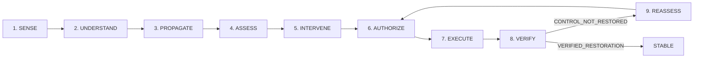
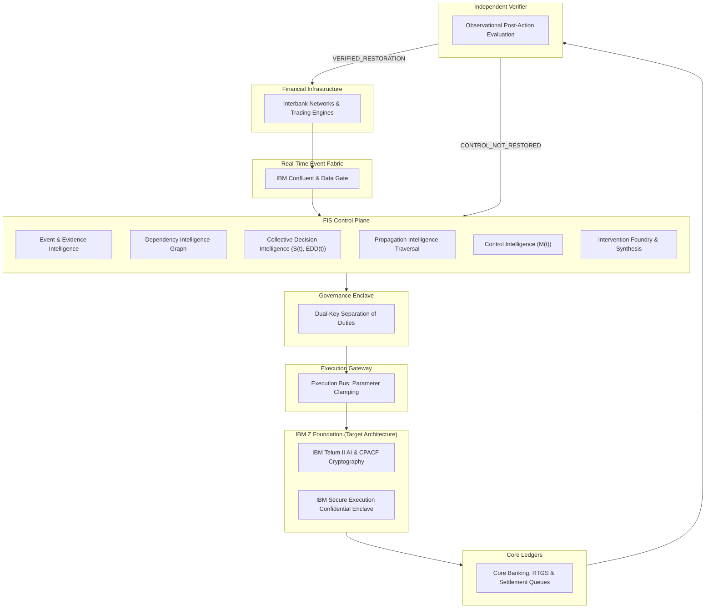

# Financial Immune System

### Systemic Financial Resilience & Control Intelligence

> An evidence-bound control intelligence layer for interconnected financial ecosystems that detects evolving threats, understands dependencies and propagation, assesses remaining control, governs intervention, and independently verifies whether control was actually restored.

[](https://github.com/inesh-2384/datathonproject/actions/workflows/ci.yml)
[](https://financial-immune-system-d9vz.onrender.com)
[-success.svg)](reports/gates/gate-3/gate_3_final_forensic_validation_report.md)
[](https://github.com/inesh-2384/datathonproject/releases/tag/v2.4.0-frozen)
[](docs/architecture/system-architecture.md)
[](LICENSE)

---

## 1. The 30-Second Idea

- **The Problem:** Financial ecosystems are tightly coupled via common models, shared data oracles, and concentrated clearing. During shocks, individually rational algorithms synchronize into collective herd runs, triggering cascade failure.
- **The FIS Response:** FIS maintains an authoritative systemic state binding evidence, dependencies, behavioral synchrony, and remaining intervention headroom.
- **The Core Differentiator:** FIS enforces that **Execution is an event; Recovery is a claim that requires evidence.** A gateway HTTP 200 does not establish recovery. Restoration is attested solely when an **Independent Enclave Verifier** observes stabilized post-action telemetry and seals a **Control Restoration Proof (CRP)**.
$$\text{RECOMMENDATION} \neq \text{AUTHORIZATION} \neq \text{EXECUTION} \neq \text{RECOVERY}$$

---

## 2. The Systemic Problem & Operational Boundaries

Traditional risk platforms operate on individual institutional perimeters, answering: *"What is my balance-sheet exposure?"* In modern financial networks, that question comes too late. Systemic collapse is driven by network structure and automated algorithmic synchronization.

```
Shared Data Oracles (DATA-X) ──► Correlated AI Models (VOL-ARB & MOM-MKT)
                                              │
                                              ▼
Liquidity Collapse (M(t) Falls) ◄── Algorithmic Herd Run (S(t) ↑, EDD(t) ↓)
```

### Operational Scope (What FIS Is NOT)
FIS is explicitly **not**:
- A fraud detector, cybersecurity firewall, or trading bot.
- A high-frequency trading (HFT) or portfolio optimization engine.
- A market prediction tool or generic banking dashboard.
- Disconnected, uncoupled machine learning models.

FIS operates **above** interconnected financial institutions as a systemic supervisory and control plane.
---

## 3. What FIS Does: The Six Intelligence Domains

1. **Event & Evidence Intelligence:** Ingests queues, obligations, and telemetry into an immutable evidence ledger.
2. **Dependency Intelligence:** Maps deep functional relationships, identifying shared cloud services, oracle feeds, and clearing chokepoints.
3. **Collective Decision Intelligence:** Detects algorithmic lockstep, measuring **Decision Synchrony $S(t)$** and **Effective Decision Diversity $EDD(t)$**.
4. **Propagation Intelligence:** Traces stress cascades across bilateral credit lines and behavioral contagion pathways.
5. **Control Intelligence:** Evaluates **Control Margin $M(t)$**, estimating remaining supervisor intervention capacity.
6. **Intervention & Verification Intelligence:** Synthesizes backstops, enforces dual-key human authorization, executes adjustments, and independently evaluates post-action telemetry.
---

## 4. The Canonical Control Loop

Unlike open-loop alerting platforms, FIS executes a governed closed-loop control lifecycle:



> [!IMPORTANT]
> **Human-in-the-Loop Governance:** AI discovers anomalies and proposes candidates, but **never** unilaterally authorizes critical interventions, closes incidents, or declares recovery. Humans authorize all critical state transitions via cryptographic dual-key signatures.
---

## 5. Why FIS Is Different: Operational Control Architecture

| Traditional Risk Systems | Financial Immune System (FIS) |
| :--- | :--- |
| Disconnected dashboards with fragmented metrics | **One Systemic State:** Unified state binding dependencies, models, and ledgers |
| Open-loop alerts (remediation untracked) | **Closed-Loop Lifecycle:** Every action tracked through execution to verified outcome |
| Assumes execution success implies resolution | **Execution $\neq$ Recovery:** Independent verification evaluates post-action telemetry |
| Perimeter-focused (isolated institutional risk) | **Collective Intelligence:** Detects inter-firm algorithmic coupling and synchrony |
| Unverifiable logs and post-hoc audits | **Evidence Lineage:** Tamper-evident, cryptographically bound Control Restoration Proofs |
---

## 6. Flagship Stress Environment: High-Speed Algorithmic Trading

Algorithmic trading is not the business domain of FIS; it serves as the **flagship high-speed stress environment** demonstrating systemic coupling.

When institutions deploy algorithmic models (`VOL-ARB-AI`, `MOM-MKT-AI`) sharing a common oracle (`DATA-X`), an upstream latency disturbance causes individual optimization routines to reach identical risk-off decisions. Individually rational micro-decisions trigger catastrophic macro-cascades. FIS detects this latent synchronization before liquidity collapses.
---

## 7. IBM Z / LinuxONE Target Architecture

Deploying FIS on **IBM Z and LinuxONE** provides a trusted enterprise foundation for mission-critical control intelligence.



### Architectural Mapping

| FIS Architectural Requirement | IBM Z / LinuxONE Capability | Operational Significance |
| :--- | :--- | :--- |
| Requirement | IBM Z / LinuxONE Capability | Target Operational Role |
| :--- | :--- | :--- |
| **Real-Time Ingestion** | **[IBM Confluent](https://www.ibm.com/products/event-automation) & [IBM Data Gate](https://www.ibm.com/products/data-gate)** | Ingests mission-critical transaction streams synchronized with core z/OS ledgers. |
| **In-Transaction AI** | **[IBM z17 / Telum II](https://newsroom.ibm.com/2024-08-26-IBM-Unveils-Telum-II-Processor-and-Spyre-Accelerator-at-Hot-Chips-2024)** | Low-latency AI inference close to mission-critical workloads alongside transaction execution. |
| **Confidential Computing** | **[IBM Secure Execution for Linux](https://www.ibm.com/docs/en/linux-on-systems?topic=security-secure-execution-linux)** | Hardware-isolated enclaves enabling multi-tenant risk evaluation without exposing trading positions. |
| **AI Governance** | **[IBM watsonx.governance](https://www.ibm.com/products/watsonx-governance)** | Model drift monitoring, guardrails, and auditability for automated backstop candidates. |
| **Operational Integration** | **[IBM Concert](https://www.ibm.com/products/concert)** | Contextualizes systemic risk telemetry within enterprise operations and playbooks. |
| **Hardware Cryptography** | **CPACF & [Crypto Express 8S](https://www.ibm.com/products/z16)** | Silicon-level hashing and digital signatures sealing Control Restoration Proofs. |

---

## 8. IBM Direction & Strategic Alignment

FIS aligns directly with IBM's enterprise roadmap:

- **AI Co-Located with Core Transactions:** Exporting telemetry to third-party clouds introduces latency and security exposure during crises. IBM Telum II enables AI inference co-located with core banking transactions.
- **Continuous Assurance over Periodic Audits:** Enterprise resilience demands moving beyond static post-mortems. Cryptographic proof generation and independent verification mirror watsonx.governance principles.
- **Sovereign Interbank Confidentiality:** Collaborative resilience requires hardware isolation. Secure Execution for Linux provides memory encryption allowing institutions to evaluate systemic risk without disclosing proprietary trading data.

> *IBM provides the trusted enterprise foundation; FIS provides the financial-domain systemic-control intelligence built on it.*

---

## 9. The Canonical Demonstration Scenario

The prototype demonstrates a complete, deterministic, reproducible stress scenario under PRNG **Seed `42091`**:

```
[T0] NOMINAL BASELINE (M(t) = 91%, S(t) = 0.12)
  │  Equilibrium across all 8 systemic hubs.
  ▼
[T1] UPSTREAM DEPENDENCY SHOCK
  │  Oracle feed DATA-X suffers a +52ms latency disturbance.
  ▼
[T2] COLLECTIVE DECISION COUPLING
  │  AI models synchronize into herd runs: Synchrony S(t) surges to 0.73, EDD collapses to 0.15.
  ▼
[T3] SYSTEMIC CASCADE & CONTROL COLLAPSE
  │  Contagion spreads across 8 institutions. Control Margin M(t) collapses to 34% (< 35% critical boundary).
  │  Active Incident declared: RN-2026-0041.
  ▼
[T4] INTERVENTION SYNTHESIS
  │  Foundry synthesizes Candidate INT-01: Targeted Dependency Isolation (DATA-X -> Tier-1 G-SIBs).
  ▼
[T5] DUAL-KEY GOVERNANCE AUTHORIZATION
  │  Incident Commander evaluates counterfactuals and authorizes action with digital signature seal.
  ▼
[T6] TECHNICAL EXECUTION (HTTP 200 OK)
  │  System Operator dispatches intervention via gateway (14ms execution latency).
  │  State transitions to EXECUTED_UNVERIFIED: Execution is an event; recovery is unproven.
  ▼
[T7] INDEPENDENT VERIFICATION: RECOVERY REJECTED
  │  Independent Enclave Verifier inspects real post-action telemetry.
  │  Latent drift in MODEL-C creates residual path PATH-MODEL-C. Observed M(t) = 42% (< 65% target).
  │  Verdict: CRP: CONTROL_NOT_RESTORED. Reassessment mandated.
  ▼
[T8] REASSESSMENT & SECONDARY BACKSTOP SYNTHESIS
  │  Reassessment cockpit produces Candidate INT-02: Enclave MODEL-C Quarantine & Parameter Clamp.
  │  Authorized by Incident Commander; dispatched by System Operator.
  ▼
[T9] INDEPENDENT VERIFICATION: VERIFIED RESTORATION
  │  Post-action telemetry stabilizes: Synchrony S(t) falls to 0.14, Diversity recovers to 0.85, M(t) reaches 84.2%.
  │  Verifier attests and cryptographically seals CRP: VERIFIED_RESTORATION. System returns to STABLE.
```

---

## 10. Governance & Evidence Semantics

FIS enforces formal semantic principles aligned with BCBS 239 and DORA Article 14:

### Semantic Distinctions
- $\text{RISK} \neq \text{CONFIDENCE}$: Low measured risk does not imply certainty; telemetric freshness must be factored.
- $\text{HAZARD} \neq \text{PRIORITY}$: Hazard severity does not determine response priority without evaluating control authority.
- $\text{RECOMMENDATION} \neq \text{AUTHORIZATION}$: Algorithmic models propose; only authorized human commanders sign.
- $\text{AUTHORIZATION} \neq \text{EXECUTION}$: Policy approval is separated from technical dispatch (Separation of Duties).
- $\text{EXECUTION} \neq \text{RECOVERY}$: Gateway dispatch receipt is an event; recovery requires empirical evidence.
- $\text{OBSERVATION} \neq \text{INTERPRETATION}$: Raw sensory data is distinct from model-derived risk interpretations.
- $\text{NON-EVENT} \neq \text{FALSE ALARM}$: An averted collapse is an intended non-event, not a false detection.
- $\text{NO OBSERVATION} \neq \text{NO EVENT}$: Sensor silence is classified as uncertainty, never safety.

### Outcome Vocabulary
- `EVENT_OBSERVED`: Empirical signal detected and verified.
- `NON_EVENT_OBSERVED`: Expected market reaction affirmatively did not occur.
- `INTERVENTION_CONDITIONED_NON_EVENT`: Catastrophic outcome prevented due to governed intervention.
- `OBSERVATION_GAP`: Telemetry missing or delayed; evidence classified as unverified.
- `RESIDUAL_HAZARD`: Primary threat neutralized, but secondary contagion vectors remain active.
- `CONFLICTED`: Contradictory telemetry received from redundant feeds; blocks recovery.
- `UNRESOLVED`: Evidence insufficient to prove causal stabilization.

### Dynamic Control Seal™
The **Dynamic Control Seal™** is a tamper-evident cryptographic provenance mechanism binding system state, incident context, human authorization signatures, execution receipts, and post-action verification proofs into an unbroken SHA-256 evidence chain across the crisis lifecycle.
---

## 11. Prototype Reality vs. Production Vision

To maintain complete intellectual honesty, FIS strictly distinguishes its software prototype from the target enterprise architecture:

| Dimension | Demonstration Prototype | Target Production Architecture |
| :--- | :--- | :--- |
| **Execution Environment** | Persistent Web Service on Render / Local Node.js v20 | IBM Z / LinuxONE s390x Mainframe Enterprise Rack |
| **Simulation Reality** | High-fidelity deterministic simulation (Seed `42091`, Mulberry32 PRNG) | Real-time production market infrastructure feeds |
| **Inference Substrate** | Local CPU execution in TypeScript (`controllabilityModel.ts`) | IBM Telum II on-chip integrated AI accelerator |
| **Event Fabric** | Server-Sent Events (SSE) stream (`/api/events/stream`) | IBM Confluent / Event Streams distributed Kafka fabric |
| **Data Integration** | In-memory authoritative state ledger with disk snapshots | IBM Data Gate synchronizing directly with Db2 for z/OS |
| **Cryptography** | Software cryptographic hashes (Node.js `crypto`) | Hardware CPACF & Crypto Express 8S HSM modules |
| **Enclave Isolation** | Process-level memory boundary | IBM Secure Execution for Linux hardware memory encryption |

> *FIS is demonstrated via a software simulation prototype. The target production architecture is engineered for IBM Z and LinuxONE, where real-time financial events, low-latency AI inference, confidential computing, and continuous assurance operate directly alongside mission-critical core financial ledgers.*
---

## 12. Verification & Engineering Maturity

The FIS codebase has completed three formal forensic validation gates:

- **Gate 1:** System Integrity & Evidence Closure — **PASS**
- **Gate 2:** Demonstration Excellence & Comprehension — **PASS (Score: 97.95 / 100, Grade A+)**
- **Gate 3:** Final Forensic Validation & Demonstration Freeze — **PASS (Score: 98.5 / 100)**

### Automated Validation Summary

| Test Category | Suite Path | Status | Verification Count |
| :--- | :--- | :---: | :---: |
| **Production Build** | `npm run build` (`tsc -b && vite build`) | **PASS** | 1632 modules transformed (0 errors) |
| **Control Restoration Proof (CRP)** | [`tests/test_crp_contract.cjs`](tests/test_crp_contract.cjs) | **PASS** | 43 / 43 contract assertions |
| **Phase 4 Closed-Loop Master** | [`tests/test_phase4_closed_loop_master.cjs`](tests/test_phase4_closed_loop_master.cjs) | **PASS** | 23 / 23 operational steps |
| **Phase 5 Master Assurance** | [`tests/run_all_phase5_tests.cjs`](tests/run_all_phase5_tests.cjs) | **PASS** | 16 / 16 test suites |
| **Living System Integration** | [`tests/integration/test_phase2_living_system.cjs`](tests/integration/test_phase2_living_system.cjs) | **PASS** | 45 / 45 criteria checks |
| **Persistent Cloud REST API** | [`scripts/validation/testCloudClosedLoopAPI.cjs`](scripts/validation/testCloudClosedLoopAPI.cjs) | **PASS** | 21 / 21 cloud API steps |
| **Headless Chrome Hero Replay** | [`scripts/validation/testCloudRenderHeroFlow.cjs`](scripts/validation/testCloudRenderHeroFlow.cjs) | **PASS** | 12 / 12 steps (0 browser errors) |
---

## 13. Live Demonstration

The frozen prototype is permanently cloud-hosted with zero local dependencies:

- **Public Demonstration URL:** [https://financial-immune-system-d9vz.onrender.com](https://financial-immune-system-d9vz.onrender.com)
- **Health Endpoint:** [`https://financial-immune-system-d9vz.onrender.com/health`](https://financial-immune-system-d9vz.onrender.com/health)

### Running the Live Hero Flow Demonstration
1. Open URL $\to$ click **ENTER CONTROL ENVIRONMENT** $\to$ **INITIALIZE ENCLAVE**. Header displays **EQUILIBRIUM: ALL CHANNELS NOMINAL** ($M(t) = 91\%$).
2. Click **Inject Shock** in header. Observe incident `RN-2026-0041` declared and $M(t)$ collapse to $34\%$ (< 35% critical boundary).
3. Navigate to **Control Foundry (08)**: Switch role to `INCIDENT_COMMANDER`, click **2. AUTHORIZE AS INCIDENT_COMMANDER**, toggle **Audit Latent Drift**, switch to `SYSTEM_OPERATOR`, and click **3. EXECUTE GOVERNED INTERVENTION**.
4. Navigate to **Independent Verification (10)**: Observe execution succeeded (HTTP 200 OK), but verifier declares **`CRP: CONTROL_NOT_RESTORED`** due to residual unquarantined contagion (`PATH-MODEL-C`, $M(t) = 42\%$).
5. Navigate to **Reassessment & 2nd Action (11)**: Under Action Authorization, authorize backstop `INT-02` as `INCIDENT_COMMANDER` and execute as `SYSTEM_OPERATOR`.
6. Return to **Independent Verification (10)**: Observe definitive recovery: **`CRP: VERIFIED_RESTORATION`**, Control Margin restored to **$84.2\%$**, Synchrony stabilized to **$0.14$**, and Diversity restored to **$0.85$**.
---

## 14. Local Development

### Prerequisites
- Node.js `20.18.0` or higher
- npm `10.0.0` or higher

```bash
# Clone and run
git clone https://github.com/inesh-2384/datathonproject.git
cd datathonproject
npm install
npm run dev # Starts server & client

# Automated verification
npm run build
node tests/test_crp_contract.cjs
node tests/test_phase4_closed_loop_master.cjs
node tests/run_all_phase5_tests.cjs
node scripts/validation/testCloudRenderHeroFlow.cjs
```
---

## 15. Repository Structure

```
financial-immune-system/
├── .github/workflows/ci.yml       # Production CI workflow
├── docs/                          # Architecture & governance specifications
├── reports/                       # 85 forensic validation reports (Gates 1–3, Phases 1–7)
├── scripts/                       # Cloud validation suites & replay runners
├── server/                        # Backend Control Enclave, PRNG simulation & REST/SSE API
├── shared/                        # Domain contracts, schemas & system constants
├── src/                           # Frontend React 18 cockpit (16 operational workspaces)
├── tests/                         # Master assurance suites (CRP contracts & closed-loop tests)
├── render.yaml                    # Persistent Render cloud deployment manifest
├── package.json                   # Manifest & dependencies
├── LICENSE                        # Apache 2.0 open-source license
└── README.md                      # Master enterprise overview
```
---

## 16. Contributors

- **Inesh N** — Systems Architect, Lead Developer & Financial Resilience Researcher ([GitHub](https://github.com/inesh-2384))

---

## 17. License & Acknowledgements

Licensed under the [Apache License, Version 2.0](LICENSE).

Built for the **IBM Z Datathon 2026**. Special recognition to the IBM Z, LinuxONE, and open-source communities advancing trusted, verified enterprise resilience.
