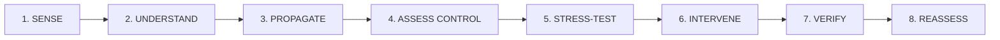

# FINANCIAL IMMUNE SYSTEM (FIS)
> **Subtitle:** Systemic Control Intelligence for AI-Enabled Financial Ecosystems  
> **Tagline:** *DON’T JUST PREDICT SYSTEMIC RISK. PRESERVE THE ABILITY TO CONTROL IT.*

---

## 0. MISSION & CORE PRINCIPLE

Financial Immune System is an enterprise systemic-control intelligence layer designed for interconnected banking networks, central counterparties (CCPs), and algorithmic trading infrastructure.

Its central operational question:
> **“How much control remains over an evolving systemic threat, what intervention capability is still available, and was control actually restored?”**

### The Core Architectural Axiom:
$$\text{THE UI IS A VISUAL PROJECTION OF REAL SYSTEM STATE.}$$

Decisions in Phase 1 establish:
- **Real state** with authoritative centralized domain schemas.
- **Real transitions** (Login $\to$ Role Selection $\to$ Context $\to$ Interventions $\to$ Reset).
- **Real relationships** (Cross-border clearing, bilateral credit lines, shared AI model dependencies).
- **Real event identity** (Monospace explicit IDs, e.g. `INST_NYC_01`, `INC-2026-0881`).
- **Real persistence** (Disk-backed authoritative state store).
- **Real-time updates** (Server-Sent Events `/api/events/stream` with heartbeats and latency tracking).
- **Realistic simulation** (Seedable Mulberry32 PRNG with reproducible baselines).
- **Deterministic replay** (Forensic microsecond timeline reproducibility).
- **Evidence lineage** (SHA-256 cryptographically sealed records for BCBS 239 & DORA Article 14).
- **Role-aware behavior** (4 functional operational roles with capability enforcement).
- **Future IBM Z/LinuxONE integration** (Confidential computing enclave specifications).

---

## 1. 8-STAGE SYSTEMIC CONTROL LIFECYCLE



---

## 2. FUNCTIONAL ROLE MATRIX

| Role | Title | Core Authority | Access Level |
|---|---|---|---|
| **SYSTEM_OPERATOR** | System Operator | Active systemic response & intervention dispatch | `FULL_CONTROL` |
| **RISK_ANALYST** | Risk Analyst | Cascade modeling, diversity assessment & counterfactuals | `ANALYTIC_INVESTIGATION` |
| **COMPLIANCE_OFFICER**| Compliance Officer | BCBS 239/DORA evidence packages, multi-sig governance | `GOVERNANCE_AUDIT` |
| **OBSERVER** | Observer | Read-only surveillance of global telemetry & stability | `READ_ONLY_OBSERVATION` |

---

## 3. APPLICATION ROUTING & MODULE BOUNDARIES

| Category | Route ID | Route Name | Phase Status |
|---|---|---|---|
| **OPERATIONAL** | `/control-center` | Control Center | `IMPLEMENTED` |
| **OPERATIONAL** | `/system-map` | System Map | `IMPLEMENTED` |
| **INTELLIGENCE** | `/collective-intelligence` | Collective Intelligence | `ARCHITECTED` (Phase 2) |
| **INTELLIGENCE** | `/propagation` | Propagation Dynamics | `ARCHITECTED` (Phase 2) |
| **INTELLIGENCE** | `/control-margin` | Control Margin | `ARCHITECTED` (Phase 2) |
| **CONTROL ACTIONS**| `/control-foundry` | Control Foundry | `ARCHITECTED` (Phase 3) |
| **CONTROL ACTIONS**| `/execution` | Execution Bus | `ARCHITECTED` (Phase 3) |
| **CONTROL ACTIONS**| `/verification` | Verification & Proof | `ARCHITECTED` (Phase 3) |
| **ASSURANCE** | `/replay` | Incident Forensics Replay | `ARCHITECTED` (Phase 2) |
| **ASSURANCE** | `/evidence` | Immutable Evidence Lineage | `IMPLEMENTED` |
| **ASSURANCE** | `/privacy` | Zero-Knowledge Enclaves | `ARCHITECTED` (Phase 3) |
| **ASSURANCE** | `/ibm-runtime` | IBM Z / LinuxONE Runtime | `ARCHITECTED` |
| **ASSURANCE** | `/benchmark` | Empirical Stress Benchmarks | `ARCHITECTED` (Phase 3) |

---

## 4. SIGNATURE GLOBAL FINANCIAL GLOBE

The signature 3D Financial Globe (WebGL Three.js) directly projects the **shared domain graph**:
$$\text{GLOBAL GLOBE} \equiv \text{SYSTEM MAP} \equiv \text{SHARED DOMAIN GRAPH}$$
- Real coordinates for 8 systemic hubs: New York, London, Frankfurt, Tokyo, Singapore, Zurich, Hong Kong, Sydney.
- Quadratic Bezier 3D arcs for bilateral credit lines and clearing chokepoints.
- Interactive raycasting: click any hub to open the Contextual Entity Inspector.

---

## 5. GETTING STARTED

```bash
# Install dependencies
npm install

# Start both backend server (port 3001) and frontend client (port 3000)
npm run dev

# Or run separately:
npm run server  # Express API + SSE Real-Time Stream + Deterministic Simulation Engine
npm run client  # Vite + React + Three.js UI
```
