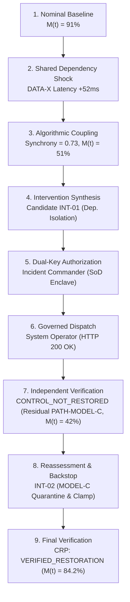

# Financial Immune System (FIS)
> **Systemic Financial Resilience & Control Intelligence**  
> *Target Architecture: IBM Z Telum II / LinuxONE Enclave | Qualification: Local Simulation*

[](https://github.com/inesh-2384/datathonproject/actions/workflows/ci.yml)
[](https://financial-immune-system-d9vz.onrender.com)
[](https://github.com/inesh-2384/datathonproject/releases/tag/v2.4.0-frozen)
[](LICENSE)

---

## 1. What FIS Is

The **Financial Immune System (FIS)** is a systemic control-intelligence layer designed for interconnected banking networks, financial market infrastructures (FMIs), central counterparties (CCPs), and algorithmic trading ecosystems. 

Rather than treating systemic risk purely as a forecasting or anomaly-detection problem, FIS models financial networks as dynamic, feedback-controlled topologies. It answers the fundamental supervisory questions:
- **How much control authority remains** over an evolving systemic contagion?
- **What governed intervention capacity** is currently available?
- **Did an executed intervention actually restore control**, or did it merely succeed technically at the gateway?

---

## 2. The Core Problem: Algorithmic Correlation & Latent Contagion

Modern systemic financial crises unfold at machine speed due to:
1. **Shared Foundation Models & Common Data Dependencies:** Financial institutions deploying correlated AI pricing models (e.g., oracle feed `DATA-X`) synchronize their trading behavior during unexpected shocks.
2. **Herd Convergence (Decision Synchrony):** Cross-sectional decision synchrony surges ($S(t) \to 1.0$), causing Effective Decision Diversity ($EDD(t)$) to collapse.
3. **Execution $\neq$ Recovery:** When authorities dispatch an emergency intervention (e.g. isolating a compromised data feed), the transaction may return `HTTP 200 OK`, yet latent secondary contagion paths (e.g., unquarantined model drift in `MODEL-C`) continue to destabilize the ecosystem.

---

## 3. The Core Closed Loop

FIS enforces an authoritative 8-stage operational closed loop:



---

## 4. System Architecture

The architecture consists of three decoupled layers:

1. **Frontend Cockpit (`src/`):** A high-density React 18 / Tailwind SPA providing 16 dedicated operational workspaces, real-time Server-Sent Events (SSE) telemetry, dynamic causal explanation panels, and an interactive 3D WebGL Financial Globe.
2. **Control Enclave Server (`server/`):** A deterministic TypeScript backend hosting the authoritative state ledger, Mulberry32 PRNG simulation engine (Seed `42091`), Control Margin engine, dual-key authorization bus, and Independent Verification Enclave.
3. **Shared Contracts (`shared/`):** Zero-dependency TypeScript schemas defining domain models, telemetric events, RBAC roles, and cryptographic proof structures.

---

## 5. Repository Structure

```
financial-immune-system/
├── .github/workflows/ci.yml       # GitHub Actions CI workflow
├── docs/                          # Architectural & governance documentation
│   ├── architecture/              # System & repository architecture
│   ├── governance/                # Separation of Duties & RBAC policies
│   ├── verification/              # Independent Verifier & CRP specification
│   ├── deployment/                # Production cloud deployment runbook
│   └── validation/                # Organization audit report
├── reports/                       # Complete forensic audit & evidence archive
│   ├── gates/                     # Gate 1, Gate 2, Gate 3 signed exit audits
│   ├── phases/                    # Phases 1 through 7 historical reports
│   └── deployment/                # Persistent cloud verification receipts
├── scripts/                       # Replay runners and verification tools
│   ├── validation/                # Cloud API suite & Headless Chrome hero flow
│   └── diagnostics/               # Workspace audit tools & screenshot utilities
├── server/src/                    # Backend Control Enclave & Simulation Engine
│   ├── assurance/                 # Evidence Engine, IBM Runtime, Privacy Boundary
│   ├── foundry/                   # Control Foundry, Execution Bus, Verifier
│   ├── intelligence/              # Control Margin, EDD, Propagation Dynamics
│   ├── routes/                    # REST API endpoints & SSE event stream
│   ├── simulation/                # Deterministic PRNG simulation (Seed 42091)
│   └── state/                     # Authoritative system state store
├── shared/                        # Zero-dependency contracts & types
│   ├── constants/                 # Route constants & status registries
│   └── types/                     # Domain, telemetry, role, and proof types
├── src/                           # Frontend React / Vite Cockpit Application
│   ├── components/                # UI widgets, shell layout, 3D financial globe
│   ├── services/                  # Real-time SSE streaming client
│   ├── store/                     # Zustand central client state
│   └── views/                     # 16 dedicated operational workspace views
├── tests/                         # Authoritative assurance test suites
│   ├── e2e/                       # Golden demo and end-to-end user journeys
│   ├── integration/               # Phase integration suites
│   ├── run_all_phase5_tests.cjs   # Phase 5 master orchestrator (16 suites)
│   ├── test_crp_contract.cjs      # CRP 12-item contract suite (43 assertions)
│   └── test_phase4_closed_loop_master.cjs # 23-step closed-loop master suite
├── Dockerfile                     # Container definition
├── render.yaml                    # Persistent Render cloud manifest
├── package.json                   # Project manifest & runtime dependencies
├── tsconfig.json                  # Strict TypeScript configuration
├── LICENSE                        # Apache 2.0 open-source license
└── README.md                      # Project documentation
```

---

## 6. Operational Workspaces

FIS organizes systemic surveillance into 16 dedicated operational views:

| Index | Workspace Name | Primary Focus |
|:---:|:---|:---|
| **01** | **Login & Enclave Gateway** | Sovereign authentication, role assumption, and hardware qualification |
| **02** | **Control Center** | Macro-prudential overview, global resilience score, active incidents |
| **03** | **Event Detection** | Real-time telemetric anomaly ingestion and threshold breach alerts |
| **04** | **System Map** | Topology network graph & 3D Financial Globe (bilateral credit channels) |
| **05** | **Collective Intelligence** | Cross-sectional Decision Synchrony $S(t)$ & Effective Decision Diversity $EDD(t)$ |
| **06** | **Propagation Dynamics** | Cascade pathways, multi-hop transmission, and contagion velocity |
| **07** | **Control Margin $M(t)$** | Formal systemic control headroom and driver decomposition |
| **08** | **Control Foundry** | Counterfactual evaluation and multi-objective candidate synthesis |
| **09** | **Governed Execution** | Dual-key authorization, digital signatures, and execution gateway |
| **10** | **Independent Verification**| Observational enclave attesting Control Restoration Proofs (CRP) |
| **11** | **Reassessment & Backstop**| Secondary backstop synthesis following unverified primary actions |
| **12** | **IBM Z Runtime** | Telum II on-chip AI accelerator telemetry & confidential computing status |
| **13** | **Incident Replay** | Bit-for-bit deterministic state replay across microsecond ticks |
| **14** | **Evidence & Lineage** | Immutable audit ledger (BCBS 239 / DORA Article 14 compliant) |
| **15** | **Privacy Boundary** | Zero-Knowledge proofs and anonymized cross-institution obligations |
| **16** | **Benchmark & Evaluation**| Stress-testing evaluation hierarchy against non-control baselines (B0–B5) |

---

## 7. Canonical Demonstration Replay

The frozen canonical scenario demonstrates why **Execution $\neq$ Recovery**:

1. **Equilibrium Baseline:** Seed `42091`, Control Margin $M(t) = 91\%$, Status `STABLE`.
2. **Oracle Degradation:** Inject `DATA-X` latency shock (+52ms).
3. **Collective Coupling:** Algorithmic pricing models synchronize ($S(t) = 0.73$, $EDD(t) = 0.15$), cascading across 8 Tier-1 institutions. Margin drops to $M(t) = 51\%$.
4. **Primary Intervention (INT-01):** Targeted Dependency Isolation authorized by `INCIDENT_COMMANDER` and executed by `SYSTEM_OPERATOR` (HTTP 200 OK).
5. **Independent Verification Failure:** Verifier evaluates real post-action telemetry; latent drift in `MODEL-C` causes verification failure (`CRP: CONTROL_NOT_RESTORED`, $M(t) = 42\%$).
6. **Reassessment & Secondary Backstop (INT-02):** Reassessment cockpit produces `CAND-RN-2026-0041-MODEL-QUARANTINE-BACKSTOP`. Authorized by `INCIDENT_COMMANDER`, executed by `SYSTEM_OPERATOR`.
7. **Verified Restoration:** Post-action telemetry evaluates clean. Verifier signs `CRP: VERIFIED_RESTORATION` ($M(t) = 84.2\%$, Synchrony $0.14$, Diversity $0.85$).

---

## 8. Local Development

### Prerequisites
- Node.js `20.18.0` or higher
- npm `10.0.0` or higher

### Installation & Launch
```bash
# Clone repository
git clone https://github.com/inesh-2384/datathonproject.git
cd datathonproject

# Install dependencies
npm install

# Start development environment (concurrent client + server)
npm run dev

# Or start services independently:
npm run server    # Backend Control Enclave on http://localhost:3001
npm run client    # Frontend Vite Dev Server on http://localhost:3000
```

---

## 9. Automated Testing & Verification

FIS maintains a comprehensive test suite executed in CI:

```bash
# 1. TypeScript & Production Build Compilation
npm run build

# 2. Control Restoration Proof (CRP) Contract Suite (43 tests)
node tests/test_crp_contract.cjs

# 3. Phase 4 Closed-Loop Master Operational Chain (23 steps)
node tests/test_phase4_closed_loop_master.cjs

# 4. Phase 5 Master Assurance Suite (16 suites, 100% pass)
node tests/run_all_phase5_tests.cjs

# 5. Persistent Cloud End-to-End Replay (Headless Chrome)
node scripts/validation/testCloudRenderHeroFlow.cjs

# 6. Persistent Cloud REST API Closed Loop Suite (21 steps)
node scripts/validation/testCloudClosedLoopAPI.cjs
```

---

## 10. Persistent Cloud Deployment

The frozen prototype is permanently hosted on Render with **zero local machine dependencies**:
- **Live URL:** [`https://financial-immune-system-d9vz.onrender.com`](https://financial-immune-system-d9vz.onrender.com)
- **Health Check:** `GET /health` returns enclave status and qualification metadata.

---

## 11. IBM Z / LinuxONE Target Architecture

FIS is architecturally designed for deployment on **IBM Z Telum II** and **LinuxONE** mainframes:
- **Telum II On-Chip AI Accelerator:** Sub-millisecond evaluation of cross-sectional model synchrony $S(t)$ and matrix controllability.
- **Secure Execution Enclaves (CPACF & Crypto Express 8S):** Hardware-isolated cryptographic signing of Control Restoration Proofs (CRP) and immutable evidence ledgers.
- **High-Throughput I/O:** Real-time processing of high-frequency clearing telemetry via z/OS and Linux on Z.

---

## 12. Scientific Truthfulness & Simulation Qualification

> [!NOTE]
> **SIMULATION QUALIFICATION NOTICE:**  
> The current runtime operates as a **high-fidelity local software simulation** reproducing the mathematical, algorithmic, and state-machine behavior of the target architecture. All PRNG streams are seeded (`Seed: 42091`) for bit-for-bit forensic determinism. Hardware-level IBM Z cryptographic acceleration is emulated via Node.js cryptographic primitives.

---

## 13. License

Copyright 2026 Financial Immune System (FIS) Contributors.  
Licensed under the [Apache License, Version 2.0](LICENSE).
