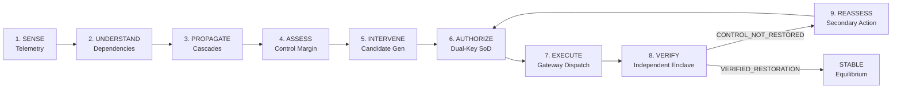
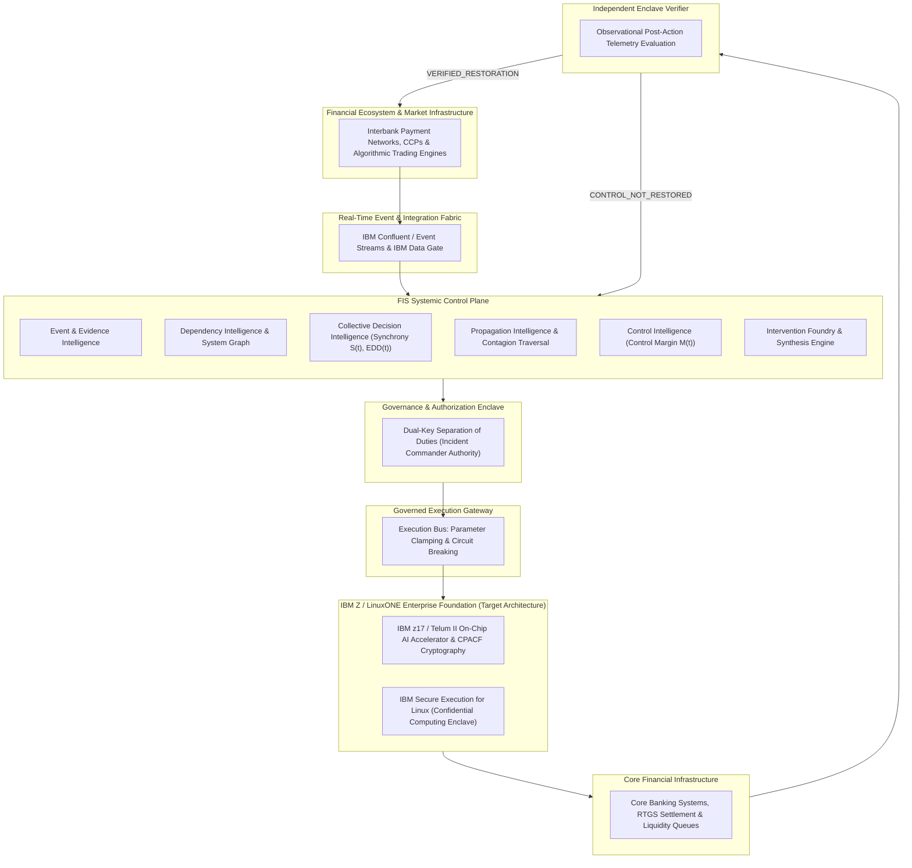

# Financial Immune System

### Systemic Financial Resilience & Control Intelligence

> An evidence-bound control intelligence layer for interconnected financial ecosystems that detects evolving threats, understands dependencies and propagation, assesses remaining control, governs intervention, and independently verifies whether control was actually restored.

[](https://github.com/inesh-2384/datathonproject/actions/workflows/ci.yml)
[](https://financial-immune-system-d9vz.onrender.com)
[-success.svg)](reports/gates/gate-3/gate_3_final_forensic_validation_report.md)
[](https://github.com/inesh-2384/datathonproject/releases/tag/v2.4.0-frozen)
[](docs/architecture/system-architecture.md)
[](LICENSE)

---

## 1. The 30-Second Idea

- **The Problem:** Modern financial systems are tightly coupled through shared data feeds, common models, and concentrated market infrastructure. When shocks hit, individually rational automated algorithms synchronize into collective herd runs, triggering systemic cascade failures.
- **The FIS Response:** Financial Immune System (FIS) maintains an evolving systemic state binding evidence, dependencies, behavioral correlation, and remaining intervention headroom.
- **The Core Differentiator:** FIS enforces that **Execution is an event; Recovery is a claim that requires evidence.** A successful HTTP 200 gateway receipt does not establish recovery. Systemic restoration is attested solely when an **Independent Enclave Verifier** observes stabilized post-action telemetry and issues a cryptographically bound **Control Restoration Proof (CRP)**.

$$\text{RECOMMENDATION} \neq \text{AUTHORIZATION} \neq \text{EXECUTION} \neq \text{RECOVERY}$$

---

## 2. The Systemic Problem & What FIS Is NOT

Traditional financial risk platforms operate on individual institutional perimeters, answering: *"What is my balance-sheet exposure?"* In modern financial networks, that question comes too late. Systemic collapse is driven by network structure and automated algorithmic synchronization.

```
Shared Data Oracles (DATA-X) ──► Correlated AI Models (VOL-ARB & MOM-MKT)
                                              │
                                              ▼
Liquidity Collapse (M(t) Falls) ◄── Algorithmic Herd Run (S(t) ↑, EDD(t) ↓)
```

### Explicit Operational Boundaries (What FIS Is NOT)
To avoid architectural misunderstanding, FIS is explicitly **not**:
- A fraud detector, cybersecurity firewall, or trading bot.
- A high-frequency trading (HFT) or portfolio optimization engine.
- A market prediction tool or generic banking dashboard.
- A collection of disconnected, uncoupled machine learning models.

FIS operates **above** interconnected financial decision environments as a systemic supervisory and control plane.

---

## 3. What FIS Does: The Six Intelligence Domains

1. **Event & Evidence Intelligence:** Ingests settlement queues, obligations, and sensor feeds into an immutable, time-ordered evidence ledger.
2. **Dependency Intelligence:** Maps deep functional relationships—identifying shared cloud services, oracle feeds, and clearing chokepoints.
3. **Collective Decision Intelligence:** Detects when independent algorithms act in lockstep, quantifying **Decision Synchrony $S(t)$** and **Effective Decision Diversity $EDD(t)$**.
4. **Propagation Intelligence:** Traces stress cascades across bilateral credit lines and behavioral contagion pathways before liquidity evaporates.
5. **Control Intelligence:** Formulates the **Control Margin $M(t)$**, an operational indicator estimating remaining supervisor intervention capacity.
6. **Intervention & Verification Intelligence:** Synthesizes multi-objective backstops, enforces dual-key human authorization, executes parameter adjustments, and independently evaluates post-action telemetry.

---

## 4. The Canonical Control Loop

Unlike open-loop observability platforms, FIS executes a governed, closed-loop lifecycle:



> [!IMPORTANT]
> **Human-in-the-Loop Governance:** AI assists in anomaly discovery and candidate synthesis, but **never** unilaterally authorizes critical interventions, closes incidents, or declares recovery. Humans authorize critical state transitions via cryptographic dual-key signatures.

---

## 5. Why FIS Is Different: Operational Control Architecture

| Traditional Financial Risk Systems | Financial Immune System (FIS) |
| :--- | :--- |
| Disconnected dashboards with fragmented, unsynchronized metrics | **One Systemic State:** Unified state vector binding dependencies, models, and ledgers |
| Open-loop alerting (alerts fire; remediation is untracked) | **Closed-Loop Lifecycle:** Every action is tracked through execution to verified outcome |
| Assumes execution success implies crisis resolution | **Execution $\neq$ Recovery:** Independent verification evaluates post-action telemetry |
| Perimeter-focused (evaluates single bank risk in isolation) | **Collective Intelligence:** Detects inter-firm model coupling and decision synchrony |
| Unverifiable log records and post-hoc incident reviews | **Evidence Lineage:** Tamper-evident, cryptographically bound Control Restoration Proofs |

---

## 6. Flagship Stress Environment: High-Speed Algorithmic Trading

Algorithmic and AI-driven trading is **not** the business domain of FIS; it serves as the **flagship high-speed stress environment** demonstrating systemic coupling.

When multiple Tier-1 institutions deploy distinct algorithmic pricing models (`VOL-ARB-AI`, `MOM-MKT-AI`) that depend on a common reference oracle (`DATA-X`), an upstream latency disturbance causes their individual optimization routines to arrive at identical risk-off decisions. Individually rational micro-decisions produce catastrophic macro-cascades. FIS detects this latent synchronization before liquidity collapses.

---

## 7. IBM Z / LinuxONE Target Architecture

Deploying FIS on **IBM Z and LinuxONE** provides a trusted enterprise foundation for mission-critical control intelligence.



### Architectural Mapping

| FIS Architectural Requirement | IBM Z / LinuxONE Capability | Operational Significance |
| :--- | :--- | :--- |
| **Real-Time Financial Ingestion** | **[IBM Confluent](https://www.ibm.com/products/event-automation) & [IBM Data Gate](https://www.ibm.com/products/data-gate)** | Ingests mission-critical transaction streams with sub-millisecond synchronization directly from core z/OS ledgers. |
| **In-Transaction AI Inference** | **[IBM z17 / Telum II](https://newsroom.ibm.com/2024-08-26-IBM-Unveils-Telum-II-Processor-and-Spyre-Accelerator-at-Hot-Chips-2024)** | Evaluates cross-sectional decision synchrony and graph propagation directly on-chip alongside transaction processing. |
| **Confidential Computing** | **[IBM Secure Execution for Linux](https://www.ibm.com/docs/en/linux-on-systems?topic=security-secure-execution-linux)** | Allows multi-tenant banks to compute collective systemic risk without exposing proprietary order books or positions. |
| **Continuous AI Governance** | **[IBM watsonx.governance](https://www.ibm.com/products/watsonx-governance)** | Enforces model drift monitoring, policy guardrails, and auditability surrounding automated recommendation candidates. |
| **Operational Integration** | **[IBM Concert](https://www.ibm.com/products/concert)** | Contextualizes systemic risk telemetry within broader enterprise operations and automated operational playbooks. |
| **Hardware Cryptography** | **CPACF & [Crypto Express 8S](https://www.ibm.com/products/z16)** | Silicon-level hashing and digital signatures seal Control Restoration Proofs without latency penalty. |

---

## 8. IBM Direction & Architectural Alignment

FIS was independently formulated around the core operational realities of systemic financial resilience. Its architecture aligns naturally with the technological direction IBM is advancing:

1. **AI Close to Core Transactions:** Exporting high-throughput financial data to third-party cloud environments introduces latency and security vulnerabilities during crises. The IBM Telum II processor enables AI inference co-located directly with core banking ledgers.
2. **From Periodic Governance to Continuous Assurance:** Enterprise resilience requires moving beyond static post-mortem audits. Continuous evidence collection, cryptographic proof generation, and independent verification reflect the governance paradigm championed by watsonx.governance.
3. **Data Sovereignty & Confidentiality:** Interbank collaboration requires strong cryptographic isolation. Secure Execution for Linux provides hardware-enforced memory encryption that enables joint resilience analysis without sharing raw commercial data.

> *IBM provides the trusted enterprise foundation; FIS provides the financial-domain systemic-control intelligence built on it.*

---

## 9. The Canonical Demonstration Scenario

The prototype demonstrates a complete, deterministic, reproducible stress scenario under PRNG **Seed `42091`**:

```
[T0] NOMINAL BASELINE (M(t) = 91%, S(t) = 0.12)
  │  Equilibrium across all 8 systemic hubs.
  ▼
[T1] UPSTREAM DEPENDENCY SHOCK
  │  Oracle feed DATA-X suffers a +52ms latency disturbance.
  ▼
[T2] COLLECTIVE DECISION COUPLING
  │  AI models synchronize into correlated herd runs: Synchrony S(t) surges to 0.73, EDD collapses to 0.15.
  ▼
[T3] SYSTEMIC CASCADE & CONTROL COLLAPSE
  │  Contagion spreads across 8 Tier-1 institutions. Control Margin M(t) collapses to 34% (< 35% critical threshold).
  │  Active Incident declared: RN-2026-0041.
  ▼
[T4] INTERVENTION SYNTHESIS
  │  Foundry generates Candidate INT-01: Targeted Dependency Isolation (DATA-X -> Tier-1 G-SIBs).
  ▼
[T5] DUAL-KEY GOVERNANCE AUTHORIZATION
  │  Incident Commander reviews counterfactuals and authorizes action with digital signature seal.
  ▼
[T6] TECHNICAL EXECUTION (HTTP 200 OK)
  │  System Operator dispatches intervention via gateway (14ms execution latency).
  │  State transitions to EXECUTED_UNVERIFIED: Execution is an event; recovery is unproven.
  ▼
[T7] INDEPENDENT VERIFICATION: RECOVERY REJECTED
  │  Independent Enclave Verifier inspects real post-action telemetry.
  │  Latent drift in MODEL-C creates residual critical path PATH-MODEL-C. Observed M(t) = 42% (< 65% target).
  │  Verdict: CRP: CONTROL_NOT_RESTORED. Reassessment mandated.
  ▼
[T8] REASSESSMENT & SECONDARY BACKSTOP SYNTHESIS
  │  Reassessment cockpit produces Candidate INT-02: Enclave MODEL-C Quarantine & Parameter Clamp.
  │  Authorized by Incident Commander; dispatched by System Operator.
  ▼
[T9] INDEPENDENT VERIFICATION: VERIFIED RESTORATION
  │  Post-action telemetry stabilizes: Synchrony S(t) falls to 0.14, Diversity recovers to 0.85, M(t) reaches 84.2%.
  │  Verifier attests and cryptographically seals CRP: VERIFIED_RESTORATION. System returns to STABLE.
```

---

## 10. Governance & Evidence Semantics

FIS is built upon formal semantic principles enforcing regulatory transparency (BCBS 239, DORA Article 14):

### Semantic Distinctions
- $\text{RISK} \neq \text{CONFIDENCE}$: Low measured risk does not imply high certainty; data freshness must be factored.
- $\text{HAZARD} \neq \text{PRIORITY}$: Hazard severity does not determine response priority without evaluating control authority.
- $\text{RECOMMENDATION} \neq \text{AUTHORIZATION}$: Algorithmic models propose; only authorized human commanders sign.
- $\text{AUTHORIZATION} \neq \text{EXECUTION}$: Policy approval is separated from technical dispatch (Separation of Duties).
- $\text{EXECUTION} \neq \text{RECOVERY}$: Gateway dispatch receipt is an event; systemic recovery requires empirical evidence.
- $\text{OBSERVATION} \neq \text{INTERPRETATION}$: Raw sensory data is distinct from model-derived risk interpretations.
- $\text{NON-EVENT} \neq \text{FALSE ALARM}$: An averted collapse is an intended non-event, not a false detection.
- $\text{NO OBSERVATION} \neq \text{NO EVENT}$: Sensor silence or observation gaps are classified as uncertainty, not safety.

### Outcome Vocabulary
- `EVENT_OBSERVED`: Empirical telemetric signal detected and verified.
- `NON_EVENT_OBSERVED`: Expected market reaction affirmatively did not occur.
- `INTERVENTION_CONDITIONED_NON_EVENT`: Catastrophic outcome prevented due to governed intervention.
- `OBSERVATION_GAP`: Telemetry missing or delayed; evidence classified as unverified.
- `RESIDUAL_HAZARD`: Primary threat neutralized, but secondary contagion vectors remain active.
- `CONFLICTED`: Contradictory telemetry received from redundant feeds; blocks recovery attestation.
- `UNRESOLVED`: Evidence insufficient to prove causal stabilization.

### Dynamic Control Seal™
The **Dynamic Control Seal™** is a tamper-evident cryptographic provenance mechanism. It binds the system state vector, active incident context, human authorization credentials, execution receipts, and post-action verification proofs into an unbroken SHA-256 evidence chain. It preserves what was known, decided, authorized, executed, and observed at each point in time.

---

## 11. Prototype Reality vs. Production Vision

To maintain complete intellectual honesty, FIS clearly separates its demonstration prototype from the target production architecture:

| Dimension | Current Demonstration Prototype | Target Production Architecture |
| :--- | :--- | :--- |
| **Execution Environment** | Persistent Web Service on Render Cloud / Local Node.js v20 | IBM Z / LinuxONE s390x Mainframe Rack |
| **Simulation Reality** | High-fidelity deterministic simulation (Seed `42091`, Mulberry32 PRNG) | Real-time production market infrastructure feeds |
| **Inference Substrate** | Local CPU execution in TypeScript (`controllabilityModel.ts`) | IBM Telum II on-chip integrated AI accelerator |
| **Event Fabric** | Server-Sent Events (SSE) stream (`/api/events/stream`) | IBM Confluent / Event Streams distributed Kafka fabric |
| **Data Integration** | In-memory authoritative state ledger with disk snapshots | IBM Data Gate synchronizing directly with Db2 for z/OS |
| **Cryptography** | Software-simulated cryptographic hashes (Node.js `crypto`) | Hardware-level CPACF & Crypto Express 8S HSM modules |
| **Enclave Isolation** | Process-level memory boundary | IBM Secure Execution for Linux hardware memory encryption |

> *Today, FIS is demonstrated through a deterministic prototype; the production architecture is designed around IBM Z/LinuxONE, where real-time financial events, low-latency AI inference, trusted execution and continuous assurance can operate close to mission-critical financial data.*

---

## 12. Verification & Engineering Maturity

The Financial Immune System codebase has passed rigorous forensic validation gates:

- **Gate 1:** System Integrity & Evidence Closure — **PASS**
- **Gate 2:** Demonstration Excellence & Judge Comprehension — **PASS (Score: 97.95 / 100, Grade A+)**
- **Gate 3:** Final Forensic Validation & Demonstration Freeze — **PASS (Score: 98.5 / 100)**

### Automated Validation Summary

| Test Category | Suite Path | Status | Verification Count |
| :--- | :--- | :---: | :---: |
| **Production Build** | `npm run build` (`tsc -b && vite build`) | **PASS** | 1632 modules transformed (0 errors) |
| **Control Restoration Proof (CRP)** | [`tests/test_crp_contract.cjs`](tests/test_crp_contract.cjs) | **PASS** | 43 / 43 contract assertions |
| **Phase 4 Closed-Loop Master** | [`tests/test_phase4_closed_loop_master.cjs`](tests/test_phase4_closed_loop_master.cjs) | **PASS** | 23 / 23 operational steps |
| **Phase 5 Master Assurance** | [`tests/run_all_phase5_tests.cjs`](tests/run_all_phase5_tests.cjs) | **PASS** | 16 / 16 test suites |
| **Living System Integration** | [`tests/integration/test_phase2_living_system.cjs`](tests/integration/test_phase2_living_system.cjs) | **PASS** | 45 / 45 criteria checks |
| **Persistent Cloud REST API** | [`scripts/validation/testCloudClosedLoopAPI.cjs`](scripts/validation/testCloudClosedLoopAPI.cjs) | **PASS** | 21 / 21 cloud API steps |
| **Headless Chrome Hero Replay** | [`scripts/validation/testCloudRenderHeroFlow.cjs`](scripts/validation/testCloudRenderHeroFlow.cjs) | **PASS** | 12 / 12 steps (0 browser errors) |

---

## 13. Live Demonstration

The frozen prototype is permanently accessible in the cloud with **zero local machine dependencies**:

- **Public Demonstration URL:** [https://financial-immune-system-d9vz.onrender.com](https://financial-immune-system-d9vz.onrender.com)
- **Health Verification:** [`https://financial-immune-system-d9vz.onrender.com/health`](https://financial-immune-system-d9vz.onrender.com/health)

### Running the Live Hero Flow Demonstration
1. Open the URL and click **ENTER CONTROL ENVIRONMENT** $\to$ **INITIALIZE ENCLAVE**.
2. Verify baseline stability: Header displays **EQUILIBRIUM: ALL CHANNELS NOMINAL** and $M(t) = 91\%$.
3. Click **Inject Shock** in the header. Observe incident `RN-2026-0041` declared and $M(t)$ collapse to $51\%$.
4. Navigate to **Control Foundry (08)** via sidebar: Switch role to `INCIDENT_COMMANDER`, click **2. AUTHORIZE AS INCIDENT_COMMANDER**, toggle **Audit Latent Drift**, switch to `SYSTEM_OPERATOR`, and click **3. EXECUTE GOVERNED INTERVENTION**.
5. Navigate to **Independent Verification (10)**: Observe that execution succeeded (HTTP 200 OK), but the verifier declares **`CRP: CONTROL_NOT_RESTORED`** due to residual unquarantined contagion (`PATH-MODEL-C`, $M(t) = 42\%$).
6. Navigate to **Reassessment & 2nd Action (11)**: Under Action Authorization, authorize backstop `INT-02` as `INCIDENT_COMMANDER` and execute as `SYSTEM_OPERATOR`.
7. Return to **Independent Verification (10)**: Observe definitive recovery: **`CRP: VERIFIED_RESTORATION`**, Control Margin restored to **$84.2\%$**, Synchrony stabilized to **$0.14$**, and Diversity restored to **$0.85$**.

---

## 14. Local Development

### Prerequisites
- Node.js `20.18.0` or higher
- npm `10.0.0` or higher

```bash
# Clone the repository
git clone https://github.com/inesh-2384/datathonproject.git
cd datathonproject

# Install dependencies
npm install

# Start development environment (concurrent backend server and Vite frontend)
npm run dev

# Or run services independently:
npm run server    # Backend Control Enclave on http://localhost:3001
npm run client    # Frontend Vite Dev Server on http://localhost:3000

# Execute automated test suites
npm run build                                      # Production build
node tests/test_crp_contract.cjs                   # CRP contracts
node tests/test_phase4_closed_loop_master.cjs      # Phase 4 closed loop
node tests/run_all_phase5_tests.cjs                # Phase 5 master suite
node scripts/validation/testCloudRenderHeroFlow.cjs # Headless Chrome replay
```

---

## 15. Repository Structure

```
financial-immune-system/
├── .github/workflows/ci.yml       # Production CI workflow
├── docs/                          # Architecture, governance & deployment documentation
│   ├── architecture/              # System & repository architecture specifications
│   ├── governance/                # Separation of Duties & RBAC enforcement policies
│   ├── verification/              # Independent Verifier & CRP specification
│   ├── deployment/                # Production Render cloud runbooks
│   └── validation/                # Repository organization audit report
├── reports/                       # Curated archive of 85 historical forensic reports
│   ├── gates/                     # Gate 1, Gate 2, Gate 3 signed exit audits
│   ├── phases/                    # Phases 1 through 7 evidence dossiers
│   └── deployment/                # Persistent cloud verification receipts
├── scripts/                       # Operational, validation & diagnostic tools
│   ├── validation/                # Replay runners, cloud API suites, SSE validators
│   └── diagnostics/               # Workspace auditor & screenshot utilities
├── server/src/                    # Backend Control Enclave & Simulation Engine
│   ├── assurance/                 # Evidence Engine, IBM Runtime, Privacy Boundary
│   ├── foundry/                   # Control Foundry, Execution Bus, Verifier
│   ├── intelligence/              # Control Margin, EDD, Propagation Dynamics
│   ├── routes/                    # REST API endpoints & SSE event stream
│   ├── simulation/                # Deterministic PRNG simulation (Seed 42091)
│   └── state/                     # Authoritative system state store
├── shared/                        # Zero-dependency contracts & types
│   ├── constants/                 # Route constants & status registries
│   └── types/                     # Domain, telemetry, role, and proof types
├── src/                           # Frontend React / Vite Cockpit Application
│   ├── components/                # UI widgets, shell layout, 3D financial globe
│   ├── services/                  # Real-time SSE streaming client
│   ├── store/                     # Zustand central client state
│   └── views/                     # 16 dedicated operational workspace views
├── tests/                         # Authoritative assurance test suites
│   ├── e2e/                       # Golden demo and end-to-end user journeys
│   ├── integration/               # Phase integration suites (Phases 1–5)
│   ├── run_all_phase5_tests.cjs   # Phase 5 master orchestrator (16 suites)
│   ├── test_crp_contract.cjs      # CRP 12-item contract suite (43 assertions)
│   └── test_phase4_closed_loop_master.cjs # 23-step closed-loop master suite
├── Dockerfile                     # Container definition
├── render.yaml                    # Persistent Render cloud manifest
├── package.json                   # Project manifest & runtime dependencies
├── tsconfig.json                  # Strict TypeScript configuration
├── LICENSE                        # Apache 2.0 open-source license
└── README.md                      # Master enterprise overview
```

---

## 16. Contributors

- **Inesh N** — Systems Architect, Lead Developer & Financial Resilience Researcher ([GitHub](https://github.com/inesh-2384))

---

## 17. License & Acknowledgements

This project is licensed under the [Apache License, Version 2.0](LICENSE).

Developed for the **IBM Z Datathon 2026**. Special recognition to the IBM Z, LinuxONE, and open-source financial resilience research communities advancing trusted, sovereign, and verified enterprise computing.
