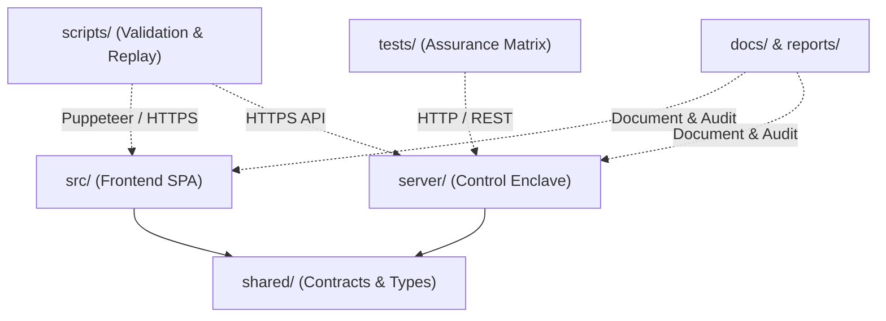

# Repository Architecture & Codebase Organization
## Financial Immune System (FIS) — Systemic Control Intelligence

This document outlines the architectural boundaries, directory structure, dependency relationships, and forensic organization of the Financial Immune System (FIS) repository.

---

## 1. Repository Purpose

The Financial Immune System (FIS) is a systemic control-intelligence layer for interconnected financial ecosystems. It continuously monitors shared dependencies, quantifies systemic control capacity through the **Control Margin $M(t)$**, governs automated and human intervention, and independently verifies whether systemic stability was genuinely restored.

This repository contains:
1. **Frontend Single Page Application (SPA):** High-density, real-time control cockpit built with React, Vite, and Tailwind CSS.
2. **Backend Control Enclave Server:** Deterministic Node.js/TypeScript simulation and control server with persistent state machine, real-time SSE event bus, and REST API.
3. **Shared Contracts & Models:** Cryptographically typed domain interfaces, telemetric schemas, role permissions, and system constants.
4. **Comprehensive Assurance & Test Matrix:** 80+ automated test suites covering unit, contract, integration, red-team, regression, and browser hero flows.
5. **Audited Evidence & Reports Archive:** Complete historical record of Gate 1, Gate 2, Gate 3, and Phases 1–7 forensic audits.

---

## 2. Target Directory Hierarchy

```
financial-immune-system/
├── .github/                        # Continuous Integration & Automation
│   └── workflows/ci.yml            # Production verification workflow
├── docs/                           # Technical Specifications & Documentation
│   ├── architecture/               # System & repository architecture
│   ├── governance/                 # Separation of Duties & RBAC policies
│   ├── verification/               # Independent Verifier & CRP specification
│   ├── deployment/                 # Cloud deployment runbooks
│   └── validation/                 # Forensic validation reports
├── reports/                        # Historical Gate & Phase Evidence Archive
│   ├── gates/                      # Gate 1, Gate 2, and Gate 3 exit audits
│   │   ├── gate-1/
│   │   ├── gate-2/
│   │   └── gate-3/
│   ├── phases/                     # Forensic reports for Phases 1 through 7
│   │   ├── phase-1/
│   │   ├── phase-2/
│   │   ├── phase-3/
│   │   ├── phase-3_1/
│   │   ├── phase-4/
│   │   ├── phase-5/
│   │   └── phase-7/
│   └── deployment/                 # Cloud deployment verification receipts
├── scripts/                        # Operational, Validation & Diagnostic Tools
│   ├── validation/                 # Headless Chrome replays, API test runners
│   └── diagnostics/                # Workspace auditors, screenshot utilities
├── server/                         # Backend Control Enclave & Simulation Engine
│   └── src/
│       ├── assurance/              # Evidence Engine, IBM Runtime, Privacy Boundary
│       ├── foundry/                # Control Foundry, Candidate Generator, Verifier
│       ├── intelligence/           # Control Margin, EDD, Propagation, Ablation
│       ├── routes/                 # Express REST endpoints & SSE streaming
│       ├── simulation/             # PRNG (Seed 42091), Baseline, Operations
│       ├── state/                  # In-memory authoritative system state
│       └── index.ts                # Server entrypoint (Port 3001)
├── shared/                         # Zero-Dependency Shared Contracts
│   ├── constants/                  # Navigation routes, status codes
│   └── types/                      # Domain, telemetry, RBAC, events schemas
├── src/                            # Frontend Cockpit Application
│   ├── components/                 # Shell, UI widgets, dashboards, globe
│   ├── services/                   # Real-time SSE streaming client
│   ├── store/                      # Zustand authoritative client store
│   ├── views/                      # 16 dedicated operational workspace views
│   ├── App.tsx                     # Shell application container
│   ├── main.tsx                    # Client entrypoint
│   └── index.css                   # Tailwind styling
├── tests/                          # Automated Assurance Test Suites
│   ├── e2e/                        # End-to-end golden path and journey tests
│   ├── integration/                # Cross-subsystem integration suites
│   ├── run_all_phase5_tests.cjs    # Master Phase 5 test orchestrator
│   ├── test_crp_contract.cjs       # Control Restoration Proof contract suite
│   ├── test_phase4_closed_loop_master.cjs # 23-step closed-loop master suite
│   └── ...                         # Dedicated phase suites
├── Dockerfile                      # Container build definition
├── render.yaml                     # Render persistent cloud deployment manifest
├── package.json                    # Dependencies and runtime scripts
├── tsconfig.json                   # Strict TypeScript compiler configuration
├── vite.config.ts                  # Vite bundler and path alias configuration
├── LICENSE                         # Apache 2.0 open-source license
└── README.md                       # Master enterprise overview
```

---

## 3. Boundary Definitions & Ownership

### 3.1 Frontend (`src/`)
- **Technology:** React 18, Vite 6, Tailwind CSS, Lucide icons, Three.js (globe).
- **Responsibility:** Visual presentation of systemic risk, human-in-the-loop governance interactions, live telemetry visualization, and deep workspace drill-downs.
- **State Coupling:** Binds unidirectionally to `useSystemStore` (Zustand), hydrated via real-time Server-Sent Events (`/api/stream`) and REST action dispatch.
- **Path Alias:** `@/*` resolves to `./src/*`.

### 3.2 Backend (`server/`)
- **Technology:** Node.js 20, TypeScript, Express, `tsx`.
- **Responsibility:** Authoritative state ledger, deterministic simulation engine (PRNG Seed 42091), Collective Decision Intelligence computation, Control Margin formulation, dual-key authorization enforcement, governed execution gateway, and Independent Verification enclave.
- **Purity Principle:** The simulation and verifier are decoupled; the verifier never mutates RBAC, topology, or candidate state.

### 3.3 Shared (`shared/`)
- **Technology:** Pure TypeScript interfaces and runtime constants.
- **Responsibility:** Common contract between frontend and backend. Contains no runtime side-effects or external dependencies.
- **Path Alias:** `@shared/*` resolves to `./shared/*`.

### 3.4 Tests (`tests/`)
- **Responsibility:** Authoritative regression prevention. Contains the 12-item CRP contract matrix, the 23-step Phase 4 operational chain, the 16-suite Phase 5 master audit, and end-to-end integration suites.
- **CI Guarantee:** Executes in GitHub Actions (`.github/workflows/ci.yml`) on every push to `main` and `master`.

### 3.5 Scripts (`scripts/`)
- **Responsibility:** Automated verification tools, headless Chrome browser hero-flow replays, persistent cloud health checks, and workspace inspection tools.

### 3.6 Reports & Documentation (`reports/`, `docs/`)
- **Responsibility:** Permanent forensic evidence repository and technical specifications. Maintains complete accountability for every claim, audit, and design decision made during the IBM Z Datathon 2026.

---

## 4. Dependency Direction



All source code dependencies point strictly inwards toward `shared/`. There are zero circular dependencies between `server/` and `src/`.
