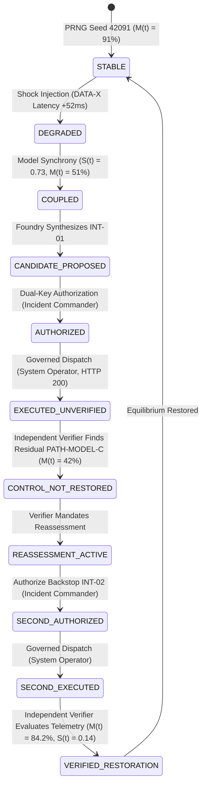

# System Architecture & Control Intelligence
## Financial Immune System (FIS)

### Executive Overview
The Financial Immune System (FIS) introduces a control-theoretic layer for interconnected financial markets. Rather than merely forecasting price fluctuations or triggering reactive alerts, FIS models financial networks as dynamic, feedback-controlled topologies subject to systemic degradation, latent algorithmic correlation, and cascading contagion.

---

## 1. Core Mathematical Foundations

### 1.1 Control Margin $M(t)$
The primary metric quantifying the remaining systemic control authority of financial authorities is the Control Margin $M(t) \in [0\%, 100\%]$:

$$M(t) = \text{clamp}\left(100 \times \left( w_c \cdot C(t) + w_d \cdot D(t) - w_u \cdot U(t) - w_p \cdot P(t) \right), 0, 100\right)$$

Where:
- $C(t)$: Raw Controllability factor derived from reachable state space and available liquid backstops.
- $D(t)$: Effective Decision Diversity ($EDD(t)$) measuring heterogeneity across automated pricing and trading algorithms.
- $U(t)$: Evidence Uncertainty discounting unverified or stale telemetric signals.
- $P(t)$: Propagation Velocity representing the rate of distress transmission across interbank obligations.

### 1.2 Decision Synchrony & Effective Decision Diversity
When algorithmic participants utilize common data feeds or shared foundation models, their risk appraisals collapse into correlated herd runs:

$$S(t) = \frac{1}{\binom{N}{2}} \sum_{i < j} \text{corr}(a_i(t), a_j(t))$$

$$EDD(t) = 1 - S(t)^\gamma$$

Where $S(t) \in [0, 1]$ is the cross-sectional decision synchrony and $EDD(t)$ measures functional decision diversity.

---

## 2. The Canonical Closed Loop

### Invariant: Execution $\neq$ Recovery
Technical dispatch success (HTTP 200 OK from the gateway) represents merely an execution event. Systemic recovery is attested exclusively by the **Independent Enclave Verifier**, which cryptographically signs a **Control Restoration Proof (CRP)** only after observing stabilized post-action telemetry.
