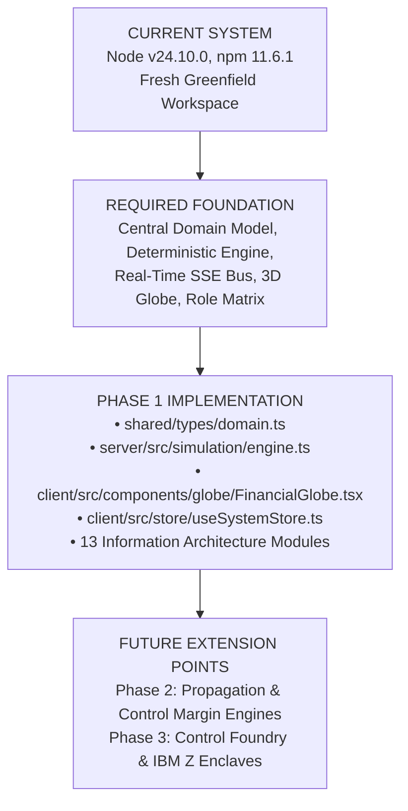
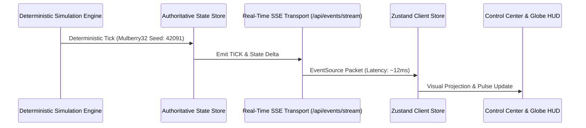

# FINANCIAL IMMUNE SYSTEM (FIS)
## Phase 1 Architectural Foundation Dossier

> **Subtitle:** Systemic Control Intelligence for AI-Enabled Financial Ecosystems  
> **Tagline:** *DON’T JUST PREDICT SYSTEMIC RISK. PRESERVE THE ABILITY TO CONTROL IT.*

---

## 1. REPOSITORY & ENVIRONMENT AUDIT



### Audit Findings:
1. **Runtime:** Node.js v24.10.0, npm 11.6.1, TypeScript 5.7.3, Python 3.13.0 on Windows.
2. **Architecture:** Decoupled full-stack architecture with an Express-based authoritative systemic state engine and real-time SSE stream (`server/`), paired with a hardware-accelerated React 18 + Vite + Three.js + Tailwind client (`src/`).
3. **Data Truth Principle:** No mockup metrics, no fake benchmarks, and no fake IBM integration. All capabilities labeled (`IMPLEMENTED`, `SIMULATED`, `ARCHITECTED`, `IBM_INTEGRATED`, `FUTURE`).

---

## 2. CORE DOMAIN MODEL (`shared/types/domain.ts`)

Every domain entity maintains a stable explicit identifier, semantic status, and immutable relationship typing:

- `Institution`: Explicit identifier (`institution_id`, e.g. `INST_NYC_01`), regulatory tier (`G_SIB`, `D_SIB`, `TIER_1_CLEARING`), WGS-84 geographic coordinates, capital adequacy ratio (CAR), liquidity coverage ratio (LCR), systemic footprint score, active AI models, and connected dependencies.
- `Asset`: Asset class (`SOVEREIGN_DEBT`, `REPO_COLLATERAL`), liquidity depth score, systemic exposure index, and primary holder institutions.
- `Dependency`: Type (`LIQUIDITY_CREDIT_LINE`, `CLEARING_SETTLEMENT`, `SHARED_AI_ALGORITHM`, `DATA_FEED`), exposure weight, telemetry latency, and chokepoint flag.
- `AIModel`: Model ID, vendor, decision domain (`LIQUIDITY_OPTIMIZATION`, `RISK_SCORING`), herd correlation risk (0.0–1.0), and effective diversity score.
- `DataProvider`: Real-time market data oracles, latency envelopes, and drift anomaly flags.
- `InfrastructureNode`: RTGS rails (`Fedwire`, `TARGET2`, `CLS Bank`), throughput capacity, and current load.
- `Incident`: Incident ID (`INC-2026-0881`), root cause vector, affected nodes, and containment margin.
- `SystemControlState`: Control margin percentage (78.4%), intervention window minutes (42m), active threat count, and system stability index (0.88).
- `Intervention`, `Authorization`, `Execution`, `Verification`: Real-time lifecycle state transitions.
- `EvidenceRecord`: SHA-256 cryptographic hash, enclave seal flag, event chain, and regulatory compliance tag (`BCBS_239`, `DORA_ARTICLE_14`, `SEC_RULE_15C3`).

---

## 3. REAL-TIME TRANSPORT & SIMULATION ENGINE



- **Deterministic PRNG:** Seedable 32-bit Mulberry32 generator ensures identical state transitions, event sequences, and control margin curves across test runs.
- **Transport:** Server-Sent Events (`/api/events/stream`) with heartbeat monitoring, latency tracking (12ms), and auto-reconnect backoff (`CONNECTED`, `RECONNECTING`, `DEGRADED`, `OFFLINE`).
- **Disk Persistence:** Authoritative state snapshots persisted to `.fis_state_snapshot.json`.

---

## 4. SIGNATURE GLOBAL FINANCIAL GLOBE

The 3D Financial Globe (WebGL Three.js) fulfills the core architectural contract:
$$\text{GLOBAL GLOBE} \equiv \text{SYSTEM MAP} \equiv \text{SHARED DOMAIN GRAPH}$$

1. **Topological Projection:** Maps 8 global financial hubs (New York, London, Frankfurt, Tokyo, Singapore, Zurich, Hong Kong, Sydney) using accurate spherical trigonometry:
   $$x = -R \sin(\phi) \cos(\theta), \quad y = R \cos(\phi), \quad z = R \sin(\phi) \sin(\theta)$$
2. **Dependency Arcs:** 3D Quadratic Bezier curves connecting bilateral clearing and credit channels with status color-coding (`STABLE`: emerald, `DEGRADING`: amber, `CRITICAL`: red).
3. **Interactive Raycasting:** Click any financial node to open the contextual `EntityInspector` slide-over drawer.

---

## 5. FUNCTIONAL ROLE MATRIX

1. **System Operator:** Proposes, authorizes, and dispatches systemic interventions; controls scenario simulation.
2. **Risk Analyst:** Investigates multi-hop cascades, monitors model diversity, and explores counterfactual intervention windows.
3. **Compliance Officer:** Audits cryptographically sealed evidence packages (`BCBS 239`, `DORA`), dual-key consensus, and enclave proofs.
4. **Observer:** Read-only surveillance of global stability indices and top-level telemetry.

---

## 6. COMPLETE USER JOURNEY VERIFICATION

```text
[STEP 1] Health Endpoint: ONLINE (Port 3001)
[STEP 2] Initial Authoritative State: 8 Institutions, 8 Dependencies, Control Margin: 78.4%
[STEP 3] Authenticate: SYSTEM_OPERATOR session token issued
[STEP 4] Entity Context: INST_NYC_01 inspected (CAR 14.2%, LCR 128.5%, 2 AI Models)
[STEP 5] Intervention Proposal: INJECT_TARGETED_LIQUIDITY registered
[STEP 6] Intervention Execution: Status EXECUTED, Control Margin restored to 93.4%
[STEP 7] Cryptographic Evidence: SHA-256 digest sealed into audit log
[STEP 8] Simulation Reset: Seed 42091 restored baseline to exact 78.4% margin
```
