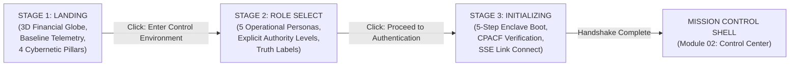

# FINANCIAL IMMUNE SYSTEM (FIS)
# PHASE 1 — EXPERIENCE ARCHITECTURE SPECIFICATION
## Enterprise Mission Control Interaction, Visual Hierarchy & Shell Ergonomics

**Product:** Financial Immune System (FIS)  
**Category:** Systemic Control Intelligence  
**Standard:** TradeSentinel Interaction Benchmark • IBM Z Datathon 2026  
**Artifact ID:** `FIS-EXP-ARCH-2026-1011`  

---

## 1. Experience Architecture Principles

The user experience architecture of the Financial Immune System is engineered around four inviolable principles:

1. **Not a Website, but a Command Environment:**  
   The platform is built as an operational console for high-stakes systemic crisis containment. It eliminates casual marketing patterns, long scroll pages, decorative animations, and disjointed tabs.
2. **One State, Multi-Lens Projection:**  
   Every screen presents a specialized analytical lens over the same authoritative state:
   - *Control Center:* Decision Surface & System Overview
   - *System Map / Globe:* Spatial & Dependency Topology
   - *Collective AI:* Latent Correlation & Algorithmic Herding
   - *Propagation:* Contagion Velocity & Transmission Rails
   - *Control Foundry:* Counterfactual Synthesis & Action Options
   - *Evidence / Replay:* Cryptographic Proof & Temporal Audit
3. **Action-Driven Feedback (The TradeSentinel Contract):**  
   Every user action produces an observable, causal state transition:
   $$\text{INPUT} \rightarrow \text{PROCESSING} \rightarrow \text{STATE CHANGE} \rightarrow \text{SYSTEM RESPONSE} \rightarrow \text{PERSISTENCE} \rightarrow \text{CROSS-SCREEN REFLECTION} \rightarrow \text{NEXT ACTION}$$
4. **Zero Ambiguity Operational Guidance:**  
   The operator is never stranded without knowing what has occurred or where to proceed. The persistent **Operational Context Bar** indicates active incident severity, remaining intervention time, and the next recommended action.

---

## 2. The 3-Stage Dedicated Entry Experience



### Stage 1: The Financial Ecosystem Before You Enter It
- **Visual Anchor:** An interactive WebGL 3D Financial Globe displaying 20 G-SIBs interconnected by glowing bilateral credit arcs.
- **Baseline Posture:** Informs the evaluator of nominal equilibrium ($M(t) = 91\%$, 0 active incidents, 102 dependencies).
- **Core Actions:** `ENTER CONTROL ENVIRONMENT`, `DEMONSTRATION MODE`, and `VIEW SYSTEM ARCHITECTURE` (opens 4-plane architectural modal).

### Stage 2: Operational Persona Selection
- **Role Gating:** Evaluators choose between 5 distinct roles: `SYSTEM_OPERATOR`, `RISK_ANALYST`, `INCIDENT_COMMANDER`, `COMPLIANCE_OFFICER`, and `OBSERVER`.
- **Authority Checklist:** Each role card explicitly details permissions (propose, authorize, execute, unmasked data).

### Stage 3: Enclave Initialization Handshake
- **Terminal Emulator:** Visually executes the 5-step cryptographic boot sequence:
  1. CPACF SHA-256 instruction set acceleration verified.
  2. Baseline topology graph loaded (20 nodes, 102 rails, Seed 42091).
  3. Server-Sent Events (SSE) telemetry pipeline connected.
  4. Role-governed session token minted (`enc_tok_...`).
  5. Systemic control equilibrium confirmed at $M(t) = 91\%$.

---

## 3. Mission-Control Shell Ergonomics

```
+----------------------------------------------------------------------------------------------------+
|  [FIS] FINANCIAL IMMUNE SYSTEM   | M(t): 91% STABLE | Tick #0 | Scenario Dropdown | Role: OPERATOR |
+----------------------------------------------------------------------------------------------------+
|  [!] ACTIVE INCIDENT BANNER  |  STEPPER: 03 -> 04 -> 05 -> 06 -> 08 -> 09 -> 10  | [NEXT ACTION ->] |
+-----------+------------------------------------------------------------------------+---------------+
| SIDEBAR   | MAIN OPERATIONAL WORKSPACE (Dedicated View)                            | CONTEXT DRAWER|
|           |                                                                        | (Entity       |
| 01 Portal | (e.g. Module 02: Control Center Decision Surface)                      |  Inspector)   |
| 02 CC     |                                                                        |               |
| 03 Sense  | - Row 1: State Dossier | Control Margin Gauge | Assurance Posture      | BANK-A        |
| 04 Map    | - Row 2: Event Stream | Mini Topology | Collective AI Preview          | Liquidity     |
| 05 AI     | - Row 3: Propagation Cascade | Waterfall Breakdown | MEI Foundry Box   | Risk Exposure |
| 06 Prop   | - Row 4: Guided Operator Cybernetic Stepper & Jump Shortcuts           | Active Events |
| 07 Margin |                                                                        |               |
| ...       |                                                                        |               |
+-----------+------------------------------------------------------------------------+---------------+
|  FOOTER: SSE Connected | Latency 12ms | CPACF SHA-256 Active | Substrate: LinuxONE (ARCHITECTED)   |
+----------------------------------------------------------------------------------------------------+
```

### Key Structural Principles:
- **No Monolithic Vertical Scroll:** The main workspace is viewport-optimized (`h-screen overflow-hidden`). Information is divided cleanly across dedicated views, tabs, and sliding inspectors.
- **Persistent Left Sidebar:** Grouped by cybernetic phases (Sense, Model, Intervene, Assure) with active route indicator and collapsed icon mode.
- **Operational Context Bar:** Sits directly below the global header, physically tethering the operator to the active incident lifecycle.
- **Contextual Entity Inspector:** Universal slide-over drawer triggered by clicking any bank, rail, oracle, or model across the Globe, System Map, or Event Log.

---

## 4. Semantic Design System Tokens

### 4.1 Color Architecture
- **Base Surfaces:**
  - `Canvas Dark:` `#050811` (Obsidian deepest black)
  - `Panel Surface:` `#080e1a` (Midnight navy with 80% opacity)
  - `Card Elevation:` `#0a1322` with border `#16233b`
- **Primary Brand / Command Accent:**
  - `Cobalt Blue:` `#2563eb` / `#3b82f6` (IBM-inspired enterprise blue)
  - `Cyan Accent:` `#06b6d4` / `#22d3ee` (Telemetry and graph indicators)
- **Semantic State Palette:**
  - `CONTROL_STABLE / RESTORED:` Emerald Glow (`#10b981`)
  - `DEGRADING / AT_RISK:` Amber Gold (`#f59e0b`)
  - `CRITICAL / ATTACK:` Crimson Rose (`#ef4444`)
  - `COLLAPSING:` Deep Maroon (`#991b1b`)
  - `UNVERIFIED / ANOMALY:` Electric Purple (`#a855f7`)

### 4.2 Typography Hierarchy
- **Primary Interface Font:** `Inter` (Sans-serif) for labels, headings, buttons, and narrative text.
- **Data & Telemetry Font:** `JetBrains Mono` / monospace for financial metrics, SHA-256 hashes, timestamps, and equations.
- **Scale:**
  - Section Headings: `text-xs font-mono font-bold tracking-wider uppercase text-slate-400`
  - Critical Numbers: `text-xl font-mono font-bold text-white`
  - Badges & Truth Labels: `text-[9px] font-mono px-1.5 py-0.5 rounded font-bold`

---

## 5. Interaction Quality & Cognitive Disclosure

Every screen is designed for the **Three Evaluator Horizons**:
1. **5-Second Horizon:** Evaluator immediately recognizes system status via the central circular gauge and top status banner.
2. **30-Second Horizon:** Evaluator understands the root cause through the active incident dossier and the Section 15 "WHY?" decomposition modal.
3. **3-Minute Horizon:** Evaluator follows the 10-step cybernetic workflow through intervention synthesis, governed execution, and independent verification.
