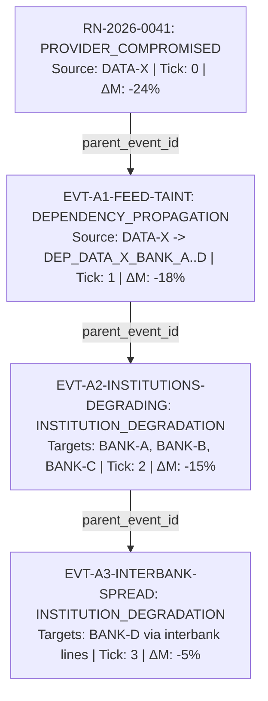

# Financial Immune System (FIS)
## Phase 2 — Authoritative Event Model Specification
### Event Taxonomy, Causal Lineage & Real-Time Transmission

---

## 1. The Authoritative Event Principle

In the Financial Immune System, **events are not decorative logs or console strings**. Every event represents a verifiable, causally linked mutation of the underlying systemic graph:

$$\text{MUTATION}(\Delta) \Longrightarrow \text{AUTHORITATIVE\_EVENT} \Longrightarrow \text{SSE STREAM} \Longrightarrow \text{EVENT RAIL \& PROJECTIONS}$$

---

## 2. Canonical Event Schema

```typescript
interface AuthoritativeEvent {
  event_id: string;               // e.g. "RN-2026-0041" or "EVT-A1-FEED-TAINT"
  tick: number;                   // Simulation clock tick (integer >= 0)
  simulation_timestamp: string;   // ISO-8601 virtual timestamp
  event_type: AuthoritativeEventType;
  severity: 'INFO' | 'WARNING' | 'ELEVATED' | 'HIGH' | 'CRITICAL';
  source_entity_id: string;       // e.g. "DATA-X"
  target_entity_id?: string;      // e.g. "BANK-A"
  parent_event_id?: string | null;// Causal parent in lineage graph
  causal_chain_id: string;        // Lineage root (e.g. "CHAIN-SCENARIO-A")
  state_deltas: StateDeltaRecord[];
  causal_narrative: string;       // Human-readable operational explanation
  systemic_impact: {
    control_margin_delta: number; // e.g. -24%
    stability_delta: number;      // e.g. -0.22
  };
}

interface StateDeltaRecord {
  entity_type: 'DATA_PROVIDER' | 'INSTITUTION' | 'DEPENDENCY' | 'INFRASTRUCTURE_NODE' | 'AI_MODEL' | 'ASSET' | 'SYSTEM_CONTROL';
  entity_id: string;
  field: string;
  previous_value: any;
  new_value: any;
}
```

---

## 3. Event Taxonomy

| Event Type | Typical Severity | Trigger Condition | Causal Meaning |
| :--- | :--- | :--- | :--- |
| **`PROVIDER_COMPROMISED`** | `CRITICAL` | Data provider oracle corruption | Root source integrity collapse |
| **`DEPENDENCY_PROPAGATION`** | `HIGH` | Outgoing feed lines taint | Contagion traversing network channels |
| **`INSTITUTION_DEGRADATION`** | `CRITICAL` | G-SIB model rejects feed; buffer drop | Receiving balance sheet stress |
| **`INFRASTRUCTURE_CONGESTION`**| `ELEVATED` | Clearing throughput dropped | Queue backlog and timeout risk |
| **`INFRASTRUCTURE_FAILURE`** | `CRITICAL` | Settlement desynchronization | Gridlock threatening cross-border rails |
| **`INTERVENTION_PROPOSED`** | `INFO` | Operator submits containment plan | Candidate action queued for review |
| **`INTERVENTION_EXECUTED`** | `HIGH` | Operator dispatches quarantine/backstop | Authoritative mitigation applied |
| **`RESIDUAL_RISK_DETECTED`** | `HIGH` | Secondary latent vector unaddressed | Surface isolation masked latent threat |
| **`BASELINE_RESTORED`** | `INFO` | Deterministic reset to Tick 0 | System returned to nominal equilibrium |

---

## 4. Causal Lineage & Provenance Tree



All events in Scenario A share `causal_chain_id: "CHAIN-SCENARIO-A"`. An evaluator querying `/api/simulation/causal-trace/BANK-A` can unambiguously reconstruct the exact provenance chain from the root oracle down to the institution's balance sheet.

---

## 5. Real-Time Transport (SSE) Packet Schema

The backend stream endpoint (`GET /api/events/stream`) transmits chunked JSON packets using the format:
```
data: {"type": "<TYPE>", "timestamp": "<ISO8601>", "payload": <DATA>}
```

Supported Packet Types:
1. **`HANDSHAKE`**: Emitted upon connection with the complete system snapshot.
2. **`TICK`**: Emitted upon simulation clock advance, containing tick, state delta, control margin, and latest authoritative events.
3. **`OPERATION_LIFECYCLE`**: Emitted upon operation transition (`QUEUED` $\rightarrow$ `RUNNING` $\rightarrow$ `PROCESSING` $\rightarrow$ `COMPLETED` / `FAILED`).
4. **`HEARTBEAT`**: Emitted every 3 seconds with virtual tick and latency ping payload.
