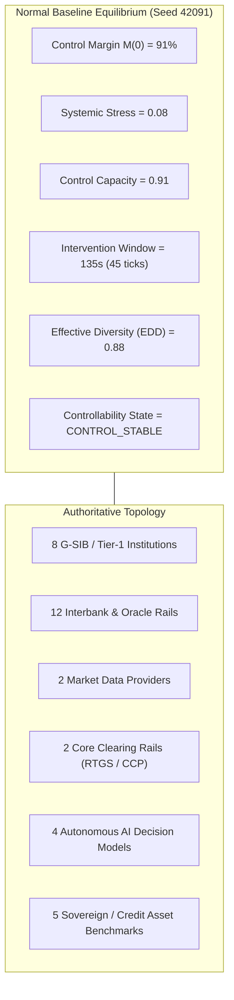

# FINANCIAL IMMUNE SYSTEM (FIS)
## NORMAL BASELINE STATE & EQUILIBRIUM SPECIFICATION
### Section 10 & 16 Architectural Baseline Design

---

### 1. Normal Baseline State Invariants

The Normal Baseline State represents the unperturbed equilibrium of the Financial Immune System. It serves as the reference ground truth for all differential assessments, state comparisons, and deterministic replays.

---

### 2. Baseline Mathematical Parameters

| Parameter | Authoritative Value | Calibration Rationale |
| :--- | :---: | :--- |
| **Initial PRNG Seed** | `42091` | Guarantees bit-for-bit deterministic state generation and cryptographic hash reproducibility. |
| **Control Margin $M(0)$** | `91%` | Represents healthy operational buffer with headroom up to $96\%$ under active reserve isolation. |
| **Systemic Stress Index** | `0.08` | Residual non-zero friction representing normal interbank settlement latency. |
| **Control Capacity Index** | `0.91` | Fully diversified execution options; zero impaired rails. |
| **Cascade Velocity** | `0.0 nodes/sec` | No active propagation. |
| **Cascade Depth** | `0 hops` | Equilibrium graph. |
| **Cascade Breadth** | `0 nodes` | Zero impaired institutions. |
| **Effective Decision Diversity** | `0.88` | High apparent and effective model diversity across institutional trading engines. |
| **Decision Synchrony** | `18%` | Normal asynchronous market order arrival. |
| **Active Incidents** | `0` | Clean incident log. |
| **Controllability State** | `CONTROL_STABLE` | Unambiguous normal operational status. |
| **Evidence Sufficiency** | `1.00` | Full telemetry link attestation. |
| **Confidence Rating** | `HIGH` | Cryptographic digests verified across all nodes. |

---

### 3. Baseline Graph Topology Inventory

1. **Institutions ($N=8$):**
   - `BANK-A`: Global Atlantic Clearing Bank (Frankfurt, $CAR=14.8\%$, $LCR=132\%$)
   - `BANK-B`: Pacific Settlement Trust (Tokyo, $CAR=15.2\%$, $LCR=141\%$)
   - `BANK-C`: Nordic Wholesale Clearing (Stockholm, $CAR=16.1\%$, $LCR=128\%$)
   - `BANK-D`: Continental Credit Bank (Paris, $CAR=14.5\%$, $LCR=135\%$)
   - `GCCB-US`: Global Core Clearing Bank (New York)
   - `TISC-UK`: Tier-1 Interbank Settlement Corp (London)
   - `ASPA-SG`: Asia-Pacific Sovereign Custody (Singapore)
   - `LATC-BR`: Latin Atlantic Transact Corp (São Paulo)

2. **Data Providers ($N=2$):**
   - `DATA-X`: Common Information Provider (Benchmark rates and sovereign debt oracle)
   - `DATA-Y`: Alternative Reference Rates Provider

3. **Infrastructure Nodes ($N=2$):**
   - `INFRA-1`: Global Real-Time Settlement Rail (RTGS Rail, $14,000\text{ TPS}$ nominal capacity)
   - `INFRA-2`: Cross-Border Clearing Hub (CCP Clearing)

4. **Autonomous AI Models ($N=4$):**
   - `MODEL-A`: Algorithmic Liquidity Router
   - `MODEL-B`: Market Making Grid Optimizer
   - `MODEL-C`: Multi-Bank Liquidity Balancer
   - `MODEL-D`: Systematic Risk Minimizer
