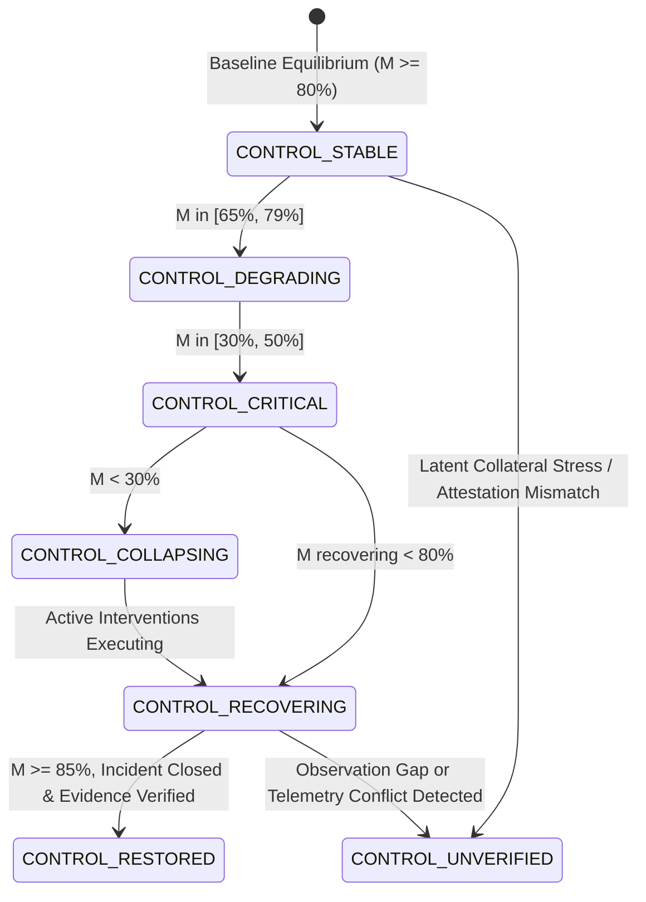

# FINANCIAL IMMUNE SYSTEM (FIS)
## CONTROL MARGIN METHODOLOGY & MATHEMATICAL FORMULATION
### Model Identifier: CM-0.2 | Intelligence Layer 5

---

### 1. Mathematical Formulation of Control Margin $M(t)$

Systemic Control Margin $M(t)$ represents the estimated proportion of systemic controllability remaining in an interconnected financial ecosystem under operational stress.

$$M(t) = \text{clamp}\left(M_{\text{baseline}} - \Delta_{\text{dep}} - \Delta_{\text{prop}} - \Delta_{\text{infra}} - \Delta_{\text{herd}} + \Delta_{\text{rec}}, \; 15, \; 96\right)$$

Where:
- $M_{\text{baseline}} = 91\%$ (Normal baseline equilibrium)
- $\Delta_{\text{dep}}$: Penalty for dependency concentration and compromised information oracles
- $\Delta_{\text{prop}}$: Penalty for multi-hop cascade depth and affected node breadth
- $\Delta_{\text{infra}}$: Penalty for core clearing/settlement rail saturation or outage
- $\Delta_{\text{herd}}$: Penalty for collective algorithmic decision convergence and diversity loss
- $\Delta_{\text{rec}}$: Margin buffer bonus gained from verified isolation and recovery protocols

---

### 2. Component Derivations

#### 2.1 Dependency Concentration Delta ($\Delta_{\text{dep}}$)
$$\Delta_{\text{dep}} = \min\left(32, \; (N_{\text{compromised\_providers}} \times 16) + \text{round}(N_{\text{distressed\_chokepoints}} \times 2.5) + \text{round}(6 \times HHI_{\text{data}})\right)$$
- Under Scenario A ($N_{\text{prov}}=1$, $N_{\text{choke}}=4$, $HHI_{\text{data}}=1.0$):
  $$\Delta_{\text{dep}} = \min(32, 16 + 10 + 6) = 32\text{ pts}$$

#### 2.2 Propagation Depth Delta ($\Delta_{\text{prop}}$)
$$\Delta_{\text{prop}} = \min\left(25, \; \text{round}(D_{\text{hops}} \times 4) + \mathbb{I}(\text{Scope} = \text{SYSTEMIC}) \times 9\right)$$
- When cascade traverses $4$ hops with systemic reach:
  $$\Delta_{\text{prop}} = \min(25, 16 + 9) = 25\text{ pts}$$
- **Resulting Scenario A Control Margin:**
  $$M(t) = 91 - 32 - 25 = 34\%\text{ (Exact Additive Identity)}$$

#### 2.3 Core Infrastructure Stress Delta ($\Delta_{\text{infra}}$)
$$\Delta_{\text{infra}} = \min\left(35, \; (N_{\text{failing\_infra}} \times 28) + \text{penalty}_{\text{load}}\right)$$
- When Global Settlement Rail INFRA-1 collapses under gridlock (Scenario B):
  $$\Delta_{\text{infra}} = \min(35, 28 + 7) = 35\text{ pts}$$
- **Resulting Scenario B Control Margin:**
  $$M(t) = 91 - 4 - 24 - 35 = 28\%\text{ (Exact Additive Identity)}$$

#### 2.4 Collective Decision Convergence Delta ($\Delta_{\text{herd}}$)
$$\Delta_{\text{herd}} = \min\left(35, \; \text{round}(\max(0, \; 0.88 - \text{EDD}) \times 34) + \mathbb{I}(\text{Synchrony} > 80\%) \times 10\right)$$
- Under Scenario D ($\text{EDD} = 0.14$, $\text{Synchrony} = 94\%$):
  $$\Delta_{\text{herd}} = \min(35, \text{round}(0.74 \times 34) + 10) = \min(35, 25 + 10) = 35\text{ pts}$$

#### 2.5 Recovery Capacity Delta ($\Delta_{\text{rec}}$)
$$\Delta_{\text{rec}} = \min(15, \; (N_{\text{recovering\_insts}} + N_{\text{recovering\_providers}}) \times 8)$$

---

### 3. Controllability State Derivation Rules

The enclave classifies systemic operational status into 7 mutually exclusive states:

#### Entry & Exit Conditions

| State | Entry Condition | Exit Condition |
| :--- | :--- | :--- |
| `CONTROL_STABLE` | $M(t) \ge 80\%$, zero active incidents, clean evidence chain. | Disruption injected, or $M(t) < 80\%$. |
| `CONTROL_DEGRADING` | $M(t) \in [51\%, 79\%]$, or early cascade detected. | Escalation to Critical ($M \le 50\%$), or recovery. |
| `CONTROL_CRITICAL` | $M(t) \in [30\%, 50\%]$, or cascade depth $\ge 3$. | Collapse ($M < 30\%$), or recovery containment. |
| `CONTROL_COLLAPSING` | $M(t) < 30\%$, clearing rails saturated, multiple G-SIBs failing. | Emergency isolation executed, or failure. |
| `CONTROL_RECOVERING` | Active intervention authorized & executing, $\Delta_{\text{rec}} > 0$. | Evidence fully verified ($M \ge 85\%$), or unverified anomaly. |
| `CONTROL_UNVERIFIED` | Observation gap detected (>3s), or telemetry contradiction found. | Fresh attested telemetry received with full digest match. |
| `CONTROL_RESTORED` | $M(t) \ge 85\%$, zero active incidents, independent attestation proof. | New operational shock. |

---

### 4. Temporal Degradation Rate $\frac{dM}{dt}$ & Trend Classification

The temporal rate of change $\frac{dM}{dt}$ measures how rapidly controllability is deteriorating per tick:

$$\frac{dM}{dt} = -\min\left(25.0, \; \max\left(1.0, \; \frac{M_{\text{baseline}} - M(t)}{\max(1, t)} + 2.5 \cdot v_{\text{prop}}\right)\right)$$

| Degradation Rate $\frac{dM}{dt}$ | Margin $M(t)$ | Trend Badge |
| :---: | :---: | :---: |
| $0.0$ | $\ge 80\%$ | `STABLE` |
| $[-4.0, 0.0)$ | $[65\%, 79\%]$ | `DEGRADING` |
| $[-12.0, -4.0)$ | $[30\%, 64\%]$ | `RAPIDLY_DEGRADING` |
| $< -12.0$ | $< 30\%$ | `CRITICAL` |
| $> 0$ (with active isolation) | Any | `RECOVERING` |

---

### 5. Dynamic Intervention Window Estimation

The estimated intervention window $W(t)$ calculates the operational time remaining before cascading contagion exhausts remaining containment alternatives:

$$W_{\text{seconds}} = \max\left(15, \; \min\left(180, \; \lfloor 1.6 \cdot M(t) - 8 \cdot v_{\text{prop}} - 20 \cdot \text{CCI} \rfloor\right)\right)$$
$$W_{\text{ticks}} = \max\left(2, \; \lfloor W_{\text{seconds}} / 3 \rfloor\right)$$

- **Uncertainty Bounds:**
  $$\pm U_{\text{ticks}} = \max\left(1, \; \lfloor W_{\text{ticks}} \times 0.25 \rfloor\right)$$
- **Trend:**
  - $M(t) < 35\% \implies$ `CRITICAL`
  - $M(t) < 65\% \implies$ `SHRINKING`
  - $\Delta_{\text{rec}} > 5 \implies$ `EXPANDING`
  - Otherwise $\implies$ `STABLE`
