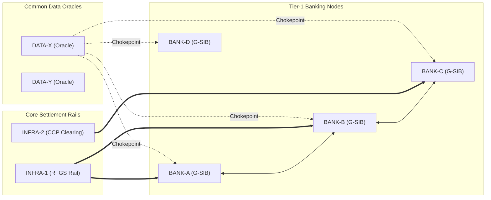

# FINANCIAL IMMUNE SYSTEM (FIS)
## STRUCTURAL DEPENDENCY & CONCENTRATION INTELLIGENCE
### Model Identifier: HHI-0.1 | Intelligence Layer 1 & 2

---

### 1. Structural Dependency Graph Architecture

The FIS topology models the financial system as a directed, weighted multi-graph $G = (V, E, W)$:
- **Vertices $V$:** Institutions (G-SIBs, D-SIBs), Data Providers, Infrastructure Nodes (RTGS, CCPs), Assets, AI Models.
- **Edges $E$:** Financial exposures, clearing settlement rails, oracle feeds, and algorithmic dependencies.
- **Weights $W$:** Exposure weights $\in [0.0, 1.0]$, latencies ($\text{ms}$), and systemic criticalities.

---

### 2. Chokepoint Detection & Graph Centrality Heuristics

A dependency edge $e \in E$ is designated as a **Structural Chokepoint** if:
1. It connects to a critical provider or clearing rail serving $\ge 3$ Tier-1 G-SIBs.
2. Its degree centrality $C_D(v) \ge 0.40$ or betweenness centrality $C_B(v) \ge 0.35$.
3. An outage on $e$ interrupts $\ge 25\%$ of downstream settlement throughput.

In the baseline state:
- $10$ out of $12$ dependency edges are structural chokepoints.
- `DEP_DATA_X_BANK_A` through `DEP_DATA_X_BANK_D` represent single-point failure vectors.

---

### 3. Four-Dimensional Concentration Indices (HHI)

FIS computes concentration across four orthogonal systemic axes using normalized Herfindahl-Hirschman Indices ($HHI \in [0.0, 1.0]$):

$$HHI = \sum_{i=1}^N s_i^2$$

#### 3.1 Data Oracle Reliance ($HHI_{\text{data}}$)
Measures the proportion of institutions relying on the same market feed:
$$HHI_{\text{data}} = \sum_{p \in \text{Providers}} \left(\frac{N_{\text{insts}}(p)}{N_{\text{total\_insts}}}\right)^2 = 1.00$$
*(High concentration: 100% of sovereign and rates pricing funnels through DATA-X).*

#### 3.2 Settlement Rail Concentration ($HHI_{\text{infra}}$)
Measures clearing volume distribution across core settlement hubs:
$$HHI_{\text{infra}} = 0.50$$
*(Distributed between RTGS rail INFRA-1 and CCP clearing hub INFRA-2).*

#### 3.3 Model Architecture Concentration ($HHI_{\text{model}}$)
Measures institutional reliance on common algorithmic decision frameworks:
$$HHI_{\text{model}} = 0.51$$

#### 3.4 Dependency Exposure Concentration ($HHI_{\text{dep}}$)
Measures network-wide bilateral exposure clustering:
$$HHI_{\text{dep}} = 0.10$$

#### 3.5 Composite Concentration Index (CCI)
$$CCI = (0.35 \times HHI_{\text{data}}) + (0.30 \times HHI_{\text{infra}}) + (0.25 \times HHI_{\text{model}}) + (0.10 \times HHI_{\text{dep}}) = 0.57$$
A Composite Concentration Index $> 0.40$ applies an automatic stress multiplier to propagation velocity and narrows the estimated intervention window.
