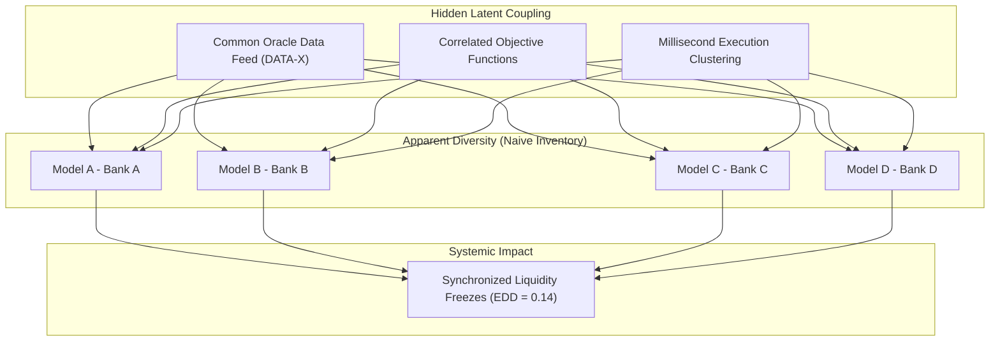

# FINANCIAL IMMUNE SYSTEM (FIS)
## EFFECTIVE DECISION DIVERSITY (EDD) METHODOLOGY
### Model Identifier: EDD-0.1 | Intelligence Layer 4

---

### 1. Research Problem: Apparent vs Effective Diversity

In AI-driven financial ecosystems, multi-institutional risk engines appear diversified because institutions deploy models from distinct vendors (e.g. Model A from Vendor 1, Model B from Vendor 2, etc.). However, when these models consume **identical market oracles** (e.g. common benchmark provider DATA-X) or share correlated training objectives, their execution decisions herd synchronously under macro stress.

---

### 2. Mathematical Formulation of EDD

Effective Decision Diversity discounted composite formula:

$$\text{EDD} = D_{\text{observed}} \times \max\left(0.12, \; 1.0 - P_{\text{data}} - P_{\text{herd}} - P_{\text{sync}}\right)$$

Where:
- $D_{\text{observed}} \in [0.0, 1.0]$: Apparent diversity based on unique model instances ($0.98$ baseline).
- $P_{\text{data}}$: Shared Data Oracle Penalty.
  $$P_{\text{data}} = \begin{cases} 0.35 & \text{if common oracle is tainted or Scenario D active} \\ 0.10 & \text{otherwise} \end{cases}$$
- $P_{\text{herd}}$: Model Correlation Penalty.
  $$P_{\text{herd}} = \rho_{\text{herd}} \times 0.35$$
  where $\rho_{\text{herd}}$ is the mean pairwise correlation across models ($0.22$ baseline $\rightarrow$ $0.78$ under shock).
- $P_{\text{sync}}$: Temporal Synchrony Penalty.
  $$P_{\text{sync}} = \left(\frac{S_{\text{sync}}}{100}\right) \times 0.30$$
  where $S_{\text{sync}} \in [0, 100\%]$ is the percentage of execution decisions occurring within the same time window.

---

### 3. Additive 4-Way Diversity Decomposition

On each simulation tick, FIS outputs the explicit decomposition:

$$\text{EDD} = D_{\text{raw}} - \Delta_{\text{data}} - \Delta_{\text{model}} - \Delta_{\text{sync}}$$

| Condition | $D_{\text{raw}}$ | Common Data Penalty | Model Correlation Penalty | Temporal Synchrony Penalty | Net EDD | Alignment State |
| :--- | :---: | :---: | :---: | :---: | :---: | :--- |
| **Normal Baseline** | $0.98$ | $-0.05$ | $-0.03$ | $-0.02$ | **$0.88$** | `DIVERGENT` |
| **Oracle Shock (A)** | $0.98$ | $-0.45$ | $-0.22$ | $-0.16$ | **$0.15$** | `CONVERGED_SYNCHRONIZED` |
| **Herding Shock (D)** | $0.98$ | $-0.35$ | $-0.25$ | $-0.24$ | **$0.14$** | `CONVERGED_SYNCHRONIZED` |

---

### 4. Recommendation Alignment Taxonomy

The enclave maps decision synchrony and correlation to an operational taxonomy:

1. **`DIVERGENT` ($\text{EDD} \ge 0.60, S_{\text{sync}} < 40\%$):**
   Models output heterogeneous responses; normal market liquidity preservation.
2. **`CORRELATED` ($\text{EDD} \in [0.25, 0.59], S_{\text{sync}} \in [40\%, 80\%]$):**
   Moderate alignment; warning issued to enclave operator.
3. **`CONVERGED_SYNCHRONIZED` ($\text{EDD} < 0.25, S_{\text{sync}} > 80\%$):**
   Algorithmic herding collapse; simultaneous liquidity pull across Atlantic and European clearing banks.
