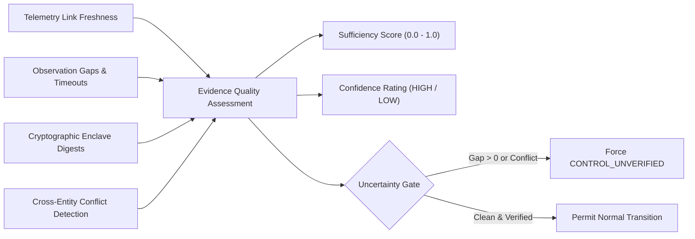

# FINANCIAL IMMUNE SYSTEM (FIS)
## EVIDENCE QUALITY & EPISTEMIC UNCERTAINTY GATING
### Model Identifier: EVD-0.1 | Intelligence Layer 5

---

### 1. The Core Uncertainty Principle: What Does the System Not Know?

A critical flaw of conventional automated decision platforms is **epistemic overconfidence**: declaring a crisis "resolved" or an environment "stable" simply because telemetry feeds have ceased reporting active alarms.

In interconnected financial networks:
- Telemetry links can time out or be severed by network partitions.
- Localized containment measures may create the illusion of surface recovery while latent contagion continues to propagate across unmonitored derivative balance sheets.
- Pre-tainted algorithmic models may execute delayed liquidation waves using stale cache data.

**FIS Core Invariant:**
> Under incomplete, stale, or conflicted evidence, the system **MUST NOT** declare `CONTROL_STABLE` or `CONTROL_RESTORED`. It **MUST** declare `CONTROL_UNVERIFIED` and downgrade confidence to `LOW` or `VERY_LOW`.

---

### 2. Evidence Sufficiency Score & Quality Metrics

Evidence Quality is quantified through four orthogonal metrics:

#### Mathematical Formulation:
$$\text{Sufficiency Score} = \min\left(1.0, \; \frac{N_{\text{attested\_evidence}}}{3.0}\right) \times \left(1.0 - 0.35 \times \mathbb{I}(N_{\text{gaps}} > 0)\right)$$

Where:
- $N_{\text{attested\_evidence}}$: Count of cryptographic records with valid SHA-256 payload digests.
- $N_{\text{gaps}}$: Number of entities with telemetry timeouts ($> 3\text{ seconds}$).

---

### 3. Observation Gap Detection Heuristics

The engine continuously audits telemetry across institutions and AI models:
1. **Link Timeout:** If `institution.status === 'OBSERVATION_GAP'`, the entity is flagged in `observation_gaps[]`.
2. **Attestation Missing:** If `aiModel.status === 'CONFLICTED'` or attestation hash is unverified, an observation gap is recorded.

---

### 4. Telemetry Conflict Resolution (Scenario C Invariant)

Under Scenario C (Incomplete Intervention & Residual Contagion):
- **Surface Observation:** Data feed DATA-X has been isolated; reported margin appears to rebound toward $76\%$.
- **Underlying Reality:** Model C is executing automated liquidations on synthetic credit benchmarks (ASSET-17); institutions BANK-C and BANK-D suffer latent collateral distress.

#### Enclave Action:
1. Conflict detection heuristic flags:
   `institutions.some(i => i.status === 'RESIDUAL_RISK') === true`
2. Confidence rating is immediately downgraded from `HIGH` to `LOW`.
3. Controllability state is locked to `CONTROL_UNVERIFIED`.
4. Incident closure is blocked at the cryptographic gate with error:
   `"Verification anomaly: Surface containment does not match collateral reality."`
