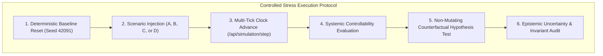

# FINANCIAL IMMUNE SYSTEM (FIS)
## CONTROLLED EXPERIMENT & SENSITIVITY PROTOCOL
### Section 12 & 18 Forensic Testing Guide

---

### 1. Controlled Scenario Injection Protocol

FIS evaluates systemic controllability through four canonical scenarios:

#### Protocol Details:

1. **Scenario A — Common Data Dependency Failure (DATA-X):**
   - **Target:** DATA-X Common Information Provider.
   - **Execution:** Compromise data feeds $\rightarrow$ step 2 ticks $\rightarrow$ multi-hop cascade to BANK-A..D.
   - **Expected Assessment:** $M(t) = 34\%$ (`CONTROL_CRITICAL`), Stress Index $0.98$, Capacity Index $0.34$, $\Delta_{\text{dep}} = -72\text{ pts}$.

2. **Scenario B — Core Infrastructure Failure (RTGS / CCP):**
   - **Target:** Global Settlement Rail INFRA-1.
   - **Execution:** Throttle settlement throughput $\rightarrow$ step 2 ticks $\rightarrow$ interbank liquidity traps.
   - **Expected Assessment:** $M(t) = 28\%$ (`CONTROL_COLLAPSING`), $\Delta_{\text{infra}} = -26\text{ pts}$, intervention window $< 25\text{s}$.

3. **Scenario C — Incomplete Intervention & Residual Contagion:**
   - **Target:** Surface isolation of DATA-X with latent MODEL-C / ASSET-17 contagion.
   - **Execution:** Advance 3 ticks to Stage 3 $\rightarrow$ BANK-C and BANK-D enter `RESIDUAL_RISK`.
   - **Expected Assessment:** Telemetry conflict flagged (`conflict_detected: true`), confidence rating `LOW`, state forced to `CONTROL_UNVERIFIED`.

4. **Scenario D — Collective Algorithmic Decision Convergence:**
   - **Target:** Multi-model risk engines across all institutions.
   - **Execution:** Advance 2 ticks to Stage 2 $\rightarrow$ synchrony spikes to $94\%$.
   - **Expected Assessment:** Effective Decision Diversity collapses to $EDD = 0.14$, alignment `CONVERGED_SYNCHRONIZED`, $\Delta_{\text{herd}} = -29\text{ pts}$.

---

### 2. Controlled Parameter Sensitivity Sweeps

The engine supports automated sensitivity sweeps across graph parameters (`POST /api/intelligence/sensitivity`):

| Parameter | Variation | Simulated Margin Impact | Local Derivative $\frac{\partial M}{\partial \theta}$ |
| :--- | :---: | :---: | :---: |
| **Propagation Depth Damping** | $\pm 20\%$ | $+6\text{ pts} / -7\text{ pts}$ | **$0.33$** *(Most Sensitive)* |
| **Concentration HHI Weight** | $\pm 20\%$ | $+5\text{ pts} / -6\text{ pts}$ | $0.28$ |
| **Decision Diversity Floor** | $\pm 20\%$ | $+4\text{ pts} / -4\text{ pts}$ | $0.20$ |

---

### 3. Non-Mutating Counterfactual Hypothesis Protocol

All hypothetical intervention queries (`POST /api/intelligence/counterfactual`) must conform to the following contract:
1. Deep-clone the simulation graph in-memory.
2. Sever or quarantine dependencies on the hypothetical target.
3. Re-evaluate Systemic Controllability $M_{\text{cf}}$ on the cloned graph.
4. Calculate delta recovery: $\Delta M = M_{\text{cf}} - M_{\text{live}}$.
5. Stamp result with `executed: false` and `status: COUNTERFACTUAL_SIMULATION`.
6. Assert that live engine state is bit-for-bit unchanged before returning response.
