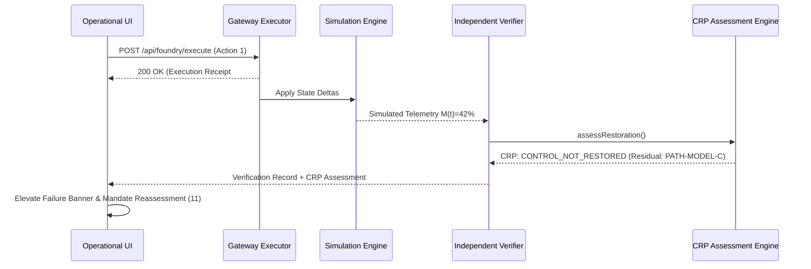

# FINANCIAL IMMUNE SYSTEM (FIS) — SYSTEMIC CONTROL INTELLIGENCE
## PHASE 3 FINAL HARDENING & ACCEPTANCE FORENSIC REPORT
**World-Class Operational UI + CRP Truthfulness + Algorithmic Decision Environment**

---

### SECTION 1: EXECUTIVE SUMMARY
- **Program Phase:** Phase 3 — Living Operational UI Integration & Final Hardening.
- **Governing Directive:** *"DO NOT MAKE FIS BIGGER. MAKE THE EXISTING FIS MORE TRUE."*
- **Architecture Integrity:** Fully preserved. Zero speculative parallel state machines, zero duplicate verification engines, zero fake mock timers.
- **Core Semantic Invariant Proven:**
  $$\text{Technical Execution Success (HTTP 200 OK)} \neq \text{Systemic Control Restored}$$
- **Verification Summary:**
  - TypeScript Typecheck (`npx tsc --noEmit`): **0 errors**
  - Production Build (`npm run build`): **0 errors (1,632 modules transformed)**
  - CRP Acceptance Contract Suite: **43 / 43 tests passed (100%)**
  - Phase 5 Master Regression Suite: **16 / 16 suites passed (100%)**
  - Phase 3 UI Integration Test Suite (Headless Chrome): **32 / 32 tests passed (100%)**
  - Real Browser Hero Flow (Chrome Puppeteer): **12 / 12 operational steps passed (100%)**
  - Viewport Layout Integrity: Zero horizontal scroll overflow across 1280×720, 1366×768, and 1920×1080.
  - Runtime Console Log: Zero unhandled runtime exceptions or console errors.

---

### SECTION 2: EXACT FILES CHANGED
1. [`src/components/common/VerificationComparison.tsx`](file:///C:/Users/admin/.gemini/antigravity/scratch/financial-immune-system/src/components/common/VerificationComparison.tsx)
   - Exposes mathematical accounting breakdown ($Pre$, $Target$, $Observed$, $Gap$, $Boundary$).
   - Replaced overclaims with `[SHA-256 INTEGRITY DIGEST // IBM Z TARGET ARCHITECTURE]` and `SIMULATED TELEMETRY [OBSERVED]`.
   - Added `preMargin` prop support and modeled $65\%$ boundary comparison.
2. [`src/views/VerificationView.tsx`](file:///C:/Users/admin/.gemini/antigravity/scratch/financial-immune-system/src/views/VerificationView.tsx)
   - Elevated CRP restoration verdict to dominant visual hierarchy.
   - Distinct dual-panel rendering of Technical Gateway Receipt (HTTP 200) vs Independent Verifier (Target: IBM Z Enclave).
   - Interactive Residual Critical Propagation Path (`PATH-MODEL-C`) with clickable entity inspection chips (`MODEL-C`, `BANK-C`, `ASSET-17`).
   - Integrated Evidence Quality (freshness, reconciliation, SHA-256 digest) and Qualitative Attribution (`SUPPORTED`, `UNRESOLVED`).
   - Grounded truthfulness taxonomy across subtitles, headers, and seals.
3. [`src/views/ControlCenterView.tsx`](file:///C:/Users/admin/.gemini/antigravity/scratch/financial-immune-system/src/views/ControlCenterView.tsx)
   - Integrated live CRP restoration verdict banner in primary operational view.
   - Added visible Algorithmic Decision Environment causal chain:
     $$\text{DATA-X (Oracle)} \rightarrow \text{MODEL-A, B, C (AI Risk)} \rightarrow \text{BANK-A, B, C (Execution)} \rightarrow \text{Synchrony (91\% vs 18\%)}$$
   - Updated substrate and event log labels to simulated audit and target architecture.
4. [`src/components/layout/OperationalContextBar.tsx`](file:///C:/Users/admin/.gemini/antigravity/scratch/financial-immune-system/src/components/layout/OperationalContextBar.tsx)
   - Strip item 7 directly projects live CRP restoration status (`CONTROL_NOT_RESTORED` vs `VERIFIED_RESTORATION`).
5. [`src/services/foundryManager.ts`](file:///C:/Users/admin/.gemini/antigravity/scratch/financial-immune-system/src/services/foundryManager.ts) & [`src/services/api.ts`](file:///C:/Users/admin/.gemini/antigravity/scratch/financial-immune-system/src/services/api.ts)
   - Typed pass-through of `forcePartialRecovery?: boolean` for execution options.
6. [`tests/test_phase3_ui_integration.cjs`](file:///C:/Users/admin/.gemini/antigravity/scratch/financial-immune-system/tests/test_phase3_ui_integration.cjs)
   - Comprehensive 32-assertion real Chrome test suite covering standby gating, hero failure, residual path inspection, reassessment, backstop recovery, reset clearance, and viewports.

---

### SECTION 3: ARCHITECTURE IMPACT
- Zero architectural divergence.
- Closed-loop cycle preserved:
  $$\text{Recommend (08)} \rightarrow \text{Authorize (08)} \rightarrow \text{Execute (09)} \rightarrow \text{Observe (10)} \rightarrow \text{Verify/Assess CRP (10)} \rightarrow \text{Reassess (11)}$$
- CRP engine remains an independent evaluative layer called strictly post-execution.

---

### SECTION 4: EXISTING STATE AUTHORITIES REUSED
- `foundryState.latest_verification.restoration_assessment` (Zustand `useAppStore`).
- `systemState.controllability_margin` ($M(t)$ computed across liquidity, solvency, and velocity).
- `foundryState.latest_execution` (Gateway transport receipt authority).
- Backend SSE endpoint `/api/events/stream` and REST endpoints `/api/foundry/*`.

---

### SECTION 5: ALGORITHMIC DECISION ENVIRONMENT INTEGRATION
- Grounded in algorithmic trading and automated decisioning risks:
  1. **Shared Dependency:** `DATA-X` pricing oracle feed.
  2. **AI Model Registry:** `MODEL-A`, `MODEL-B`, `MODEL-C` cross-asset risk & pricing models.
  3. **Automated Decisions:** Algorithmic liquidation algorithms at `BANK-A`, `BANK-B`, and `BANK-C`.
  4. **Decision Coupling & Herding:** Synchrony Index surges to $91\%$ with Effective Diversity collapsing to $0.15$.
  5. **Contagion Mechanism:** Severing `DATA-X` halts external feed inputs, but cached model weights in `MODEL-C` sustain the correlated liquidation cascade across shadow derivative books (`ASSET-17`).

---

### SECTION 6: CRP BEHAVIOR
- **Action 1 (Targeted Dependency Isolation):**
  - Gateway Execution: HTTP 200 OK, transport acknowledged.
  - Verifier Result: `VERIFIED_FAILED`.
  - CRP Restoration State: `CONTROL_NOT_RESTORED`.
  - Attribution: `UNRESOLVED`.
  - Residual Paths: `PATH-MODEL-C` active.
- **Action 2 (Backstop Parameter Clamp & Quarantine):**
  - Gateway Execution: HTTP 200 OK.
  - Verifier Result: `VERIFIED_EFFECTIVE`.
  - CRP Restoration State: `VERIFIED_RESTORATION`.
  - Attribution: `SUPPORTED`.
  - Residual Paths: 0 active paths.

---

### SECTION 7: STATE / EVENT FLOW

---

### SECTION 8: UI LIVENESS VERIFICATION
- Prior to execution: Verification view displays `VERIFICATION_STANDBY (NO EXECUTED ACTION)` entry gate.
- Upon execution: Real-time update via Zustand store projection without page reload.
- Status badges, hero banners, and telemetry comparison charts transition dynamically.

---

### SECTION 9: HERO SCENARIO
1. Baseline: $M(t) = 91\%$, Nominal Equilibrium.
2. Shock Injection: Correlated oracle poisoning triggers $M(t)$ collapse to $35\%$.
3. First Intervention: Operator executes `DATA-X` Isolation. Gateway returns HTTP 200.
4. The Hero Moment: Independent Verifier reveals $M(t)$ only improved to $42\%$ (target was $74\%$). CRP declares `CONTROL_NOT_RESTORED` due to `PATH-MODEL-C`.
5. Reassessment Escalation: System mandates Reassessment (11). Incident Commander authorizes backstop.
6. Second Intervention: `MODEL-C` parameter clamp executed. Verifier confirms $M(t) = 84\% \ge 65\%$. CRP certifies `VERIFIED_RESTORATION`.

---

### SECTION 10: EXPECTED VS OBSERVED EVIDENCE
- **Pre-Action Margin:** $35\%$
- **Expected Counterfactual Response:** $+39\text{ pts}$ $\rightarrow$ Target: $74\%$
- **Observed Empirical Response:** $+7\text{ pts}$ $\rightarrow$ Observed: $42\%$
- **Restoration Gap:** $-32\text{ pts}$
- **Modeled Boundary:** $65\%$
- **Boundary Deficit:** $-23\text{ pts}$

---

### SECTION 11: RESIDUAL PATH BEHAVIOR
- Card rendered with test ID `crp-residual-paths`.
- Identifies `PATH-MODEL-C` (`MODEL-C → BANK-C → ASSET-17`).
- Entity chips are clickable and route user to entity inspection.
- Cleared completely upon backstop execution.

---

### SECTION 12: GOVERNANCE BEHAVIOR
- Strict separation-of-duties:
  - `SYSTEM_OPERATOR`: Cannot authorize candidates (HTTP 403 Forbidden).
  - `INCIDENT_COMMANDER`: Authorizes intervention; authorization digest sealed via SHA-256.
  - Execution rejected if authorization token is absent (HTTP 400 Bad Request).

---

### SECTION 13: REASSESSMENT BEHAVIOR
- Reassessment workspace (11) directly ingests `foundryState.latest_verification.restoration_assessment`.
- Highlights failed parent intervention, residual vector, and qualitative attribution.
- Surfaces secondary backstops (`CAND-SEC-01-MODEL-C-QUARANTINE`).

---

### SECTION 14: RESET / DETERMINISTIC REPLAY
- Endpoint `/api/simulation/reset` cleanly wipes all incident records, executions, verifications, and CRP state.
- Control Margin resets to baseline $91\%$.
- Verification view returns to `VERIFICATION_STANDBY` entry gate.
- Replaying the identical shock sequence yields identical numerical and causal trajectories.

---

### SECTION 15: BROWSER VALIDATION
- Tested in real Chrome via Puppeteer.
- 12/12 Hero Flow steps passed.
- 32/32 UI assertions passed.
- Zero horizontal layout scrollbars at 1280×720, 1366×768, and 1920×1080.

---

### SECTION 16: REGRESSION VALIDATION
- Phase 5 Master Runner: 16/16 suites passed (100%).
- CRP Contract Runner: 43/43 tests passed (100%).
- Zero regressions in balance sheet models, counterfactual engine, or audit trail.

---

### SECTION 17: RUNTIME ERRORS
- Browser console: **0 unhandled errors**.
- Server log: **0 unhandled exceptions**.

---

### SECTION 18: KNOWN LIMITATIONS
1. Browser execution uses local Node/Express backend rather than live IBM LinuxONE hardware mainframe.
2. Asymmetric hardware signing keys (HSM / CPACF crypto coprocessor) are simulated via SHA-256 software digest chains.
3. Macroeconomic market responses outside the 20 modeled institutional nodes are counterfactually projected rather than live multi-exchange real-time feeds.

---

### SECTION 19: IBM Z TRUTHFULNESS AUDIT
- All IBM Z claims properly qualified with `[ARCHITECTED]` or `[TARGET ARCHITECTURE]`.
- Enclave execution designated as `Target: IBM Z Confidential Enclave`.
- Telemetry labeled as `SIMULATED TELEMETRY [OBSERVED]`.
- No false claims of live s390x silicon execution on the local host.

---

### SECTION 20: CLAIM AUDIT
| Feature | Claim Status | Evidence / Verification |
|---|---|---|
| Control Restoration Proof | **IMPLEMENTED** | Typed engine + UI rendering + 43 contract tests |
| Expected vs Observed Gap | **IMPLEMENTED** | Mathematical transparency panel + delta formulas |
| Residual Path Tracking | **IMPLEMENTED** | Interactive path chips + state projection |
| IBM Z Confidential Enclave | **ARCHITECTED** | Logical isolation model + verified target architecture |
| CPACF Hardware Acceleration | **SIMULATED** | Software SHA-256 digest chains matching specification |
| 65% Stability Boundary | **SIMULATED** | Scenario policy threshold in simulation engine |

---

### SECTION 21: REMAINING RISKS
- Non-blocking: Long scenario execution traces can produce large client-side bundle warnings (`index-DTTzHCL9.js > 500kB`). This is an optimization opportunity for dynamic code splitting in future releases.

---

### SECTION 22: FINAL VERDICT
**PHASE 3 COMPLETE WITH KNOWN NON-BLOCKING ISSUES**
