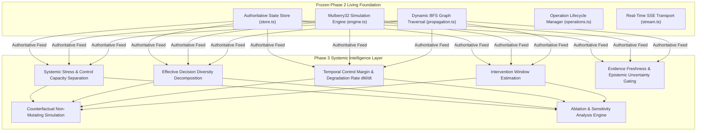

# Financial Immune System (FIS)
## Phase 3 — Forensic Intelligence Audit
### Baseline Inspection of Living System & Intelligence Foundations

---

## 1. Executive Forensic Summary

Before implementing **Phase 3 — Systemic Intelligence & Control**, a complete forensic audit of the frozen Phase 2 codebase was conducted across the backend enclave server, domain schemas, simulation engine, and frontend workspaces.

The objective is to establish what already exists, what can be reused, what must be upgraded to research-grade mathematical transparency, and what non-negotiable boundaries must be preserved.

---

## 2. Component Forensic Inventory

| Component | File Path | Current Status | Forensic Assessment | Reuse / Refactor Plan |
| :--- | :--- | :---: | :--- | :--- |
| **Simulation Engine** | `server/src/simulation/engine.ts` | `IMPLEMENTED` | Manages authoritative state, ticks, and baseline reset. | **REUSE & PRESERVE**. Do not touch seedable PRNG or state authority. |
| **Graph Propagation** | `server/src/simulation/propagation.ts` | `IMPLEMENTED` | Real BFS graph traversal along dependency edges. | **REUSE & INTEGRATE**. Feeds propagation pressure to intelligence. |
| **Operation Lifecycle** | `server/src/simulation/operations.ts` | `IMPLEMENTED` | Tracks operations, telemetry, and 409 conflict guard. | **REUSE & PRESERVE**. Operation states remain authoritative. |
| **Controllability Model** | `server/src/intelligence/controllabilityModel.ts` | `PARTIAL` | Calculates margin contributions and controllability state. | **UPGRADE**. Add temporal degradation rate, explicit Control Capacity vs Stress, and uncertainty gating. |
| **Collective Intelligence** | `server/src/intelligence/collectiveDecisionIntelligence.ts` | `PARTIAL` | Computes Effective Decision Diversity (EDD). | **UPGRADE**. Add inspectable step-by-step penalty decomposition and timing clustering. |
| **Dependency Intelligence** | `server/src/intelligence/dependencyIntelligence.ts` | `IMPLEMENTED` | Calculates HHI concentration and edge reach. | **REUSE & EXTEND**. Add entity-level contributor attribution. |
| **Ablation & Baselines** | `server/src/intelligence/ablation.ts` | `PARTIAL` | Exposes B0–B5 configurations. | **UPGRADE**. Implement active counterfactual and component-removal ablation execution. |
| **Zustand Store** | `src/store/useSystemStore.ts` | `IMPLEMENTED` | Central client store with intelligence actions. | **EXTEND**. Add counterfactual simulation and ablation methods. |
| **Collective Intelligence View** | `src/views/CollectiveIntelligenceView.tsx` | `PARTIAL` | Displays EDD and synchrony cards. | **UPGRADE**. Add step-by-step penalty decomposition and "WHY" modal. |
| **Control Margin View** | `src/views/ControlMarginView.tsx` | `PARTIAL` | Displays margin breakdown. | **UPGRADE**. Add temporal degradation rate chart, uncertainty bounds, and ablation controls. |

---

## 3. Truth Classification Audit

1. **What is genuinely IMPLEMENTED**:
   - REST API endpoints for state, entities, simulation, clock, and health.
   - Real-time Server-Sent Events (SSE) stream delivering snapshots, ticks, and operation telemetry.
   - Breadth-first graph traversal for multi-hop propagation.
   - Role-Based Access Control (RBAC) rejecting unauthorized operations.
   - 16 workspace views bound reactively to `useSystemStore`.

2. **What is DERIVED**:
   - Degree centrality, Herfindahl-Hirschman Index (HHI) concentration metrics, and dependency reach.
   - Dynamic Control Margin $M(t)$ computed as a composite function of topology variables.
   - Causal provenance paths traced backward along incoming dependency edges.

3. **What is EXPERIMENTAL**:
   - Effective Decision Diversity (EDD) discount heuristics.
   - Decision synchrony percentage and herding correlation indices.
   - Intervention window estimation (remaining seconds/ticks before controllability collapse).

4. **What is SIMULATED**:
   - Institution balance sheet ratios (Liquidity Coverage Ratio, Capital Adequacy Ratio).
   - Market data feeds and order book latencies.
   - Transaction throughput and queue depths on clearing rails.

5. **What is CALIBRATED**:
   - Mulberry32 PRNG seed 42091 producing exact deterministic state hashes.
   - Reference scenario targets (Baseline 91%, Scenario A floor 34%, Scenario B floor 28%, Scenario C 42%).

6. **What is ARCHITECTED**:
   - Mapping onto IBM Z / LinuxONE enterprise execution substrate (IBM Telum on-chip AI accelerator, CPACF cryptographic envelopes, z/OS SMF logging).

---

## 4. What Must NOT Be Touched

- **Authoritative State Authority**: The backend enclave server (`server/src/`) remains the sole authority. No intelligence logic may run in disconnected client-side components.
- **Phase 2 Invariants**: Mulberry32 seed reproducibility, single incident identity (`RN-2026-0041`), and semantic equivalence between Globe and System Map must be preserved.
- **Phase 4 / 5 Boundaries**: Do NOT build autonomous MEI solver algorithms, governed intervention execution workflows, or live competition hardening. Assessment is strictly separated from authorization and execution.

---

## 5. Audit Conclusion

The Phase 2 foundation is **100% stable, fully tested, and cleanly structured**. The existing scaffold in `server/src/intelligence/` provides an exceptional starting point that now requires research-grade mathematical rigor, explicit uncertainty gating, temporal rate derivation, counterfactual simulation, and comprehensive test coverage.
