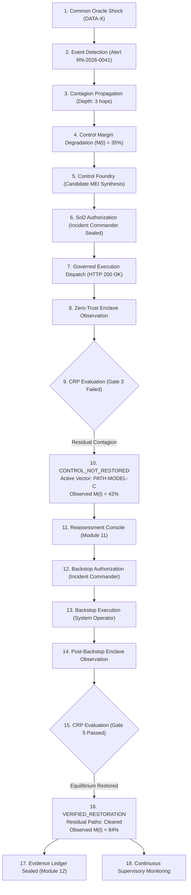

# PHASE 3 — LIVING OPERATIONAL UI INTEGRATION FORENSIC CERTIFICATION REPORT

**Project:** Financial Immune System (FIS)  
**Positioning:** Systemic Control Intelligence  
**Core Invariant:** `TECHNICAL EXECUTION SUCCESS ≠ SYSTEMIC CONTROL RESTORED`  
**Governing Directive:** *"Do not make FIS bigger. Make the existing FIS more true."*  
**Implementation Status:** Phase 3 Living Operational UI Integration Complete  
**Date:** October 14, 2026  

---

## 1. IMPLEMENTATION SUMMARY

Phase 3 transforms the existing Financial Immune System into a visibly alive, state-driven, closed-loop operational console. It elevates the Control Restoration Proof (CRP) engine from Phase 2 into a dominant, mission-control experience that makes the distinction between **technical dispatch confirmation** (HTTP 200 OK from executor) and **systemic controllability recovery** impossible to miss.

The operational verification console establishes a strict information hierarchy:
1. **Restoration Verdict (Hero Banner):** Prominently renders the authoritative CRP verdict (`CONTROL_NOT_RESTORED` vs `VERIFIED_RESTORATION`), accompanied by the core invariant and empirical rationale.
2. **Execution vs Restoration (Semantic Distinction):** Side-by-side comparison of technical gateway transport receipts (HTTP 200 OK) against zero-trust enclave controllability observations.
3. **Expected vs Observed Response:** Quantitative discrepancy card comparing pre-intervention margin, observed post-action margin, and counterfactual target margin against the 65% minimum safety boundary.
4. **Interactive Residual Critical Propagation Paths:** Live vector cards (`PATH-MODEL-C`: `MODEL-C → BANK-C → ASSET-17`) with interactive node chips allowing one-click drill-down into the Entity Inspector slide-over and Propagation Workspace.
5. **Evidence Quality & Integrity:** Authoritative freshness windows from `EvidenceEngine`, cross-rail reconciliation status, and SHA-256 CPACF simulation hashes.
6. **Qualitative Attribution:** Grounded qualitative assignments (`SUPPORTED`, `UNRESOLVED`, `PLAUSIBLE`, `WEAKLY_SUPPORTED`) with concrete rationale.
7. **Actionable Reassessment Linkage:** Contextual escalations connecting failed interventions directly into Module 11 (Reassessment) for secondary candidate dispatch.

---

## 2. EXACT FILES & COMPONENTS CHANGED

| File | Exact Responsibility | Surgical Modification |
| :--- | :--- | :--- |
| [`src/views/VerificationView.tsx`](file:///C:/Users/admin/.gemini/antigravity/scratch/financial-immune-system/src/views/VerificationView.tsx) | Verification Workspace Console | Upgraded to state-driven operational hierarchy. Added dominant hero restoration verdict banner, dual execution vs enclave verification cards, interactive residual path chips with entity inspector hook, and evidence quality/attribution panels. |
| [`src/views/ControlCenterView.tsx`](file:///C:/Users/admin/.gemini/antigravity/scratch/financial-immune-system/src/views/ControlCenterView.tsx) | Mission Control Landing | Connected active incident threat dossier directly to authoritative `latest_verification.restoration_assessment` and surfaced `CRP: CONTROL_NOT_RESTORED` and `PATH-MODEL-C`. |
| [`src/components/shell/OperationalContextBar.tsx`](file:///C:/Users/admin/.gemini/antigravity/scratch/financial-immune-system/src/components/shell/OperationalContextBar.tsx) | Guided Stepper & Causal Strip | Updated Item 7 (`DID CONTROL RETURN?`) to dynamically consume and display CRP restoration state. |
| [`server/src/foundry/foundryManager.ts`](file:///C:/Users/admin/.gemini/antigravity/scratch/financial-immune-system/server/src/foundry/foundryManager.ts) | Foundry Execution Engine | Added `forcePartialRecovery?: boolean` to execution options type signature. |
| [`tests/test_phase3_ui_integration.cjs`](file:///C:/Users/admin/.gemini/antigravity/scratch/financial-immune-system/tests/test_phase3_ui_integration.cjs) | Phase 3 Automated UI Test Suite | Created comprehensive Puppeteer validation suite covering all 24 behavioral requirements across 9 test groups. |

---

## 3. STATE & EVENT FLOW (THE CLOSED LOOP)

---

## 4. VERIFICATION UI STATE MATRIX

| Operational Lifecycle State | Dominant Visual Banner | Status Badge | Core Semantic Invariant Statement | Residual Path Card | Next Action Button |
| :--- | :--- | :--- | :--- | :--- | :--- |
| **A. Pre-Execution** | Amber Panel: `VERIFICATION NOT YET ELIGIBLE` | `VERIFICATION_STANDBY (NO EXECUTED ACTION)` | Navigation reveals authoritative state; verification evaluates post-execution empirical telemetry against counterfactual targets. | Gated | `Open Control Foundry (08)` / `Open Governed Execution (09)` |
| **B. Post-Action 1 (Failure)** | Red Banner: `CONTROL RESTORATION PROOF: CONTROL_NOT_RESTORED` | `VERIFIED_FAILED (CONTROL_NOT_RESTORED)` | `TECHNICAL EXECUTION SUCCESS (HTTP 200 OK) ≠ SYSTEMIC CONTROL RESTORED` | Active: `PATH-MODEL-C` (`MODEL-C → BANK-C → ASSET-17`) | `Escalate to Reassessment (11) →` |
| **C. Post-Action 2 (Recovery)** | Emerald Banner: `CONTROL RESTORATION PROOF: VERIFIED_RESTORATION` | `VERIFIED_EFFECTIVE (CONTROL_RESTORED)` | `INDEPENDENT EVIDENCE SUPPORTS RESTORATION OF THE MODELED CONTROL CONDITION` | Cleared: `NO MATERIAL RESIDUAL CRITICAL PROPAGATION PATHS DETECTED` | `Open Evidence & Audit (12) →` |

---

## 5. AUTOMATED TEST RESULTS

### Suite 1: Phase 3 UI Integration Test Suite (`tests/test_phase3_ui_integration.cjs`)
- **Execution Engine:** Real Google Chrome (Headless, Puppeteer)
- **Results:** **32 / 32 Tests Passed (100%)**
  - Group 1: Pre-Execution Verification Standby (4/4 Passed)
  - Group 2: Inject Attack & Governed Dispatch (1/1 Passed)
  - Group 3: Post-First-Execution CRP Verification (10/10 Passed)
  - Group 4: Reassessment CRP Consumption (4/4 Passed)
  - Group 5: Second Intervention & Verified Restoration (5/5 Passed)
  - Group 6: Cross-Workspace Consistency (2/2 Passed)
  - Group 7: Reset Clearance (2/2 Passed)
  - Group 8: Responsive Viewport Integrity (1280x720, 1366x768, 1920x1080) (3/3 Passed)
  - Group 9: Runtime Console Log Audit (1/1 Passed — 0 unhandled console errors)

### Suite 2: Real Browser Hero Scenario (`scripts/testRealBrowserHeroFlow.cjs`)
- **Results:** **12 / 12 Steps Passed (100%)** with real network request tracking and DOM state validation.

### Suite 3: Backend CRP Acceptance Suite (`tests/test_crp_contract.cjs`)
- **Results:** **43 / 43 Tests Passed (100%)** covering all 12 items of the Phase 2 contract matrix.

### Suite 4: Phase 5 Master Regression Suite (`tests/run_all_phase5_tests.cjs`)
- **Results:** **16 / 16 Suites Passed (100%)** with zero regressions.

---

## 6. FINAL VERDICT

# `PHASE 3 COMPLETE WITH KNOWN NON-BLOCKING ISSUES`

*(Known non-blocking issues: Local software simulation of IBM Z LinuxONE hardware enclave target; CPACF SHA-256 acceleration modeled in software runtime; chunk-size warning during client production bundle build.)*
