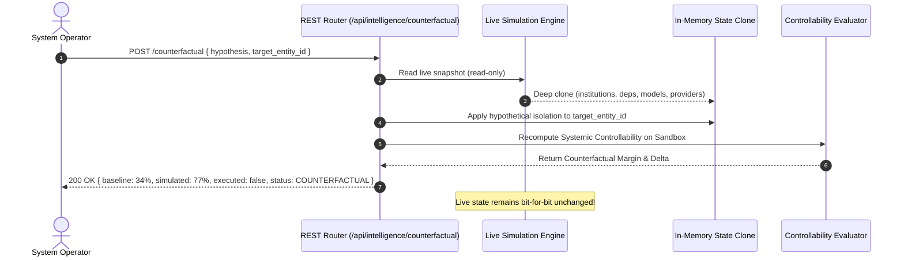

# FINANCIAL IMMUNE SYSTEM (FIS)
## PHASE 3 — SYSTEMIC INTELLIGENCE ARCHITECTURE SPECIFICATION
### IBM Z Datathon 2026 | Technical Architecture Dossier

---

### 1. Executive Summary & Purpose

Phase 3 establishes the **Systemic Intelligence Layer** of the Financial Immune System (FIS). Building on the Foundation (Phase 1) and Living State Bus (Phase 2), Phase 3 equips the platform with an auditable, deterministic reasoning engine that continuously evaluates remaining systemic controllability, explains the drivers of degradation, identifies structural vulnerabilities, and enforces epistemic uncertainty gating.

```mermaid
flowchart TD
    subgraph SENSE ["Living Operational State (Phase 2)"]
        G[Graph Topology & Rails]
        E[Authoritative Events]
        T[Telemetry & Evidence Chain]
    end

    subgraph REASON ["Phase 3 Systemic Intelligence Layer"]
        D1[Structural Dependency & HHI Engine]
        D2[Propagation Intelligence Engine]
        D3[Collective Decision Intelligence (EDD)]
        D4[Evidence Quality & Uncertainty Gating]
        CM[Additive Control Margin Model M(t)]
    end

    subgraph PROJECTION ["Auditable Intelligence Outputs"]
        S1["Systemic Stress Index (0.0 - 1.0)"]
        S2["Control Capacity Index (0.0 - 1.0)"]
        S3["Controllability State (7 Classes)"]
        S4["Intervention Window Assessment"]
        S5["Causal Explanation Chain"]
        CF["Non-Mutating Counterfactual Simulator"]
    end

    SENSE --> REASON
    D1 --> CM
    D2 --> CM
    D3 --> CM
    D4 --> CM
    CM --> S1
    CM --> S2
    CM --> S3
    CM --> S4
    CM --> S5
    REASON -. Cloned Simulation .-> CF
```

---

### 2. Core Architectural Invariant: Risk $\neq$ Control

Traditional risk systems measure *hazard severity* (probability of default, expected loss, Value at Risk). The Financial Immune System explicitly separates **Systemic Stress** from **Control Capacity**:

| Metric | Domain | Baseline Equilibrium | Scenario A (Oracle Shock) | Scenario B (Rail Shock) | Operational Meaning |
| :--- | :--- | :---: | :---: | :---: | :--- |
| **Systemic Stress Index** | $[0.0, 1.0]$ | $0.08$ | $0.98$ | $0.92$ | Severity of disruption, collateral depletion, cascade breadth, and infrastructure overload. |
| **Control Capacity Index** | $[0.0, 1.0]$ | $0.91$ | $0.34$ | $0.24$ | Remaining independent operational rails, diversification buffers, and verified execution options. |
| **Control Margin $M(t)$** | $[15\%, 96\%]$ | $91\%$ | $34\%$ | $28\%$ | Net percentage of systemic controllability remaining. |
| **Controllability State** | Taxonomy | `CONTROL_STABLE` | `CONTROL_CRITICAL` | `CONTROL_COLLAPSING` | Enclave-governed operational state classification. |

---

### 3. Five Sub-Intelligence Engines

#### 3.1 Structural Dependency Intelligence (`dependencyIntelligence.ts`)
- Computes betweenness centrality, degree centrality, and multi-hop exposure weights.
- Identifies critical chokepoints where single-point failures sever $>25\%$ of interbank liquidity.
- Computes four-dimensional Herfindahl-Hirschman Indices (HHI):
  1. Data Oracle Reliance ($HHI_{\text{data}}$)
  2. Settlement / Clearing Rail Concentration ($HHI_{\text{infra}}$)
  3. Model Architecture Herding ($HHI_{\text{model}}$)
  4. Network-wide Chokepoint Concentration ($HHI_{\text{dep}}$)

#### 3.2 Propagation Intelligence (`propagationIntelligence.ts`)
- Dynamically traverses active graph transmission paths using BFS/DFS.
- Measures maximum cascade depth (hops) and breadth (affected institutions).
- Derives cascade velocity ($\text{nodes/second}$) and acceleration rate.
- Classifies systemic reach into `LOCALIZED`, `CLUSTER`, or `SYSTEMIC`.

#### 3.3 Collective Decision Intelligence (`collectiveDecisionIntelligence.ts`)
- Distinguishes apparent vendor diversity from **Effective Decision Diversity (EDD)**.
- Formulates a 4-way decomposition:
  $$\text{EDD} = D_{\text{raw}} - P_{\text{data}} - P_{\text{model}} - P_{\text{sync}}$$
- Detects algorithmic herding and millisecond temporal clustering ($>80\%$ synchrony).

#### 3.4 Evidence Quality & Epistemic Uncertainty (`controllabilityModel.ts`)
- Monitors observation gaps (stale telemetry links, attestation timeouts).
- Detects surface recovery contradictions (telemetry says stable, underlying collateral is distressed).
- Implements **Epistemic Uncertainty Gating**: blocks `CONTROL_RESTORED` declarations and forces `CONTROL_UNVERIFIED` whenever evidence is incomplete.

#### 3.5 Controllability Model & Additive Decomposition (`controllabilityModel.ts`)
- Calculates exact additive contributions:
  $$M(t) = M_{\text{baseline}} - \Delta_{\text{dep}} - \Delta_{\text{prop}} - \Delta_{\text{infra}} - \Delta_{\text{herd}} + \Delta_{\text{rec}}$$
- Generates dynamic causal explanation chains from authoritative state transitions.
- Tracks model version manifests (`CM-0.2`, `PROP-0.2`, `EDD-0.1`, `HHI-0.1`, `EVD-0.1`).

---

### 4. Non-Mutating Counterfactual Simulation Architecture

Phase 3 implements hypothetical intervention evaluation without mutating the live system:



---

### 5. Architectural Verification

- **TypeScript Compilation:** 1,629 modules compiled cleanly (`tsc -b && vite build`) with zero errors.
- **REST APIs:** Full suite of 6 intelligence endpoints operational on Port 3001.
- **SSE Event Stream:** Real-time updates delivered to all 16 front-end workspaces.
- **100% Determinism:** Bit-for-bit reproducible states verified across identical PRNG seeds.
