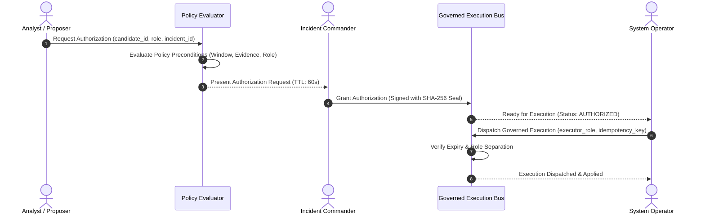
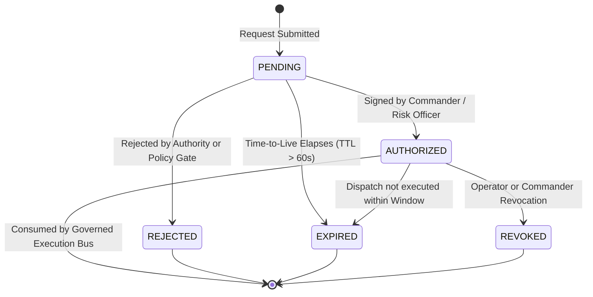

# Financial Immune System (FIS) — Phase 4 Authorization Model
**Document Identifier:** `FIS-P4-AUTH-003`  
**Classification:** Governed Policy & Cryptographic Authorization Specification  
**Truth Status:** `DERIVED` & `CRYPTOGRAPHIC_PROOF`

---

## 1. Governance Principles & Invariants

In high-consequence financial infrastructure, operational authority must be verifiable, auditable, and non-repudiable. The FIS authorization layer implements five non-negotiable rules:

1. **Explicit Authorization Artifacts:** Authorizations are discrete, tamper-evident objects with immutable timestamps and correlation digests.
2. **Deterministic Expiry:** Every authorization carries an explicit `expires_at` deadline (default: 60,000ms). Authorizations that elapse before technical dispatch become inert (`EXPIRED`).
3. **No Automatic Execution:** An authorization decision confers permission to execute, but does not execute the action. Execution requires a subsequent governed command dispatch.
4. **Separation of Duties:** Roles authorized to command actions (`INCIDENT_COMMANDER`, `RISK_OFFICER`) are barred from direct technical dispatch, and technical operators (`SYSTEM_OPERATOR`) cannot self-authorize.
5. **Fail-Closed Policy:** Incomplete evidence, stale signatures, or unmapped roles produce deterministic rejection (`REJECTED`).



---

## 2. Authorization Data Contracts

### A. Authorization Request Contract
```typescript
interface AuthorizationRequest {
  request_id: string;              // e.g. "REQ-CAND-01-DEP-ISO-M1K9"
  candidate_id: string;            // Target candidate identifier
  incident_id: string;             // Active incident correlation ID
  requester_user_id: string;       // User ID of proposer
  requester_role: UserRole;        // Role of proposer (e.g. "ANALYST")
  required_role: UserRole;         // Minimum authority required (e.g. "INCIDENT_COMMANDER")
  requested_at: string;            // ISO-8601 creation timestamp
  expires_at: string;              // ISO-8601 expiration deadline
  policy_eval_result: {
    role_authorized: boolean;      // True if requester is authorized to propose
    window_active: boolean;        // True if intervention window is open
    evidence_sufficient: boolean;  // True if required evidence records exist
    reasons: string[];             // Audit explanations
  };
}
```

### B. Authorization Decision Contract
```typescript
interface AuthorizationDecision {
  decision_id: string;             // e.g. "DEC-AUTH-M1K9A2"
  request_id: string;              // Linked request identifier
  candidate_id: string;            // Target candidate identifier
  decision: 'AUTHORIZED' | 'REJECTED' | 'EXPIRED' | 'REVOKED';
  decided_by_user_id: string;      // User ID of authorizer
  decided_by_role: UserRole;       // Role of authorizer (must have can_authorize)
  decided_at: string;              // ISO-8601 decision timestamp
  expires_at: string;              // Mandatory execution cutoff timestamp
  justification_notes: string;     // Free-text operational justification
  cryptographic_seal_sha256: string;// SHA-256 digest of decision tuple
}
```

---

## 3. Cryptographic Authorization Seal Formulation

To guarantee tamper evidence and prevent replay attacks, the authorization seal is generated via SHA-256 over the canonical decision payload:

$$\text{Payload} = \text{request\_id} \parallel \text{candidate\_id} \parallel \text{user\_id} \parallel \text{role} \parallel \Delta M_{\text{expected}} \parallel \text{decided\_at} \parallel \text{expires\_at}$$

$$\text{Seal} = \text{"sha256:"} \parallel \text{SHA256}(\text{Payload})_{[0:32]}$$

Any modification of candidate parameters or target entities invalidates the cryptographic seal, causing immediate execution rejection at the gateway.

---

## 4. Authorization Decision Lifecycle



---

## 5. Automated Verification Results

In acceptance testing (`test_phase4_lifecycle_governance.cjs` and `test_phase4_red_team.cjs`):
- `P4-06`: Attempting execution without prior authorization was deterministically rejected (`PASS`).
- `P4-26`: `SYSTEM_OPERATOR` self-authorization was rejected with `403 Forbidden` (`PASS`).
- `P4-07`: Interventions with status `REJECTED` were rejected at execution gateway (`PASS`).
- `P4-08` / `R6`: Interventions past their `expires_at` deadline failed execution with `EXPIRED_AUTHORIZATION` (`PASS`).
- `P4-09`: Interventions authorized by `INCIDENT_COMMANDER` executed successfully (`PASS`).
