# Financial Immune System (FIS) — Phase 4 Evidence Lineage & Audit Trail
**Document Identifier:** `FIS-P4-LINEAGE-008`  
**Classification:** Evidence Lineage & Immutable Audit Trail Specification  
**Truth Status:** `CRYPTOGRAPHIC_PROOF` & `DERIVED`

---

## 1. Lineage Architecture & Principles

In high-assurance operational intelligence, every action, authorization, and outcome must possess an unbroken cryptographic lineage. Merely recording logs is insufficient; logs can be altered, truncated, or forged.

The FIS evidence architecture guarantees:
1. **Unbroken Causal Lineage:** Every decision points directly to the triggering intelligence, authoritative events, and pre-action telemetry state.
2. **Tamper-Evident SHA-256 Digesting:** Critical records (requests, decisions, executions, observations, verifications) generate deterministic SHA-256 digests chained to previous events.
3. **Temporal Freshness Proofs:** Telemetry sampling records explicit millisecond timestamps to enforce freshness decay boundaries.
4. **Regulatory Audit Readiness:** Conforms with **DORA Article 14** (auditability of operational decisions) and **BCBS 239** (data lineage and completeness).

```mermaid
flowchart LR
    A["Event Detected (EVT)"] --> B["Control State Shift"]
    B --> C["Candidate Recommendation"]
    C --> D["Authorization Decision (DEC)"]
    D --> E["Governed Execution (EXEC)"]
    E --> F["Independent Observation (OBS)"]
    F --> G["Verification Record (VERIF)"]
    G --> H["Evidence Record (EVD)"]
    H --> I["Immutable Audit Trail"]
```



---

## 2. Chronological Operational Event Chain

The unified audit trail records eleven discrete operational milestones for every intervention lifecycle:

| Sequence | Milestone Event Type | Source Subsystem | Cryptographic Digest | Audit Role |
| :---: | :--- | :--- | :--- | :--- |
| **1** | `ANOMALY_DETECTED` | Telemetry Pipeline | `sha256(event_payload)` | Anomaly detection |
| **2** | `CONTROL_MARGIN_CHANGED` | Controllability Model | `sha256(margin_delta)` | Controllability shift |
| **3** | `INTERVENTION_RECOMMENDED`| Minimum Effective Engine | `sha256(candidate_tuple)`| Algorithmic MEI |
| **4** | `AUTHORIZATION_REQUESTED` | Operations Console | `sha256(request_tuple)` | Governance submission |
| **5** | `INTERVENTION_AUTHORIZED` | Authority Bus | `sha256(seal_payload)` | Commander approval |
| **6** | `EXECUTION_STARTED` | Enclave Gateway | `sha256(dispatch_tuple)`| Gateway dispatch |
| **7** | `INTERVENTION_EXECUTED` | Governed Execution Bus | `sha256(receipt_payload)`| Technical receipt |
| **8** | `INDEPENDENT_OBSERVATION` | Telemetry Probe | `sha256(observed_state)` | Unbiased measurement |
| **9** | `VERIFICATION_COMPLETED` | Independent Verifier | `sha256(verif_report)` | Expected vs Observed |
| **10**| `OUTCOME_CONFIRMED` | Independent Verifier | `sha256(outcome_tuple)` | State transition |
| **11**| `REASSESSMENT_COMPLETED` | Intelligence Engine | `sha256(post_margin)` | Closed-loop equilibrium |

---

## 3. Evidence Freshness Decay Model

Evidence freshness is evaluated on every verification pass:

$$\Delta t_{\text{freshness}} = t_{\text{verify}} - t_{\text{evidence}}$$

$$\text{FreshnessStatus} = \begin{cases}
\text{FRESH} & \text{if } \Delta t_{\text{freshness}} \le 60\text{ seconds} \\
\text{STALE} & \text{if } \Delta t_{\text{freshness}} > 60\text{ seconds}
\end{cases}$$

- **Operational Enforcement:** When $\text{FreshnessStatus} == \text{STALE}$, the verifier is prohibited from certifying control restoration, enforcing `VERIFIED_UNCERTAIN` and `CONTROL_UNVERIFIED`.
- **Empirical Proof:** Verified in `P4-19` and `R4` (`100% PASS`).

---

## 4. Audit Trail Data Schema

```typescript
interface AuditTrailEvent {
  audit_id: string;                    // e.g. "AUD-M1K9-4F2A"
  timestamp: string;                   // ISO-8601 millisecond timestamp
  event_type: string;                  // Milestone event type
  actor_role: string;                  // e.g. "INCIDENT_COMMANDER"
  actor_id: string;                    // User / service account identifier
  lifecycle_state: InterventionLifecycleState;
  intervention_id: string;             // Correlated intervention candidate
  details: string;                     // Operational explanation
  evidence_digest?: string;            // SHA-256 seal or receipt hash
}
```

---

## 5. Audit Inspection Endpoints

- `GET /api/foundry/audit-trail`: Returns chronological audit lineage stream.
- `POST /api/assurance/verify-integrity`: Validates SHA-256 digest chains across all stored evidence packages.
