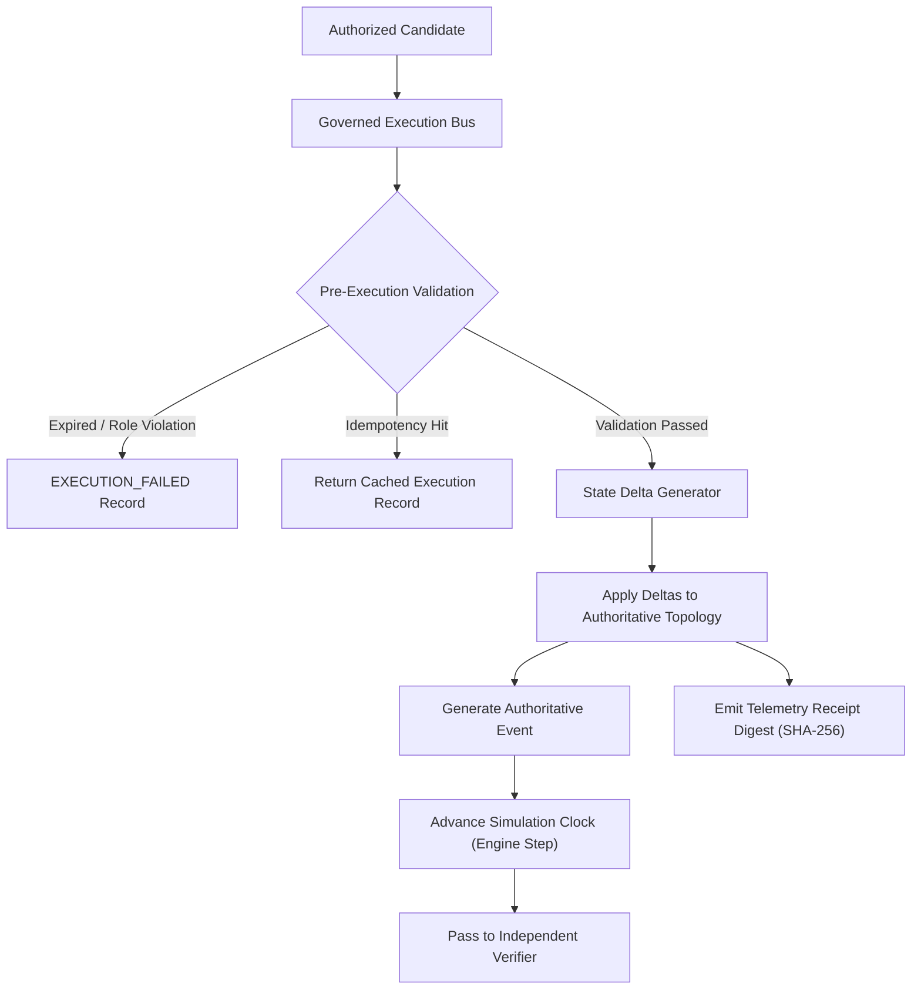

# Financial Immune System (FIS) — Phase 4 Execution Model
**Document Identifier:** `FIS-P4-EXEC-004`  
**Classification:** Technical Dispatch & Authoritative State Delta Specification  
**Truth Status:** `DERIVED` & `SIMULATED`

---

## 1. Execution Bus Architecture & Invariants

The Governed Execution Bus serves as the authoritative interface between high-level governance decisions and the underlying financial simulation topology. Execution is never a cosmetic UI trigger; every execution dispatches structured, multi-entity state transitions recorded directly in the shared system state.



---

## 2. Technical Execution Lifecycle

An execution request proceeds through five explicit technical states:

$$\text{QUEUED} \longrightarrow \text{VALIDATING} \longrightarrow \text{EXECUTING} \longrightarrow \begin{cases} \text{EXECUTED} & \text{(Telemetry Receipt Generated)} \\ \text{EXECUTION\_FAILED} & \text{(Gateway Timeout / Rail Failure)} \end{cases}$$

### Technical Execution Contract
```typescript
interface ExecutionRecord {
  execution_id: string;                    // e.g. "EXEC-CAND-01-DEP-ISO-K9A2"
  candidate_id: string;                    // Linked intervention ID
  authorization_id: string;                // Cryptographic authorization reference
  idempotency_key?: string;                // Client idempotency token
  executed_by_role: UserRole;              // Must be "SYSTEM_OPERATOR"
  executed_by_user_id: string;             // Dispatcher user identifier
  status: 'QUEUED' | 'VALIDATING' | 'EXECUTING' | 'EXECUTED' | 'EXECUTION_FAILED';
  dispatched_at: string;                   // ISO-8601 dispatch start
  completed_at?: string;                   // ISO-8601 gateway receipt
  execution_latency_ms: number;            // Gateway round-trip latency
  telemetry_receipt_digest_sha256: string; // SHA-256 proof of receipt
  state_deltas_applied_count: number;      // Number of graph mutations applied
  technical_error?: string;                // Error narrative if failed
}
```

---

## 3. Authoritative Topology State Deltas

When an intervention is dispatched, the bus applies real entity mutations depending on the intervention class:

| Intervention Class | Topology Mutations Applied | Affected Entity Types | State Delta Example |
| :--- | :--- | :--- | :--- |
| **`DEPENDENCY_ISOLATION`** | Set dependency status to `RECOVERING`. Isolate corrupted feed records. Restore provider load to nominal levels. | `DEPENDENCY`, `DATA_PROVIDER`, `INSTITUTION`, `INFRASTRUCTURE_NODE` | `DEP_DATA_X_BANK_A.status: COMPROMISED → RECOVERING` |
| **`MODEL_DIVERSIFICATION`** | Force AI model status to `STABLE`. Reset `effective_diversity_score = 0.78` and `herd_correlation_risk = 0.28`. | `AI_MODEL`, `INSTITUTION` | `MODEL-A.effective_diversity: 0.14 → 0.78` |
| **`DATA_QUARANTINE`** | Quarantine data provider ingest records. Set provider status to `RECOVERING`. | `DATA_PROVIDER` | `DATA-X.status: COMPROMISED → RECOVERING` |
| **`EXPOSURE_REDUCTION`** | Haircut interbank credit lines by 50%. Halve `exposure_weight`. | `DEPENDENCY` | `DEP_BANK_A_BANK_B.exposure_weight: 0.85 → 0.42` |
| **`TEMPORAL_STAGGERING`** | Inject 150-600ms network buffers across gateways. Reduce herd synchrony risk. | `AI_MODEL` | `MODEL-C.herd_correlation_risk: 0.78 → 0.38` |
| **`SELECTIVE_SUSPENSION`** | Disconnect non-compliant participant channels. Mark dependency `DISRUPTED`. | `DEPENDENCY` | `DEP_DATA_X_BANK_C.status: ACTIVE → DISRUPTED` |

---

## 4. Idempotency & Concurrency Safety

Repeated submissions of identical execution commands are safeguarded via an in-memory cache keyed by `idempotency_key` or `candidate_id:authorization_id`.
- If an execution request arrives with a previously processed key, the bus returns the existing `ExecutionRecord` without reapplying state deltas or emitting duplicate authoritative events.
- Tested and verified in `P4-28` and `R7` (`100% PASS`).

---

## 5. Technical Failure Modes

To demonstrate resilience under degraded infrastructure, the execution engine supports simulated technical failures:
- **Gateway Timeout:** Command packet dropped by transport rail gateway.
- **Result:** `status = EXECUTION_FAILED`, `state_deltas_applied_count = 0`, authoritative event `EXECUTION_FAILED` emitted with critical severity.
- **State Impact:** Authoritative Control Margin remains unmutated; no false recovery is reported.

---

## 6. Governed Operational Rollback

For interventions designated reversible (`reversibility !== 'IRREVERSIBLE'`), the system provides governed state rollback:

$$\text{Rollback}: \quad \mathcal{S}_{t+1} \longrightarrow \mathcal{S}_t \quad (\Delta_{\text{revert}} = \Delta^{-1})$$

1. **Authorization Gate:** Requires explicit authorization from `INCIDENT_COMMANDER` or `RISK_OFFICER`.
2. **Delta Reversal:** Reverts state deltas in reverse order of application.
3. **Irreversible Protection:** Interventions marked `IRREVERSIBLE` (e.g. `SELECTIVE_SUSPENSION`) are strictly blocked from rollback (`400 Bad Request`), preventing illegal state rollbacks.
