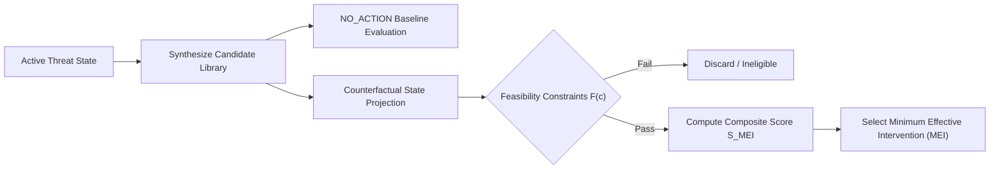

# Financial Immune System (FIS) — Phase 4 Intervention Methodology
**Document Identifier:** `FIS-P4-METH-002`  
**Classification:** Quantitative Intervention Synthesis & Optimization Specification  
**Truth Status:** `DERIVED` (Simulation Topology) & `EXPERIMENTAL` (Multi-Objective Optimization)

---

## 1. Mathematical Formulation of Minimum Effective Intervention (MEI)

In systemic financial networks, over-intervention (e.g. emergency global market halts or unilateral clearing freezes) often causes greater collateral economic destruction than the initiating disturbance. Conversely, under-intervention allows contagion cascades to breach the unrecoverable liquidity horizon.

The Financial Immune System introduces the **Minimum Effective Intervention (MEI)** principle:

$$\text{MEI} = \arg\max_{c \in \mathcal{C}} \mathcal{S}_{\text{MEI}}(c) \quad \text{subject to} \quad \mathcal{F}(c) = \text{TRUE}$$

Where:
- $\mathcal{C}$ is the active candidate intervention library.
- $\mathcal{S}_{\text{MEI}}(c)$ is the multi-objective utility score.
- $\mathcal{F}(c)$ is the hard feasibility constraint filter.

---

## 2. Multi-Objective Scoring Function

The composite objective function balances systemic control restoration against market disruption, operational latency, reversibility, and latent residual hazards:

$$\mathcal{S}_{\text{MEI}}(c) = w_R \cdot \Delta M(c) - w_D \cdot D(c) + w_V \cdot R_V(c) - w_L \cdot L(c) - P_{\text{residual}}(c)$$

### Parameter Specifications & Calibration

| Component | Notation | Weight | Formula / Range | Rationale |
| :--- | :---: | :---: | :--- | :--- |
| **Control Restoration** | $\Delta M(c)$ | $w_R = 1.8$ | $M_{\text{projected}}(c) - M_{\text{baseline}}$ | Prioritizes interventions returning $M(t) \ge 65\%$. |
| **Disruption Penalty** | $D(c)$ | $w_D = 1.2$ | Score $\in [0, 100]$ | Penalizes market friction and liquidity contraction. |
| **Reversibility Bonus** | $R_V(c)$ | $w_V = 1.0$ | $\text{HIGH}: +25, \text{MED}: +10, \text{IRREV}: -20$ | Rewards actions that can be safely rolled back. |
| **Execution Latency** | $L(c)$ | $w_L = 0.5$ | Latency in seconds | Penalizes actions that risk window expiration. |
| **Residual Hazard Penalty**| $P_{\text{residual}}$ | N/A | $\text{CRITICAL}: -80, \text{OTHER}: 0$ | Disqualifies flawed partial remedies. |

---

## 3. Mandatory Counterfactual Baseline (`NO_ACTION`)

Every evaluation cycle deterministically synthesizes `CAND-*-NO-ACTION` as the benchmark zero-intervention reference point:

$$\mathcal{B}_0 = \langle M_0, H_0, N_0, \text{EDD}_0 \rangle$$

- **Projected Margin Delta:** $\Delta M_{\text{no\_action}} = -\min(25, \max(12, \text{round}(0.40 \cdot M_{\text{current}})))$
- **Projected Propagation Hops:** $H_{\text{projected}} = \min(6, H_{\text{current}} + 2)$
- **Projected Affected Nodes:** $N_{\text{projected}} = \min(18, N_{\text{current}} + 5)$
- **Residual Risk:** Automatically designated `CRITICAL`.

By anchoring all candidate evaluations against $\mathcal{B}_0$, operators and algorithmic agents obtain transparent proof of:
1. Propagation hops prevented: $\Delta H(c) = H_{\text{projected}}(\mathcal{B}_0) - H_{\text{projected}}(c)$
2. Institutional nodes preserved: $\Delta N(c) = N_{\text{projected}}(\mathcal{B}_0) - N_{\text{projected}}(c)$
3. Control margin preserved: $\Delta M_{\text{net}}(c) = M_{\text{projected}}(c) - M_{\text{projected}}(\mathcal{B}_0)$

---

## 4. Intervention Taxonomy & Typologies

| Typology | Intervention Class | Typical Target Rails | Reversibility | Authority Level | Primary Use Case |
| :--- | :--- | :--- | :---: | :---: | :--- |
| **A** | `DEPENDENCY_ISOLATION` | Shared oracle/feed rails (`DATA-X`) | `HIGH` | `INCIDENT_COMMANDER` | Common data corruption / oracle spoofing. |
| **B** | `DEPENDENCY_ISOLATION` | RTGS payment rails (`INFRA-1`) | `HIGH` | `INCIDENT_COMMANDER` | Central clearinghouse & settlement congestion. |
| **C** | `DATA_QUARANTINE` | Model cache & ingest feeds | `HIGH` | `INCIDENT_COMMANDER` | Ingest quarantine without model retraining. |
| **D** | `MODEL_DIVERSIFICATION` | Institutional AI models (`MODEL-A`, `MODEL-C`)| `HIGH` | `INCIDENT_COMMANDER` | Collective algorithmic synchrony & herding. |
| **E** | `TEMPORAL_STAGGERING` | Order matching gateways | `HIGH` | `INCIDENT_COMMANDER` | Desynchronizing simultaneous liquidity drains. |
| **F** | `EXPOSURE_REDUCTION` | Bilateral credit lines | `MEDIUM` | `RISK_OFFICER` | Cross-bank fire-sale contagion ringfencing. |
| **G** | `SELECTIVE_SUSPENSION` | Rogue settlement nodes | `IRREVERSIBLE` | `COMPLIANCE_OFFICER` | Severe non-compliance / malicious entities. |
| **H** | `HUMAN_ESCALATION` | Sovereign discount window | `MEDIUM` | `RISK_OFFICER` | Intraday sovereign liquidity backstop. |

---

## 5. Feasibility Constraints & Ineligibility Filters

An intervention candidate $c$ is eligible for recommendation if and only if all predicates hold:

$$\mathcal{F}(c) = \begin{cases}
\text{TRUE} & \text{if } M_{\text{projected}}(c) \ge 65\% \land D(c) \le 50\% \land L(c) < T_{\text{window}} \land \text{Eligible}_{\text{Assurance}}(c) = \text{ELIGIBLE} \\
\text{FALSE} & \text{otherwise}
\end{cases}$$

When an active conflict exists between primary operational telemetry and immutable audit feeds, candidates that do not quarantine the conflicted rail are flagged `assurance_eligibility = BLOCKED` with reason `INSUFFICIENT ASSURANCE: Telemetry conflict detected`.
