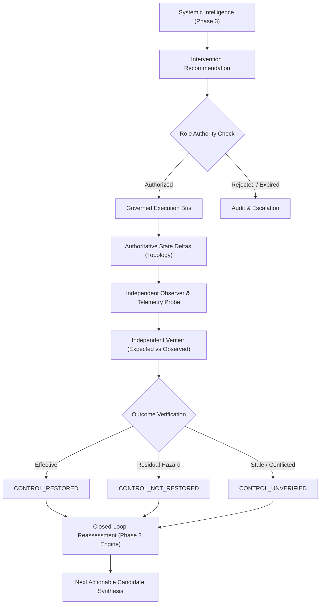
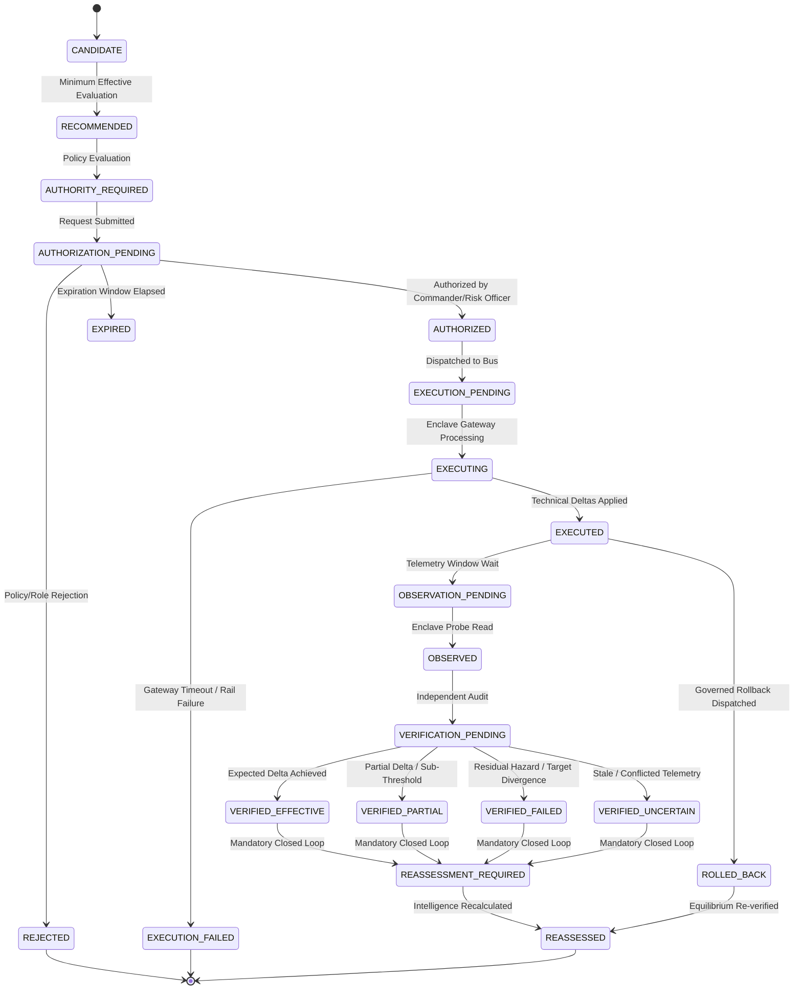

# Financial Immune System (FIS) — Phase 4 Operational Governance
**Document Identifier:** `FIS-P4-GOV-001`  
**Classification:** Research-Grade Operational Architecture & Governance Specification  
**Canonical Operational Loop:**  
$$\text{INTELLIGENCE} \longrightarrow \text{RECOMMENDATION} \longrightarrow \text{AUTHORITY CHECK} \longrightarrow \text{AUTHORIZATION} \longrightarrow \text{EXECUTION} \longrightarrow \text{INDEPENDENT OBSERVATION} \longrightarrow \text{VERIFICATION} \longrightarrow \text{OUTCOME} \longrightarrow \text{REASSESSMENT}$$

---

## 1. Executive Summary & Semantic Invariants

The Financial Immune System (FIS) transforms systemic financial risk management from passive statistical monitoring into a closed-loop, governed operational control architecture. Conventional risk engines stop at anomaly alerting or correlation dashboards. FIS establishes deterministic systemic control by enforcing strict boundaries between observation, recommendation, authorization, technical execution, independent verification, and ground-truth reassessment.

### Core Semantic Invariants
To eliminate superficial UI automation and guarantee research-grade integrity under adversarial auditing, the following eleven invariants are enforced:

1. **Risk $\neq$ Control:** Detecting high systemic fragility does not equate to preserving operational controllability.
2. **Hazard $\neq$ Priority:** A localized high-severity anomaly is not necessarily a systemic chokepoint.
3. **Recommendation $\neq$ Authorization:** Algorithmic recommendation confers zero execution capability.
4. **Authorization $\neq$ Execution:** Approved interventions require separate cryptographic dispatch.
5. **Execution $\neq$ Confirmation:** Successful technical command dispatch does not verify telemetry acceptance.
6. **Execution Success $\neq$ Outcome Recovery:** An isolation packet may execute flawlessly while contagion continues downstream across alternative unquarantined rails.
7. **Observation $\neq$ Interpretation:** Raw telemetry observations remain distinct from causal outcome attribution.
8. **Verifier Independence:** The verifier is logically separate from the executor and can disagree with execution claims.
9. **Stale Evidence Invalidation:** Evidence older than 60 seconds enforces `CONTROL_UNVERIFIED` and blocks premature restoration declarations.
10. **Conflicting Telemetry Fence:** Telemetry disagreement between operational feeds and audit trails triggers `CONFLICTED` status.
11. **Single Source of Truth:** All metrics emerge dynamically from the authoritative graph topology via the Phase 3 engine.

---

## 2. Canonical 22-State Intervention Lifecycle

The intervention state machine defines 22 deterministic lifecycle states. Arbitrary state jumps and frontend-only mutations are rejected server-side.

### State Transition Invariants
- **Entry Checks:** Transitions require correlation ID, incident ID, actor role, and cryptographic payload digest.
- **Expiry Enforcement:** Authorizations carry an explicit `expires_at` ISO-8601 deadline (default: 60s). Expired authorizations transition to `EXPIRED` and fail technical execution deterministically.
- **Idempotency:** Identical execution requests referencing the same `idempotency_key` return existing execution records without reapplying state deltas.

---

## 3. Server-Side Separation of Duties & RBAC Matrix

To prevent unauthorized operations and self-authorization loopholes, role permissions are strictly validated server-side against `ROLE_PERMISSIONS_REGISTRY`:

| Role Name | Authority Scope | Propose | Authorize | Execute Technical | Mutate State | Audit / Verify |
| :--- | :--- | :---: | :---: | :---: | :---: | :---: |
| **OBSERVER** | Non-operational read-only telemetry | ❌ | ❌ | ❌ | ❌ | ❌ |
| **ANALYST** | Contagion modeling & proposal synthesis | ✅ | ❌ | ❌ | ❌ | ❌ |
| **INCIDENT_COMMANDER** | Emergency intervention governance | ✅ | ✅ | ❌ | ❌ | ❌ |
| **RISK_OFFICER** | Limit haircut & exposure governance | ✅ | ✅ | ❌ | ❌ | ❌ |
| **COMPLIANCE_OFFICER** | Regulatory compliance & dual-key signoff | ❌ | ✅ | ❌ | ❌ | ❌ |
| **SYSTEM_OPERATOR** | Technical dispatch & rollback execution | ❌ | ❌ | ✅ | ✅ | ❌ |
| **AUDITOR** | Cryptographic verification review | ❌ | ❌ | ❌ | ❌ | ✅ |

### Non-Negotiable RBAC Constraints
1. **No Self-Authorization:** A `SYSTEM_OPERATOR` is strictly prohibited from authorizing interventions. Execution requires authorization signed by an `INCIDENT_COMMANDER`, `RISK_OFFICER`, or `COMPLIANCE_OFFICER`.
2. **No Analyst Dispatch:** An `ANALYST` can analyze propagation and request intervention authorization, but cannot dispatch execution commands.
3. **No Auditor Mutation:** An `AUDITOR` is strictly read-only and cannot mutate graph or incident state.

---

## 4. Verification Gate Summary

All 12 lifecycle and governance acceptance tests (Suite 1: `test_phase4_lifecycle_governance.cjs`) passed with 100% compliance:
- `P4-01` through `P4-05`: Recommendation synthesis and attribute validation (`PASS`)
- `P4-06`: Unauthorized execution blocked (`PASS`)
- `P4-26`: Server-side separation of duties (`SYSTEM_OPERATOR` self-authorization rejected 403) (`PASS`)
- `P4-07`: Rejected authorization blocked (`PASS`)
- `P4-09`: Valid `INCIDENT_COMMANDER` authorization granted (`PASS`)
- `P4-10`: Governed dispatch executed (`PASS`)
- `P4-28`: Idempotent deduplication verified (`PASS`)
- `P4-11`: Gateway failure handling verified (`PASS`)
