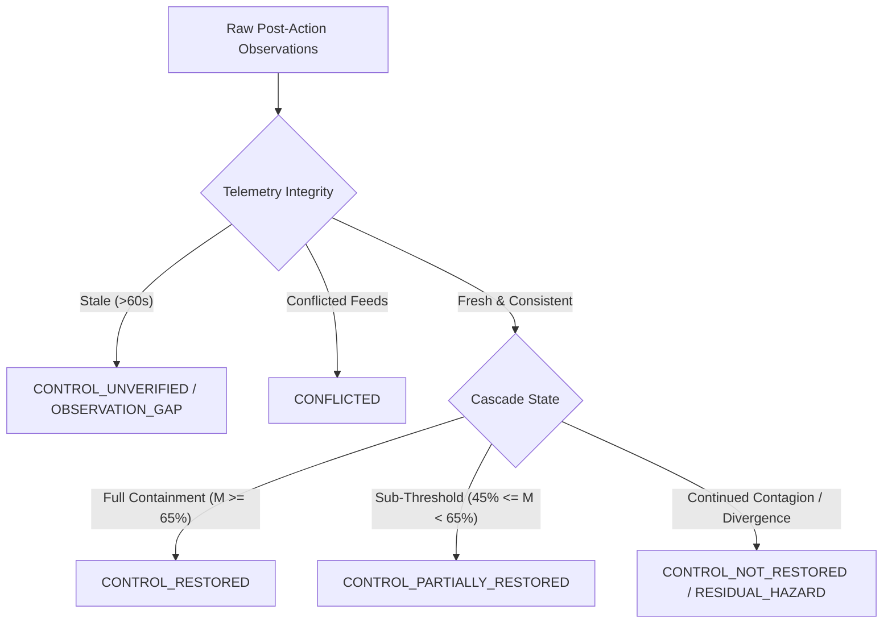
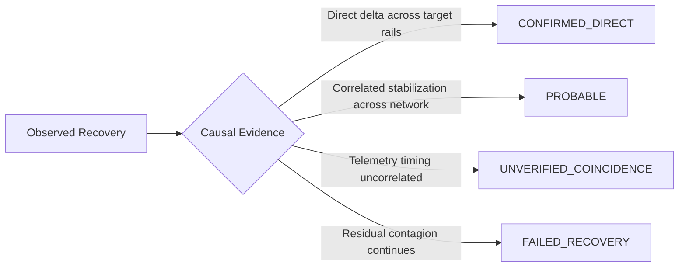

# Financial Immune System (FIS) — Phase 4 Outcome Taxonomy
**Document Identifier:** `FIS-P4-OUT-006`  
**Classification:** Operational Outcome & Causal Attribution Taxonomy  
**Truth Status:** `DERIVED` & `SIMULATED`

---

## 1. Rationale: The Failure of Binary Recovery

Conventional automated platforms reduce operational intervention outcomes to a simplistic binary:
$$\text{Outcome} \in \{\text{SUCCESS}, \text{FAILURE}\}$$

In interconnected systemic financial networks, binary outcomes are dangerous falsehoods. An intervention can:
- Execute without errors yet fail to prevent downstream contagion.
- Restore primary clearing rails while leaving algorithmic fire-sales active in secondary markets.
- Appear successful due to stale telemetry when real risk continues compounding.
- Induce an unobservable non-event where catastrophe was averted but cannot be directly observed without counterfactual baseline accounting.

The Financial Immune System implements an expressive, non-binary outcome taxonomy.

---

## 2. Canonical Observed Outcome Vocabulary

| Outcome State | Operational Definition | Systemic Implication | Next Mandated Action |
| :--- | :--- | :--- | :--- |
| **`CONTROL_RESTORED`** | Control Margin recovered to $\ge 65\%$, cascade velocity is $0.0\text{ nodes/s}$, and all residual hazard flags are cleared. | Normal equilibrium restored within risk tolerance. | Return to baseline continuous monitoring. |
| **`CONTROL_PARTIALLY_RESTORED`** | Cascade velocity suppressed, but Control Margin remains sub-threshold ($45\% \le M(t) < 65\%$). | Fragility persists; vulnerable to secondary shocks. | Trigger secondary exposure reduction or liquidity buffer. |
| **`CONTROL_NOT_RESTORED`** | Intervention executed, but downstream contagion continues or target nodes continue degrading. | Primary intervention was insufficient or bypassed. | Mandatory emergency escalation and candidate synthesis. |
| **`CONTROL_UNVERIFIED`** | Telemetry evidence is stale ($>60\text{s}$) or incomplete. Restoration cannot be attested. | Enclave cannot verify physical truth of system state. | Invalidate previous recovery claim; refresh audit probes. |
| **`RESIDUAL_HAZARD`** | Primary rail cleared, but unquarantined decision tensors or collateral fire-sales detected in secondary nodes. | Latent contagion active beneath surface stabilization. | Immediate multi-vector quarantine and collateral backstop. |
| **`CONFLICTED`** | Operational feed reports stabilization while audit feed reports ongoing distress. | Unresolved telemetry desynchronization or spoofing. | Apply state fence; perform cross-oracle reconciliation. |
| **`INTERVENTION_CONDITIONED_NON_EVENT`** | Catastrophic collapse prevented through preemptive action, evidenced by counterfactual divergence vs $\mathcal{B}_0$. | Containment achieved prior to observable damage. | Record counterfactual attribution and close incident. |
| **`OBSERVATION_GAP`** | Network or enclave partition prevents sampling of critical Tier-1 nodes. | Blind spot in systemic situational awareness. | Dispatch auxiliary polling probe; restrict limits. |
| **`UNRESOLVED`** | Contagion dynamics still in transit; insufficient ticks have elapsed to determine trajectory. | Transient state awaiting propagation settlement. | Await next clock tick for secondary observation. |

---

## 3. Causal Attribution Framework

The verifier assigns an explicit causal attribution rating to separate real operational efficacy from coincidence or exogenous market fluctuations:

### Attribution Classes
1. **`CONFIRMED_DIRECT`:** Direct state deltas on target dependencies correlate with immediate cessation of downstream cascade.
2. **`PROBABLE`:** Target stabilized, but network effects may have contributed to broader recovery.
3. **`UNVERIFIED_COINCIDENCE`:** Recovery timing diverges from execution latency; potential exogenous recovery.
4. **`FAILED_RECOVERY`:** Technical command succeeded, but causal chain failed to halt systemic transmission.

---

## 4. Operational Alignment

This non-binary taxonomy aligns directly with international supervisory frameworks:
- **BCBS 239 (Risk Data Aggregation):** Mandates explicit handling of data gaps and unverified risk positions.
- **DORA Article 14 (Operational Resilience):** Requires independent post-incident verification and residual risk disclosure.
