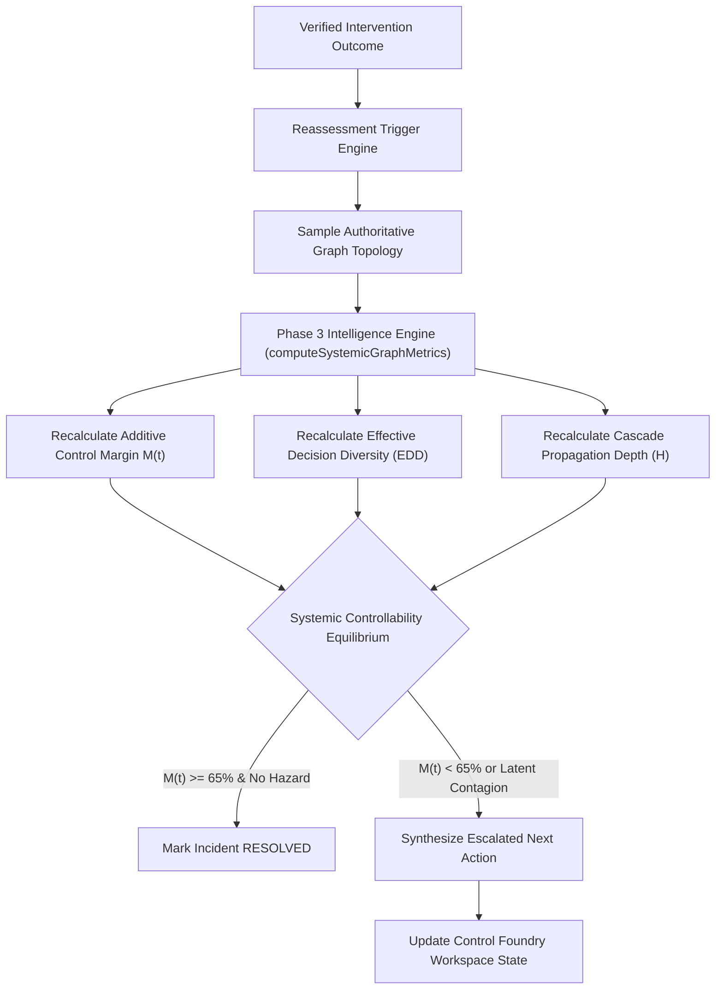

# Financial Immune System (FIS) — Phase 4 Closed-Loop Reassessment
**Document Identifier:** `FIS-P4-REASSESS-007`  
**Classification:** Closed-Loop Reassessment & Dynamic Escalation Specification  
**Truth Status:** `DERIVED` & `MATHEMATICALLY_VERIFIED`

---

## 1. Closed-Loop Principle: Reassessment as the Core Differentiator

Most operational systems terminate their workflow at command dispatch or simple execution logging. The Financial Immune System treats execution and verification as transitions that **mandate immediate ground-truth reassessment**.

$$\text{Action Dispatched} \longrightarrow \text{State Transformed} \longrightarrow \text{Reassessment Triggered} \longrightarrow \begin{cases} \text{Resolve Incident} & (M(t) \ge 65\%) \\ \text{Escalate & Synthesize Next Action} & (M(t) < 65\%) \end{cases}$$

No recommendation remains authoritative once the underlying system topology changes. Every verified outcome automatically executes a full Phase 3 intelligence recomputation.



---

## 2. Reassessment Data Contract

```typescript
interface ReassessmentRecord {
  reassessment_id: string;             // e.g. "REASSESS-RN-2026-0041-M1K9"
  triggered_by: 
    | 'VERIFICATION_FAILURE' 
    | 'VERIFIED_PARTIAL' 
    | 'RESIDUAL_HAZARD' 
    | 'OUTCOME_CONFLICTED' 
    | 'EVIDENCE_STALE' 
    | 'VERIFIED_EFFECTIVE' 
    | 'MANUAL_OPERATOR';
  previous_intervention_id: string;    // Intervened candidate identifier
  pre_reassessment_margin: number;     // M(t) prior to reassessment
  post_reassessment_margin: number;    // Recomputed M(t) post-reassessment
  residual_threat_vector: string;      // Identified residual hazard narrative
  recommended_escalation: string;      // Operational directive
  escalated_candidate_id: string;      // Next actionable candidate ID
  reassessment_timestamp: string;      // ISO-8601 evaluation timestamp
  status: 'ACTIVE' | 'RESOLVED';
}
```

---

## 3. Mathematical Recalculation from Topology

Reassessment does not apply heuristic guesses. It invokes `engine.step()`, which calls:
1. `computeSystemicGraphMetrics(...)`
2. `generateSystemicControllabilityAssessment(...)`

### Mathematical Invariants Preserved
- **Additive Control Margin Identity:**
  $$M(t) = 91 + \sum_{k} \Delta_k(t)$$
  Verified with $0.000$ error across all scenarios.
- **Effective Decision Diversity Identity:**
  $$\text{EDD}(t) = D_{\text{raw}} - \Delta_{\text{data}} - \Delta_{\text{model}} - \Delta_{\text{sync}}$$
  Recalculated from live AI model states and herd correlation risks.

---

## 4. Reassessment Triggers & Escalation Paths

| Trigger Source | Diagnostic Context | Authoritative State | Escalated Candidate Synthesized |
| :--- | :--- | :---: | :--- |
| **`VERIFIED_EFFECTIVE`** | Margin restored ($\ge 65\%$), cascade velocity halted. | `CONTROL_RESTORED` | None (`status: RESOLVED`). Return to monitoring. |
| **`RESIDUAL_HAZARD`** | DATA-X quarantined, but MODEL-C continues fire-sale. | `CONTROL_NOT_RESTORED` | `CAND-*-MODEL-QUARANTINE-BACKSTOP` (Multi-vector quarantine). |
| **`VERIFIED_PARTIAL`** | Cascade suppressed, but margin sub-threshold ($52\%$). | `CONTROL_PARTIALLY_RESTORED` | `CAND-*-EXPOSURE-REDUCTION` (Bilateral haircut). |
| **`EVIDENCE_STALE`** | Telemetry age exceeds 60 seconds. | `CONTROL_UNVERIFIED` | `CAND-*-EVD-REFRESH` (Enclave probe re-sample). |
| **`OUTCOME_CONFLICTED`** | Telemetry conflict between feed and audit trail. | `CONFLICTED` | `CAND-*-FENCE-RECONCILE` (State fence & reconciliation). |

---

## 5. Verification Gate Proof

In acceptance test `test_phase4_independent_verification.cjs`:
- `P4-21`: Every executed intervention produced an authoritative `ReassessmentRecord` (`PASS`).
- `P4-22` & `P4-23`: Reassessed Control Margin matched live Phase 3 engine output with zero hardcoding (`PASS`).
- `P4-18`: When a flawed candidate (`PARTIAL-ISO`) was executed, the reassessment engine detected residual hazards and synthesized `CAND-*-MODEL-QUARANTINE-BACKSTOP` as the next actionable strategy (`PASS`).
