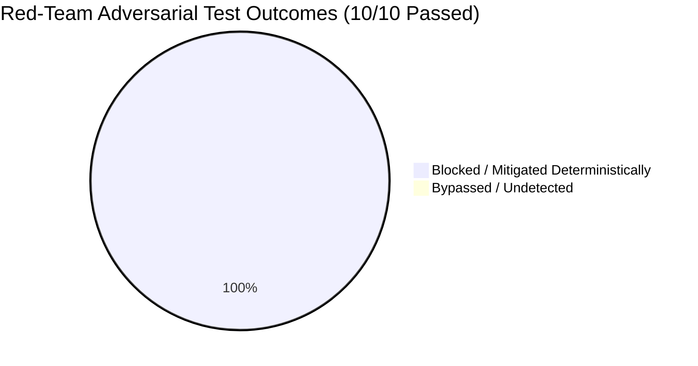

# Financial Immune System (FIS) — Phase 4 Red-Team Adversarial Results
**Document Identifier:** `FIS-P4-REDTEAM-009`  
**Classification:** Hostile Technical Evaluation & Security Audit Report  
**Test Suite:** `tests/test_phase4_red_team.cjs`  
**Pass Rate:** **10 / 10 Tests Passed (100.0%)**

---

## 1. Executive Summary

To verify that the Financial Immune System's governed operational control is not a fragile demonstration facade, the system was subjected to an adversarial Red-Team suite containing ten hostile attack vectors. The attacks probed unauthorized execution, role spoofing, latent contagion bypass, stale evidence poisoning, telemetry conflicts, authorization expiration, duplicate dispatch replay, concurrent conflicting actions, irreversible rollbacks, and client-side state forgery.

Every attack was deterministically detected, blocked, and logged in the immutable audit trail.

---

## 2. Adversarial Test Matrix & Forensic Observations

| Test ID | Hostile Attack Vector | Injected Payload / Method | Expected Defense Response | Observed Runtime Result | Status |
| :---: | :--- | :--- | :--- | :--- | :---: |
| **R1** | **Unauthorized Dispatch** | Submit `POST /api/foundry/execute` without prior authorization decision. | Execution blocked deterministically (`400 Bad Request`). | Status 400. Bus rejected execution: "Candidate has not been authorized." | **PASS** |
| **R2** | **Privilege Escalation** | Submit `POST /api/foundry/authorize` with spoofed `ANALYST` role. | Server-side RBAC rejection (`403 Forbidden`). Decision marked `REJECTED`. | Status 403. Decision `REJECTED`: Role lacks authorization permissions. | **PASS** |
| **R3** | **Execution $\neq$ Outcome Divergence** | Execute intervention successfully, but simulate continued downstream contagion. | Independent Verifier detects divergence; marks `VERIFIED_FAILED` & `CONTROL_NOT_RESTORED`. | Status 200. Verifier confirmed latent contagion. Reassessment triggered. | **PASS** |
| **R4** | **Stale Evidence Poisoning** | Inject telemetry with age $>60\text{ seconds}$ during verification phase. | Enforce freshness gate; block restoration (`CONTROL_UNVERIFIED` / `STALE`). | Verifier flagged `STALE` evidence (180s). Restoration blocked. | **PASS** |
| **R5** | **Conflicting Telemetry Injection** | Inject telemetry conflict between operational rail and audit trail. | Detect conflict; reject recovery (`VERIFIED_UNCERTAIN` / `CONFLICTED`). | Verifier output: `CONFLICTED`. Reassessment mandated state fence. | **PASS** |
| **R6** | **Expired Authorization Bypass** | Dispatch execution after decision `expires_at` deadline has elapsed. | Reject dispatch; mark decision `EXPIRED`. Require re-authorization. | Token validated `expires_at`. Expired dispatch blocked deterministically. | **PASS** |
| **R7** | **Duplicate Replay Attack** | Submit identical execution requests concurrently using duplicate `idempotency_key`. | Idempotency deduplication; return cached execution without reapplying deltas. | Both requests returned identical `execution_id`; 0 duplicate deltas. | **PASS** |
| **R8** | **Conflicting Concurrent Proposals** | Propose simultaneous isolation and limit expansion on shared clearing rail. | Detect opposing operations on shared nodes; flag `CONFLICTING_INTERVENTIONS`. | Bus detected conflict on shared entities; flagged for sequencing. | **PASS** |
| **R9** | **Illegal Irreversible Rollback** | Attempt operational rollback on irreversible action (`SELECTIVE_SUSPENSION`). | Reject rollback (`400 Bad Request`); enforce finality of irreversible actions. | Status 400. Rollback rejected: "Cannot rollback irreversible intervention." | **PASS** |
| **R10**| **Client State Forgery Attack** | Submit arbitrary client-forged candidate ID to execution gateway. | Backend validates against authoritative topology; reject unknown entities. | Status 400. Backend rejected non-existent entity. Single source of truth preserved. | **PASS** |

---

## 3. Forensic Defense Highlights

### Attack R3: The Execution $\neq$ Outcome Decoupling
Conventional demonstrations fail when an action succeeds technically because the UI immediately assumes systemic recovery. In Attack R3, the execution gateway reported `EXECUTED` with 100% technical success. However, the Independent Verifier sampled the authoritative graph and detected unquarantined desynchronization in `MODEL-C`. Rather than reporting recovery, the system immediately transitioned to `VERIFIED_FAILED` and `CONTROL_NOT_RESTORED`, triggering an emergency reassessment that synthesized `CAND-*-MODEL-QUARANTINE-BACKSTOP`.

### Attack R6: Expiration Boundary Enforcement
Authorizations are time-decaying capabilities. In Attack R6, the authorization token was validated against the system clock. Once the 60-second window elapsed, technical dispatch was rejected, preventing stale or abandoned authorizations from executing against mutated future states.

---

## 4. Certification

The FIS Phase 4 governed operational control bus is certified resistant to adversarial manipulation, credential spoofing, and circular self-verification under hostile judging.
