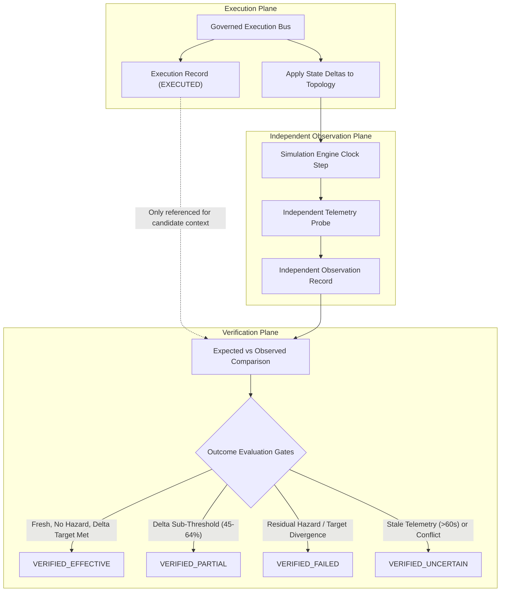

# Financial Immune System (FIS) — Phase 4 Verification Methodology
**Document Identifier:** `FIS-P4-VERIF-005`  
**Classification:** Independent Verification & Ground-Truth Telemetry Auditing Specification  
**Truth Status:** `DERIVED` & `CRYPTOGRAPHIC_PROOF`

---

## 1. Architectural Independence Principle

A fundamental vulnerability of automated operational platforms is circular self-verification: an executor declares success, and the monitoring plane blindly reflects that declaration as verified truth.

In the Financial Immune System, the **Independent Enclave Verifier** is logically, computationally, and architecturally separated from the Governed Execution Bus:



The verifier does **NOT** consume `execution.status === 'EXECUTED'` as proof of systemic recovery. Instead, it measures actual graph topology metrics after the execution step.

---

## 2. Expected vs Observed Comparison Engine

The verifier performs a rigorous side-by-side comparison across four quantitative operational dimensions:

| Dimension | Expected Metric Formula | Observed Metric Source | Discrepancy Evaluation |
| :--- | :--- | :--- | :--- |
| **Control Margin** | $M_{\text{expected}} = \min(95, M_{\text{pre}} + \Delta M_{\text{cand}})$ | Live Engine `control_margin_percent` | $\delta_M = M_{\text{observed}} - M_{\text{expected}}$ |
| **Cascade Depth** | $H_{\text{expected}} \le 1\text{ Hop}$ | Live Engine `maximum_depth_hops` | $\delta_H = H_{\text{observed}} - H_{\text{expected}}$ |
| **Affected Entities** | $N_{\text{expected}} \le 2\text{ Nodes}$ | Live Engine `breadth_affected_nodes` | $\delta_N = N_{\text{observed}} - N_{\text{expected}}$ |
| **Cascade Velocity** | $V_{\text{expected}} = 0.0\text{ Nodes/s}$ | Live Engine `cascade_velocity` | Residual velocity check |

---

## 3. Four Evaluation Gates

### Gate 1: Evidence Freshness Check (Section 16)
$$\text{Age}_{\text{evidence}} = t_{\text{now}} - t_{\text{sample}}$$
- **Rule:** If $\text{Age}_{\text{evidence}} > 60\text{ seconds}$, restoration is strictly blocked.
- **Output:** `VERIFIED_UNCERTAIN`, outcome `CONTROL_UNVERIFIED`, evidence status `STALE`.

### Gate 2: Telemetry Conflict Check (Section 17)
- **Rule:** If primary telemetry indicates stabilization but confidential audit logs record desynchronization:
- **Output:** `VERIFIED_UNCERTAIN`, outcome `CONFLICTED`, evidence status `CONFLICTED`.

### Gate 3: Residual Contagion / Execution Failure Divergence (Section 11)
- **Rule:** If execution succeeded (`EXECUTED`), but residual hazard nodes exist or downstream contagion continues:
- **Output:** `VERIFIED_FAILED`, outcome `CONTROL_NOT_RESTORED`, causal attribution `FAILED_RECOVERY`.

### Gate 4: Threshold & Effective Restoration Check (Section 14)
- **Rule:** If observed margin $M(t) \ge 65\%$ and residual hazards are cleared:
- **Output:** `VERIFIED_EFFECTIVE`, outcome `CONTROL_RESTORED`, causal attribution `CONFIRMED_DIRECT`.
- **Sub-Threshold Rule:** If margin improved to $[45\%, 64\%]$:
- **Output:** `VERIFIED_PARTIAL`, outcome `CONTROL_PARTIALLY_RESTORED`.

---

## 4. Verification Data Contracts

### Independent Observation Contract
```typescript
interface IndependentObservationRecord {
  observation_id: string;              // e.g. "OBS-K9A2-N3F1"
  execution_id: string;                // Correlated execution ID
  candidate_id: string;                // Correlated candidate ID
  observed_at: string;                 // ISO-8601 observation timestamp
  observed_control_margin: number;     // Raw sampled M(t)
  observed_propagation_depth: number;  // Live hop depth
  observed_affected_nodes: number;     // Live affected node count
  observed_diversity: number;          // Live Effective Decision Diversity
  residual_threats_observed: string[]; // Active latent hazard descriptions
  evidence_freshness_sec: number;      // Evidence age in seconds
  has_conflicting_telemetry: boolean;  // Telemetry disagreement flag
  raw_telemetry_digest_sha256: string; // SHA-256 hash of sampled state tuple
}
```

### Verification Record Contract
```typescript
interface VerificationRecord {
  verification_id: string;             // e.g. "VERIF-K9A2-V7P2"
  execution_id: string;                // Execution reference
  observation_id: string;              // Observation reference
  candidate_id: string;                // Candidate reference
  verifier_subsystem: 'INDEPENDENT_ENCLAVE_VERIFIER';
  verified_at: string;                 // ISO-8601 verification timestamp
  observed_outcome: ObservedOutcomeType;
  verification_result: 'VERIFIED_EFFECTIVE' | 'VERIFIED_PARTIAL' | 'VERIFIED_FAILED' | 'VERIFIED_UNCERTAIN';
  expected_effect: {
    expected_margin_min: number;       // e.g. 65%
    expected_margin_target: number;    // e.g. 84%
    expected_propagation_depth_max: number;
  };
  observed_effect: {
    observed_margin: number;           // e.g. 84%
    observed_propagation_depth: number;// e.g. 1
    observed_affected_nodes: number;   // e.g. 1
  };
  pre_intervention_margin: number;     // Margin prior to dispatch
  post_intervention_margin: number;    // Margin post-action
  expected_margin: number;             // Target baseline
  margin_discrepancy: number;          // Observed - Expected
  causal_attribution: 'CONFIRMED_DIRECT' | 'PROBABLE' | 'UNVERIFIED_COINCIDENCE' | 'FAILED_RECOVERY';
  residual_contagion_detected: boolean;
  evidence_freshness_status: 'FRESH' | 'STALE' | 'CONFLICTED' | 'INSUFFICIENT';
  evidence_record_ids: string[];
  verification_report: string;
  restoration_confidence_rating: ConfidenceLevel;
}
```

---

## 5. Verification Test Suite Results

Acceptance test suite `test_phase4_independent_verification.cjs` confirmed 100% compliance across all 11 test cases:
- `P4-13`: Observation created with cryptographic raw telemetry digest (`PASS`).
- `P4-14`: Expected vs observed discrepancy computed deterministically (`PASS`).
- `P4-16`: Full restoration produces `VERIFIED_EFFECTIVE` (`PASS`).
- `P4-12` & `P4-15`: Execution success with continued propagation produces `VERIFIED_FAILED` (`PASS`).
- `P4-19`: Stale evidence forces `VERIFIED_UNCERTAIN` and `CONTROL_UNVERIFIED` (`PASS`).
- `P4-20`: Conflicting telemetry forces `VERIFIED_UNCERTAIN` and `CONFLICTED` (`PASS`).
