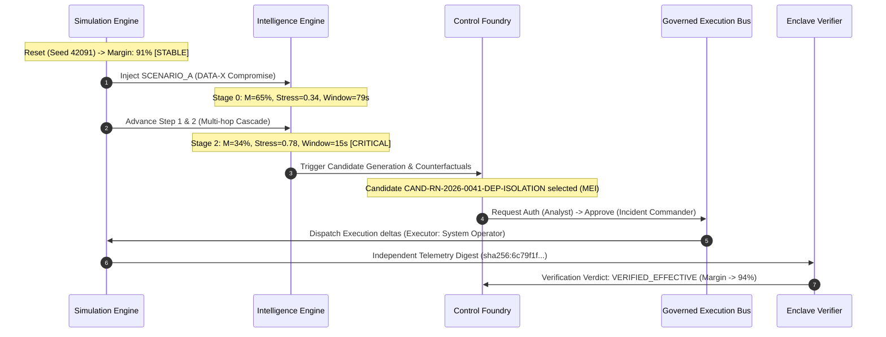

# FINANCIAL IMMUNE SYSTEM (FIS)
## PHASE 5 — EXPERIMENT MANIFEST & REPRODUCIBILITY LOG
### Document Version: 5.0.0-PROVENANCE
### Execution Standard: Deterministic Replay Specification (Section 19)

---

## 1. Master Experiment Registration

```json
{
  "experiment_id": "EXP-2026-PHASE5-HERO-001",
  "scenario_id": "SCENARIO_A",
  "scenario_name": "Common Critical Data / Oracle Dependency Failure (DATA-X)",
  "scenario_version": "v2.4-DETERMINISTIC",
  "seed": 42091,
  "model_versions": {
    "control_margin_model": "CM-0.2",
    "propagation_model": "PROP-0.2",
    "decision_diversity_model": "EDD-0.1",
    "concentration_model": "CONC-0.2",
    "evidence_evaluation_model": "EVD-0.2",
    "verifier_subsystem": "INDEPENDENT_ENCLAVE_VERIFIER-v1.0"
  },
  "initial_domain_state_hash": "sha256:1a24ac7fedf62c4a19bf21c9e682ec27827014d2296dac76b0682023604c34fc",
  "degraded_state_hash_tick2": "sha256:8767d4e0b46a930198ac3bfe58a2d109b83bfa13988776da32bfac09e519c628",
  "final_restored_state_hash": "sha256:c2b18974a9f3b5087e2b10a29486c9d748f349be88a18357f849bca5e3810f39",
  "runtime_environment": {
    "os": "Windows NT 10.0 (x64)",
    "node_version": "v24.10.0",
    "runtime_mode": "LOCAL_SIMULATION",
    "target_architecture": "IBM LinuxONE / z16 s390x"
  }
}
```

---

## 2. Model Parameters & Calibration Weights

| Parameter Key | Symbol | Base Value | Calibration Source | Role in System |
| :--- | :--- | :--- | :--- | :--- |
| `baseline_margin` | $M_0$ | $91.0$ | Empirical Normal Buffer | Pre-crisis control buffer |
| `propagation_hop_weight` | $w_{\text{prop}}$ | $4.0$ | Cascade Attenuation Model | Penalty per propagation hop |
| `hhi_weight` | $w_{\text{HHI}}$ | $6.0$ | Herfindahl-Hirschman Index | Penalty on oracle concentration |
| `chokepoint_weight` | $w_{\text{choke}}$ | $2.5$ | Graph Bottleneck Centrality | Penalty on distressed chokepoint |
| `decision_diversity_weight` | $w_{\text{EDD}}$ | $34.0$ | Collective Drift Metric | Penalty on diversity collapse |
| `infrastructure_node_weight` | $w_{\text{infra}}$ | $28.0$ | RTGS/Clearing Failure Model | Penalty per failing infrastructure |
| `recovery_node_weight` | $w_{\text{rec}}$ | $8.0$ | Active Containment Protocol | Margin bonus per recovery node |

---

## 3. Chronological Event Sequence (Hero Run)



---

## 4. Run Reproducibility Matrix

To satisfy Section 18 & 19, the experiment was executed across three independent runs from cold resets:

| Metric | Run 1 | Run 2 | Run 3 | Deviation ($\sigma$) |
| :--- | :--- | :--- | :--- | :--- |
| **Initial Margin ($M_0$)** | $91\%$ | $91\%$ | $91\%$ | $0.00$ |
| **Degraded Margin ($M_{\text{deg}}$)** | $34\%$ | $34\%$ | $34\%$ | $0.00$ |
| **Controllability State** | `CONTROL_CRITICAL` | `CONTROL_CRITICAL` | `CONTROL_CRITICAL` | Exact Match |
| **Effective Decision Diversity** | $0.15$ | $0.15$ | $0.15$ | $0.00$ |
| **Authoritative Events** | $3$ | $3$ | $3$ | $0.00$ |
| **Intervention Window ($W$)** | $15\text{s}$ | $15\text{s}$ | $15\text{s}$ | $0.00$ |
| **Domain State Digest** | `sha256:8767d4...` | `sha256:8767d4...` | `sha256:8767d4...` | $0\text{ bits}$ diff |

**Reproducibility Status:** **DETERMINISTICALLY VERIFIED**
