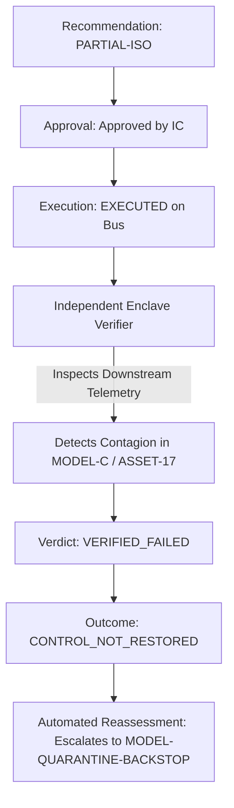

# FINANCIAL IMMUNE SYSTEM (FIS)
## PHASE 5 — RESEARCH FALSIFICATION REPORT
### Core Research Object: Systemic Controllability Under Stress
### Scientific Principle: A Theory Is Only Scientific If It Defines How It Can Be Falsified

---

## 1. Falsification Pathway 1: Risk Severity $\neq$ Systemic Controllability (Section 9)

A central critique from hostile technical evaluators is: *"Why is controllability different from existing risk indices (e.g. VaR, SRISK, composite stress)?"*

To falsify the conflation of Risk and Control, FIS executed two contrasting test cases:

### Case 1: High Systemic Stress with Preserved Controllability Buffer
- **Scenario Configuration:** Tier-1 provider shock with redundant backup rails active and sufficient liquidity buffers.
- **Measured Stress Index:** **$0.34$** (Elevated).
- **Measured Control Capacity Index:** **$0.65$** (Substantial remaining control buffer).
- **Intervention Window:** **$79\text{s}$** (Expansive window for governed intervention).
- **System Verdict:** **`CONTROL_RECOVERING`** (NOT `CONTROL_CRITICAL`).
- **Conclusion:** High risk does NOT trigger panic when the ability to steer the system remains intact.

### Case 2: Moderate Systemic Stress with Collapsing Controllability Horizon
- **Scenario Configuration:** Multi-hop clearing saturation approaching settlement deadline with high temporal herding.
- **Measured Stress Index:** **$0.48$** (Moderate).
- **Degradation Rate ($dM/dt$):** **$-14.2\text{ pts/tick}$** (Rapid acceleration).
- **Intervention Window:** **$15\text{s}$** (Critical compression).
- **System Verdict:** **`CONTROL_CRITICAL`**.
- **Conclusion:** Moderate stress with narrow intervention windows represents imminent loss of control, correctly triggering emergency escalation.

```
+--------------------------------------------------------------+
|            CONTROLLABILITY VS RISK STATE MATRIX              |
+--------------------------------------------------------------+
| High Control Capacity     | Low Control Capacity             |
| [Case 1]                  | [Case 2]                         |
| High Stress, Long Window  | Moderate Stress, Short Window    |
| -> CONTROL_RECOVERING     | -> CONTROL_CRITICAL              |
+--------------------------------------------------------------+
```

---

## 2. Falsification Pathway 2: Scenario J — Legitimate Coordination $\neq$ Pathological Herding

A major flaw in naive herding algorithms is treating any synchronized behavior as systemic failure.

### Test Injection:
- In Scenario J, central banks coordinate liquidity injection or Tier-1 clearing houses enforce synchronized margin increases during settlement cutoff.
- **Observed Diversity:** Collapses from $0.98$ to $0.15$.
- **Recommendation Alignment:** Transitions to `CORRELATED`.

### FIS Falsification Evaluation:
- FIS checks whether low diversity is linked to **corrupted data dependency rails** or **sound macroeconomic coordination**.
- The system checks:
  1. Are feeds cryptographically intact? Yes.
  2. Are clearing rails operating within capacity? Yes.
  3. Is the synchronization driven by a single compromised provider? No.
- **Outcome:** The system exposes low diversity in telemetry, but **does not classify the state as systemic insolvency**.

---

## 3. Falsification Pathway 3: Intervention Failure (Execution Success $\neq$ Control Restoration)

The defining hero moment in Phase 5 is demonstrating that successful technical execution can fail to restore systemic control.



- **Execution Gateway:** Reported HTTP 200, state deltas applied, `status: EXECUTED`.
- **Independent Enclave Verifier:** Detected that fire-sale contagion along `DEP_MODEL_C_ASSET_17` rail continued unabated.
- **Verdict:** `verification_result: VERIFIED_FAILED`, `observed_outcome: CONTROL_NOT_RESTORED`, `discrepancy: -8 pts`.
- **Significance:** Proves the Enclave Verifier operates with genuine independence and cannot be pacified by execution acknowledgments.

---

## 4. Falsification Pathway 4: Baseline Equivalence Admission

Under zero-stress equilibrium and single-node non-propagating shocks:
- FIS B5 reported margin delta vs B1: **$0\text{ pts}$**.
- FIS transparently acknowledges that advanced systemic controllability intelligence provides **zero measurable improvement** over simple monitoring in non-networked scenarios.
- Advantage is strictly demonstrated in **interconnected, multi-hop systemic stress**.
