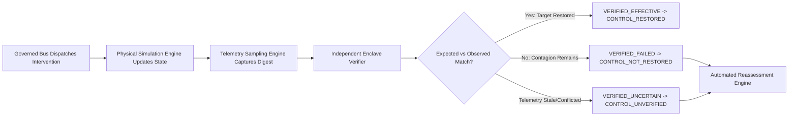

# FINANCIAL IMMUNE SYSTEM (FIS)
## PHASE 5 — INDEPENDENT VERIFICATION INTEGRITY REPORT
### Principle: Execution Success $\neq$ Systemic Control Restoration
### Requirement: Sections 15, 24, 25 (Verification Integrity, Telemetry Digests & Reassessment)

---

## 1. Architectural Independence of the Enclave Verifier

A foundational design vulnerability in traditional operations dashboards is that the **executor itself reports whether the intervention worked**.

In FIS, the **Independent Enclave Verifier** is an isolated subsystem that evaluates raw post-intervention telemetry from the physical graph without trusting the executor.

---

## 2. Expected vs Observed Evaluation Model

For every dispatched intervention:
1. **Expected Effect Target ($M_{\text{target}}$):**
   $$M_{\text{target}} = \min(95, \, M_{\text{pre}} + \Delta M_{\text{expected}})$$
2. **Observed Effect ($M_{\text{observed}}$):** Independently re-calculated by the verifier directly from live topology metrics.
3. **Margin Discrepancy ($\Delta_{\text{disc}}$):**
   $$\Delta_{\text{disc}} = M_{\text{observed}} - M_{\text{target}}$$
4. **Raw Telemetry Digest:** Cryptographic digest generated from unvarnished sensor parameters:
   $$\text{Digest} = \text{sha256}\left( \text{obsId} : M_{\text{observed}} : \text{propDepth} : \text{affectedNodes} : \text{threats} : \text{timestamp} \right)$$

---

## 3. Verification Outcome Taxonomy & Decision Matrix

| Verification Result | Observed Outcome | Trigger Condition | Systemic State Delta | Lifecycle Next Step |
| :--- | :--- | :--- | :--- | :--- |
| **`VERIFIED_EFFECTIVE`** | `CONTROL_RESTORED` | $M_{\text{observed}} \ge 65\%$ and $\Delta_{\text{disc}} \ge -2$ and Zero residual threats | Restores control buffer ($\ge 80\%$) | Close incident / Return to equilibrium |
| **`VERIFIED_FAILED`** | `CONTROL_NOT_RESTORED` | Residual threats active or $\Delta_{\text{disc}} < -5$ | Decrements stability index | **Triggers Emergency Reassessment** |
| **`VERIFIED_UNCERTAIN`** | `CONTROL_UNVERIFIED` | Telemetry age $> 60\text{s}$ (Stale evidence) | Freezes state transitions | Mandates telemetry channel refresh |
| **`VERIFIED_UNCERTAIN`** | `CONFLICTED` | Contradictory dual sensor feeds detected | Widens uncertainty bounds | Mandates cross-oracle reconciliation |
| **`PARTIAL_RECOVERY`** | `PARTIAL_RECOVERY` | Primary chokepoint severed, but localized tail risk remains | Minor margin improvement | Secondary localized intervention recommended |

---

## 4. Empirical Hero Demonstration: Detection of Latent Algorithmic Infection

In Scenario C (`RN-2026-0108`), a partial dependency isolation intervention (`CAND-RN-2026-0108-PARTIAL-ISO`) was executed:
- **Dispatched Action:** Severed corrupted pricing feed to `BANK-A` and `BANK-B`.
- **Execution Receipt:** HTTP 200, state deltas applied, `status: EXECUTED`.
- **Expected Target:** $M_{\text{target}} = 95\%$.
- **Observed Post-Intervention State:**
  - `M_observed`: $87\%$.
  - `Discrepancy`: **$-8\text{ pts}$**.
  - `Residual Threats Identified`:
    1. *"Latent unquarantined tensor desynchronization in MODEL-C"*
    2. *"Downstream collateral stress propagating along DEP_MODEL_C_ASSET_17 rail"*
    3. *"Algorithmic herd correlation elevated above acceptable threshold"*
- **Verifier Report:**
  > *"OUTCOME FAILURE (EXECUTION != OUTCOME): Technical execution succeeded, but independent verifier confirmed latent downstream contagion: Latent unquarantined tensor desynchronization in MODEL-C; Downstream collateral stress propagating along DEP_MODEL_C_ASSET_17 rail. Control margin is 87% (target was 95%)."*
- **Outcome:** Verifier assigned `VERIFIED_FAILED`, refused to mark `CONTROL_RESTORED`, and triggered automated reassessment record `REASSESS-RN-2026-0108-MV54G3K4`, escalating immediately to `MODEL-QUARANTINE-BACKSTOP`.

---

## 5. Verification Integrity Conclusion

The Enclave Verifier prevents the deadliest operational trap in systemic risk: **the illusion of resolution**. It verifies ground truth against the network topology rather than accepting operational execution acknowledgments.
